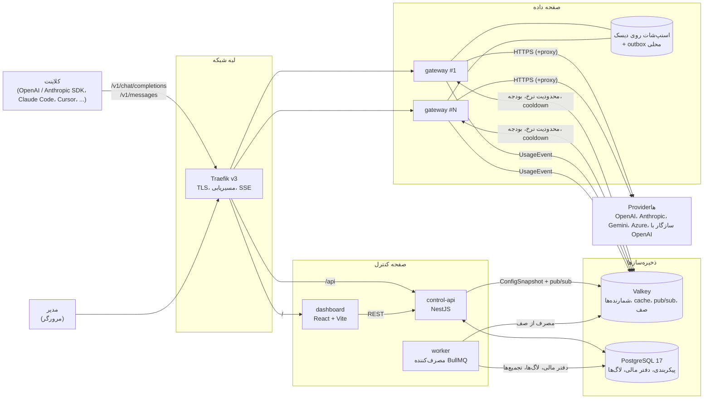
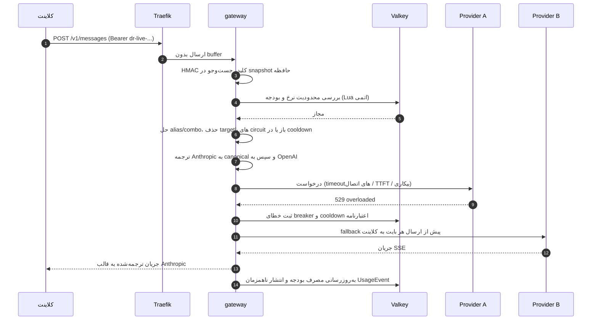
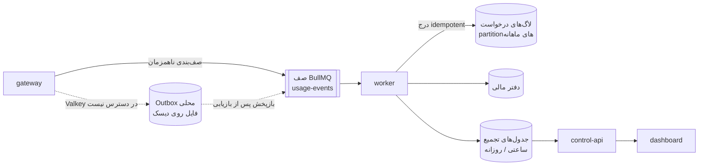
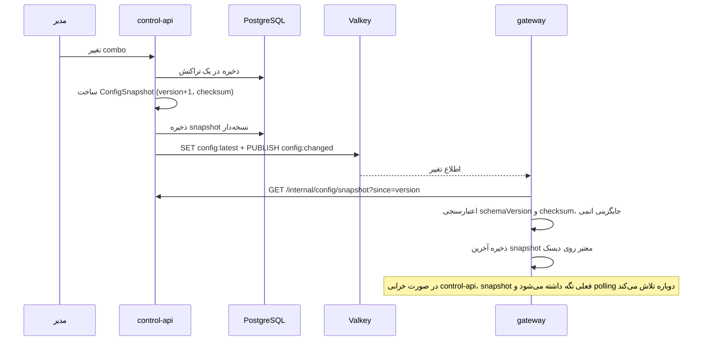

[English](ARCHITECTURE.md) · [فارسی](ARCHITECTURE.fa.md)

# معماری DiRouter

> این سند معماری هدف MVP را تعریف می‌کند. تصمیم‌ها و دلایل آن‌ها در [ADRها](adr/README.fa.md) ثبت شده‌اند و اصطلاحات دامنه در [واژه‌نامه](GLOSSARY.fa.md) تعریف شده‌اند. وجود یک طراحی در این سند به معنای کامل بودن پیاده‌سازی آن نیست.

## 1. نمای کلی

DiRouter از دو بخش جدا تشکیل شده است:

- **صفحه داده (Data plane)** (`apps/gateway`): مسیر پرترافیک هر درخواست LLM. احراز هویت با virtual key، محدودیت نرخ، بودجه، مسیریابی، ترجمه قالب، fallback و streaming را انجام می‌دهد. باید سریع، بی‌حالت (stateless) و مستقل از صفحه کنترل باشد.
- **صفحه کنترل (Control plane)** (`apps/control-api`، `apps/worker`، `apps/dashboard`): مدیریت سازمان، کاربران، providerها، کلیدها، مدل‌ها و comboها؛ انتشار پیکربندی؛ پردازش رویدادهای مصرف؛ گزارش‌گیری و داشبورد.

اصل طراحی اصلی ([ADR-006](adr/0006-data-plane-independence.fa.md)) این است که **صفحه داده به صفحه کنترل وابسته نیست**. اگر PostgreSQL، control-api یا worker در دسترس نباشند، ترافیک موجود با آخرین پیکربندی معتبر ادامه می‌یابد.

## 2. اجزا

| جزء               | مسئولیت‌ها                                                                                                      | وابستگی‌های سخت زمان اجرا                                                |
| ----------------- | --------------------------------------------------------------------------------------------------------------- | ------------------------------------------------------------------------ |
| **Traefik**       | TLS (Let's Encrypt)، مسیریابی بر اساس مسیر، health checkها، SSE بدون buffer                                     | ندارد                                                                    |
| **gateway**       | سازگاری با APIهای OpenAI/Anthropic، مسیریابی، fallback، circuit breakerها، محدودیت نرخ، بودجه، انتشار داده مصرف | ندارد، به شرط موجود بودن یک snapshot معتبر؛ Valkey یک fallback محلی دارد |
| **control-api**   | API مدیریتی، احراز هویت داشبورد، RBAC، رمزنگاری اعتبارنامه‌ها، ساخت و انتشار ConfigSnapshot                     | PostgreSQL، Valkey                                                       |
| **worker**        | مصرف UsageEvent، نوشتن در دفتر مالی/لاگ‌ها، جدول‌های تجمیع، نگهداری partitionها                                 | PostgreSQL، Valkey                                                       |
| **dashboard**     | رابط مدیریتی فارسی و RTL                                                                                        | control-api                                                              |
| **mock-provider** | upstream مصنوعی با پاسخ‌های تزریق‌شده 429/5xx و تأخیر برای تست و سناریوهای chaos                                | ندارد                                                                    |
| **Valkey**        | شمارنده‌های محدودیت نرخ/بودجه، وضعیت cooldown/breaker، pub/sub پیکربندی، صف BullMQ                              | ندارد                                                                    |
| **PostgreSQL**    | منبع حقیقت پیکربندی، کاربران، دفتر مالی و لاگ‌های درخواست پارتیشن‌بندی‌شده                                      | ندارد                                                                    |

## 3. جریان درخواست

مراحل gateway:

1. **ورودی و احراز هویت:** کلید مجازی را از `Authorization: Bearer` یا `x-api-key` می‌خواند، با HMAC-SHA256 هش می‌کند و در snapshot حافظه جست‌وجو می‌کند. هیچ پرس‌وجوی پایگاه داده‌ای در مسیر پرترافیک انجام نمی‌شود.
2. **اعتبارسنجی:** بدنه درخواست را با schemaهای `@dirouter/contracts` اعتبارسنجی می‌کند. فیلدهای ناشناخته را، تا جایی که قراردادهای APIهای خارجی اجازه می‌دهند، حفظ می‌کند.
3. **محدودیت‌ها:** بررسی‌های RPM، TPM، همزمانی و بودجه را در سطح کلید، پروژه و تیم، از طریق اسکریپت‌های Lua اتمی در Valkey اعمال می‌کند. اگر Valkey در دسترس نباشد، از محدودکننده محلی و `failMode` پیکربندی‌شده استفاده می‌شود.
4. **مسیریابی:** نام درخواست‌شده را به یک alias، combo یا مدل تبدیل می‌کند و فهرست مرتبی از targetهای مدل/اعتبارنامه می‌سازد. targetهای با circuit باز، اعتبارنامه‌های در cooldown و مدل‌های قفل‌شده حذف می‌شوند.
5. **ترجمه:** درخواست را ابتدا به مدل canonical و سپس به API upstream ترجمه می‌کند. این کار به N + M مترجم نیاز دارد، نه N × M.
6. **ارسال و تاب‌آوری:** timeoutهای لایه‌ای، retry با backoff و jitter، و fallback به target بعدی را اعمال می‌کند. fallback در streaming فقط پیش از ارسال اولین بایت به کلاینت مجاز است.
7. **پاسخ:** پاسخ یا جریان را به قالب API ورودی برمی‌گرداند. خطاها همان قالب را دارند و یک کد پایدار DiRouter.
8. **حسابداری:** هزینه را از مصرف توکن و قیمت‌های مدل محاسبه می‌کند، شمارنده‌های بودجه را در Valkey به‌روز می‌کند و یک `UsageEvent` را به صف می‌فرستد. پاسخ منتظر ماندگاری ناهمزمان نمی‌ماند.

مقادیر پولی در مرزهای قرارداد به صورت رشته‌های اعشاری USD با حداکثر هشت رقم اعشار، و در PostgreSQL به صورت `Decimal(18,8)` هستند. کمک‌تابع‌های پولی مشترک از حساب نقطه‌ثابت BigInt استفاده می‌کنند (`1 USD = 10^8` واحد داخلی)؛ قیمت مدل‌ها بر حسب USD به ازای هر یک میلیون توکن است. اتمام بودجه با HTTP 429 و کد `budget_exceeded` پاسخ داده می‌شود.

## 4. جریان رویداد مصرف

- هر رویداد یک `idempotencyKey` دارد. تلاش‌های مجدد صف یا بازپخش outbox نباید یک درخواست را دوبار هزینه‌گذاری کنند؛ نوشتن در پایگاه داده از کلید یکتای مناسب و `ON CONFLICT ... DO NOTHING` استفاده می‌کند.
- Valkey شمارنده‌های زندهٔ بودجه را نگه می‌دارد. PostgreSQL منبع حقیقت حسابداری است و worker به‌صورت دوره‌ای شمارنده‌ها را با آن تطبیق می‌دهد.
- لاگ‌ها در یک جدول پارتیشن‌بندی‌شده ذخیره می‌شوند. پرس‌وجوهای داشبورد از جدول‌های تجمیع استفاده می‌کنند تا روی لاگ‌های خام تجمیع سنگین اجرا نشود.

## 5. جریان پیکربندی

- `ConfigSnapshot` دارای `schemaVersion` (قالب) و `version` یکنواخت است. gateway نسخه‌های قدیمی‌تر و schemaVersionهای ناشناخته را رد می‌کند.
- اسرار providerها فقط به صورت رمزنگاری‌شده با AES-256-GCM در snapshot قرار می‌گیرند. gateway آن‌ها را با استفاده از `MASTER_KEY` در حافظه رمزگشایی می‌کند.
- اگر control-api هنگام راه‌اندازی در دسترس نباشد، gateway با یک snapshot معتبر روی دیسک شروع می‌کند.

## 6. تاب‌آوری

| ریسک                                    | پاسخ                                                                                           |
| --------------------------------------- | ---------------------------------------------------------------------------------------------- |
| خطای گذرای provider (429، 5xx، timeout) | طبقه‌بندی خطاها، retry با backoff/jitter، و fallback از طریق combo                             |
| قطع کامل provider                       | circuit breakerهای provider/model با probeهای half-open                                        |
| رسیدن یک اعتبارنامه به سقف مجاز         | cooldown همان اعتبارنامه و ادامه با اعتبارنامه دیگر                                            |
| provider کند                            | timeoutهای جدا برای اتصال، TTFT و بیکاری؛ دیواره همزمانی (bulkhead) به‌ازای هر provider        |
| قطعی control-api یا PostgreSQL          | ادامه با snapshotهای حافظه/دیسک                                                                |
| قطعی Valkey                             | محدودکننده محلی، `failMode` قابل پیکربندی و outbox محلی مصرف                                   |
| استقرار نسخه جدید                       | خاموشی تدریجی: پذیرش درخواست متوقف می‌شود، جریان‌های باز تخلیه می‌شوند و سپس خروج انجام می‌شود |

## 7. انتخاب فناوری‌ها

| لایه                       | انتخاب                                                                      | ADR                                              |
| -------------------------- | --------------------------------------------------------------------------- | ------------------------------------------------ |
| gateway                    | NestJS با adapter نوع Fastify و مسیر پرترافیک سبک                           | [ADR-001](adr/0001-gateway-nestjs-fastify.fa.md) |
| control-api، worker        | NestJS                                                                      | [ADR-001](adr/0001-gateway-nestjs-fastify.fa.md) |
| پایگاه داده                | PostgreSQL 17 + Prisma                                                      | [ADR-002](adr/0002-postgresql-prisma.fa.md)      |
| شمارنده‌ها، cache، pub/sub | Valkey                                                                      | [ADR-003](adr/0003-valkey.fa.md)                 |
| Reverse proxy              | Traefik v3                                                                  | [ADR-004](adr/0004-traefik-reverse-proxy.fa.md)  |
| صف رویدادها                | BullMQ روی Valkey                                                           | [ADR-005](adr/0005-bullmq-event-queue.fa.md)     |
| داشبورد                    | React + Vite + TypeScript، TanStack Router/Query، shadcn/ui، Tailwind (RTL) | ندارد                                            |
| Schemaها                   | Zod در `@dirouter/contracts`، با خروجی JSON Schema                          | ندارد                                            |
| Monorepo                   | pnpm workspaces + Turborepo، TypeScript سخت‌گیرانه، ESM                     | ندارد                                            |
| استقرار                    | Docker و Docker Compose (توسعه، تولید، HA)                                  | ندارد                                            |

## 8. بسته‌های مشترک

| بسته                      | محتوا                                                                                                              | مصرف‌کنندگان                            |
| ------------------------- | ------------------------------------------------------------------------------------------------------------------ | --------------------------------------- |
| `@dirouter/contracts`     | schemaهای OpenAI/Anthropic، مدل canonical، ConfigSnapshot، UsageEvent، قالب‌ها و طبقه‌بندی خطاها                   | همه برنامه‌ها، در صورت نیاز             |
| `@dirouter/shared`        | Pino با redaction، خطاها، اعتبارسنجی متغیرهای محیطی، AES-256-GCM نسخه‌دار، ULID، HMAC، کمک‌تابع‌های پولی نقطه‌ثابت | برنامه‌های Node                         |
| `@dirouter/db`            | schema و client مربوط به Prisma                                                                                    | control-api، worker                     |
| `@dirouter/model-catalog` | قیمت‌ها و قابلیت‌های مدل‌ها                                                                                        | control-api، gateway از طریق snapshotها |
| `@dirouter/ui`            | کامپوننت‌های React                                                                                                 | dashboard                               |

gateway نباید به `@dirouter/db` وابسته باشد؛ این قاعده ADR-006 را در سطح کد اجرا می‌کند.

