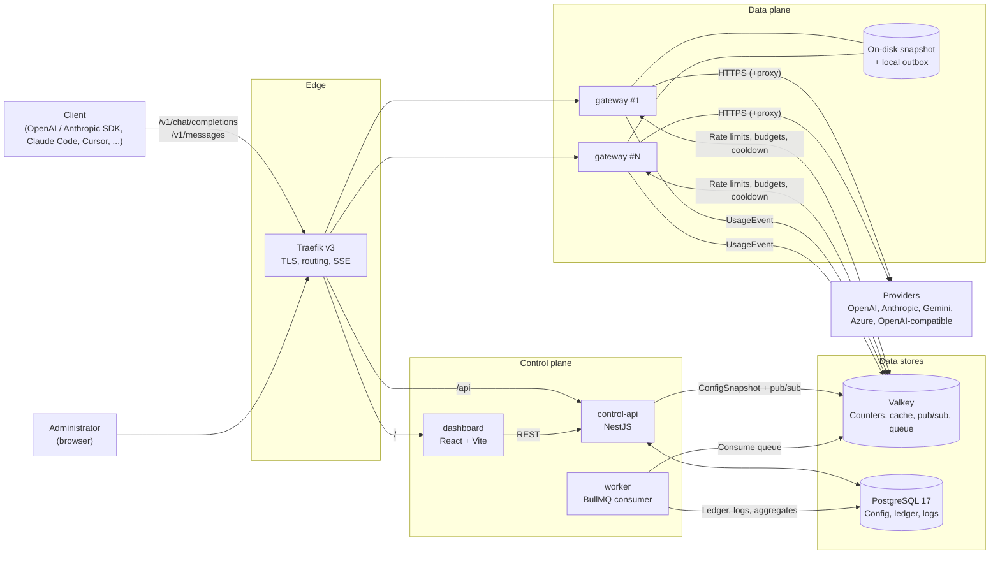
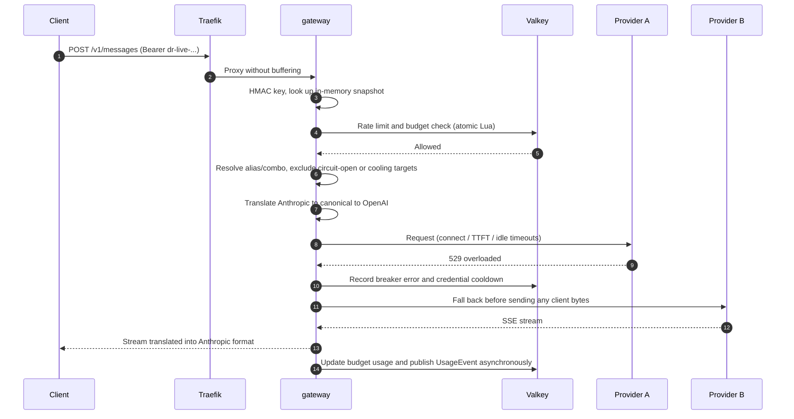
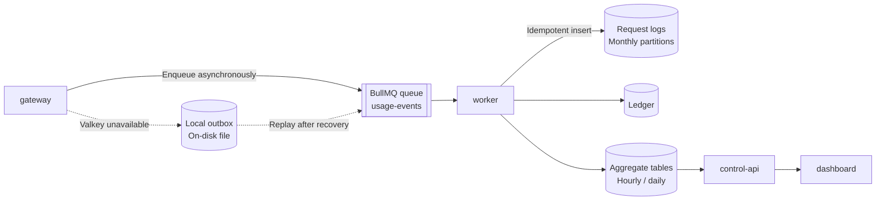
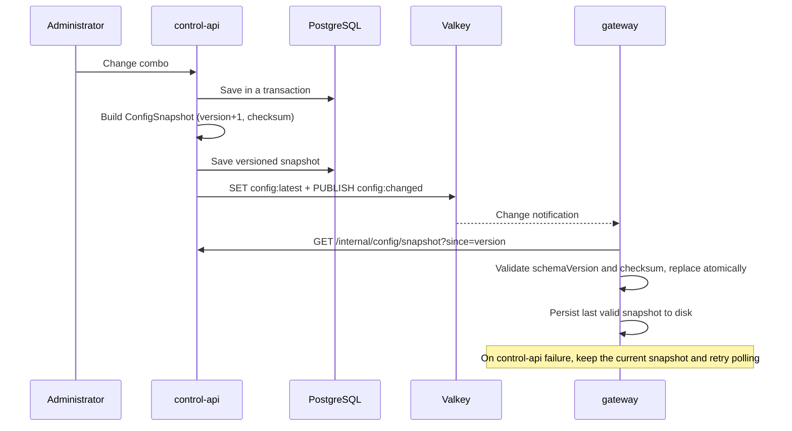

[English](ARCHITECTURE.md) · [فارسی](ARCHITECTURE.fa.md)

# DiRouter architecture

> This document defines the target MVP architecture. Decisions and their rationale are recorded in the [ADRs](adr/README.md); domain terms are defined in the [glossary](GLOSSARY.md). A design described here does not imply that its implementation is complete.

## 1. Overview

DiRouter has two separate parts:

- **Data plane** (`apps/gateway`): the hot path for every LLM request. It handles virtual-key authentication, rate limits, budgets, routing, format translation, fallback, and streaming. It must be fast, stateless, and independent of the control plane.
- **Control plane** (`apps/control-api`, `apps/worker`, `apps/dashboard`): organization, user, provider, key, model, and combo management; configuration publication; usage-event processing; reporting; and the dashboard.

The primary design principle ([ADR-006](adr/0006-data-plane-independence.md)) is that **the data plane does not depend on the control plane**. If PostgreSQL, control-api, or worker becomes unavailable, existing traffic continues using the last valid configuration.

## 2. Components

| Component         | Responsibilities                                                                                                     | Hard runtime dependencies                                                 |
| ----------------- | -------------------------------------------------------------------------------------------------------------------- | ------------------------------------------------------------------------- |
| **Traefik**       | TLS (Let's Encrypt), path routing, health checks, unbuffered SSE                                                     | None                                                                      |
| **gateway**       | OpenAI/Anthropic API compatibility, routing, fallback, circuit breakers, rate limits, budgets, usage publication     | None, provided a valid snapshot is available; Valkey has a local fallback |
| **control-api**   | Administrative API, dashboard authentication, RBAC, credential encryption, ConfigSnapshot generation and publication | PostgreSQL, Valkey                                                        |
| **worker**        | UsageEvent consumption, ledger/log writes, aggregate tables, partition maintenance                                   | PostgreSQL, Valkey                                                        |
| **dashboard**     | Persian, RTL administrative UI                                                                                       | control-api                                                               |
| **mock-provider** | Synthetic upstream with injected 429/5xx responses and delays for testing and chaos scenarios                        | None                                                                      |
| **Valkey**        | Rate-limit/budget counters, cooldown/breaker state, config pub/sub, BullMQ queue                                     | None                                                                      |
| **PostgreSQL**    | Source of truth for configuration, users, the financial ledger, and partitioned request logs                         | None                                                                      |

## 3. Request flow

Gateway stages:

1. **Ingress and authentication:** read the virtual key from `Authorization: Bearer` or `x-api-key`, hash it with HMAC-SHA256, and look it up in the in-memory snapshot. No database query occurs on the hot path.
2. **Validation:** validate the body with `@dirouter/contracts` schemas. Preserve unknown fields where the external API contracts allow them.
3. **Limits:** apply key-, project-, and team-level RPM, TPM, concurrency, and budget checks through atomic Lua scripts in Valkey. If Valkey is unavailable, use the local limiter and the configured `failMode`.
4. **Routing:** resolve the requested name to an alias, combo, or model and construct an ordered list of model/credential targets. Exclude circuit-open targets, cooling credentials, and locked models.
5. **Translation:** translate the request into the canonical model and then into the upstream API. This requires N + M translators rather than N × M.
6. **Dispatch and resilience:** apply layered timeouts, retry with backoff and jitter, and fallback to the next target. Stream fallback is allowed only before the first byte is sent to the client.
7. **Response:** translate the response or stream back to the inbound API format. Errors use that same format and a stable DiRouter code.
8. **Accounting:** calculate cost from usage and model prices, update budget counters in Valkey, and enqueue a `UsageEvent`. The response does not wait for asynchronous persistence.

Monetary values use USD decimal strings with up to eight fractional digits at contract boundaries and `Decimal(18,8)` in PostgreSQL. The shared money helpers use BigInt fixed-point arithmetic (`1 USD = 10^8` internal units); model prices are USD per million tokens. Budget exhaustion returns `budget_exceeded` with HTTP 429.

## 4. Usage-event flow

- Each event has an `idempotencyKey`. Queue retries or outbox replays must not charge the same request twice; database writes use an appropriate unique key and `ON CONFLICT ... DO NOTHING`.
- Valkey holds live budget counters. PostgreSQL is the accounting source of truth, and worker periodically reconciles counters against it.
- Logs are stored in a partitioned table. Dashboard queries use aggregate tables instead of running expensive aggregations on raw logs.

## 5. Configuration flow

- `ConfigSnapshot` carries a `schemaVersion` (format) and a monotonic `version`. Gateway rejects older versions and unknown schema versions.
- Provider secrets are included only as AES-256-GCM ciphertext. Gateway decrypts them in memory using `MASTER_KEY`.
- If control-api is unavailable at startup, gateway starts with a valid on-disk snapshot.

## 6. Resilience

| Risk                                         | Response                                                                       |
| -------------------------------------------- | ------------------------------------------------------------------------------ |
| Transient provider error (429, 5xx, timeout) | Classify errors, retry with backoff/jitter, and fall back through the combo    |
| Complete provider outage                     | Provider/model circuit breakers with half-open probes                          |
| A credential reaches its limit               | Cool down that credential and continue with another                            |
| Slow provider                                | Separate connect, TTFT, and idle timeouts; a per-provider concurrency bulkhead |
| control-api or PostgreSQL outage             | Continue using in-memory/on-disk snapshots                                     |
| Valkey outage                                | Local limiter, configurable `failMode`, and local usage outbox                 |
| New deployment                               | Graceful shutdown: stop accepting requests, drain open streams, then exit      |

## 7. Technology choices

| Layer                    | Choice                                                                      | ADR                                           |
| ------------------------ | --------------------------------------------------------------------------- | --------------------------------------------- |
| gateway                  | NestJS with the Fastify adapter and a lightweight hot path                  | [ADR-001](adr/0001-gateway-nestjs-fastify.md) |
| control-api, worker      | NestJS                                                                      | [ADR-001](adr/0001-gateway-nestjs-fastify.md) |
| Database                 | PostgreSQL 17 + Prisma                                                      | [ADR-002](adr/0002-postgresql-prisma.md)      |
| Counters, cache, pub/sub | Valkey                                                                      | [ADR-003](adr/0003-valkey.md)                 |
| Reverse proxy            | Traefik v3                                                                  | [ADR-004](adr/0004-traefik-reverse-proxy.md)  |
| Event queue              | BullMQ on Valkey                                                            | [ADR-005](adr/0005-bullmq-event-queue.md)     |
| Dashboard                | React + Vite + TypeScript, TanStack Router/Query, shadcn/ui, Tailwind (RTL) | None                                          |
| Schemas                  | Zod in `@dirouter/contracts`, with JSON Schema export                       | None                                          |
| Monorepo                 | pnpm workspaces + Turborepo, strict TypeScript, ESM                         | None                                          |
| Deployment               | Docker and Docker Compose (development, production, HA)                     | None                                          |

## 8. Shared packages

| Package                   | Contents                                                                                                          | Consumers                              |
| ------------------------- | ----------------------------------------------------------------------------------------------------------------- | -------------------------------------- |
| `@dirouter/contracts`     | OpenAI/Anthropic schemas, canonical model, ConfigSnapshot, UsageEvent, error formats and taxonomy                 | All applications as required           |
| `@dirouter/shared`        | Pino with redaction, errors, environment validation, versioned AES-256-GCM, ULID, HMAC, fixed-point money helpers | Node applications                      |
| `@dirouter/db`            | Prisma schema and client                                                                                          | control-api, worker                    |
| `@dirouter/model-catalog` | Model prices and capabilities                                                                                     | control-api, gateway through snapshots |
| `@dirouter/ui`            | React components                                                                                                  | dashboard                              |

Gateway must not depend on `@dirouter/db`; this enforces ADR-006 at the code level.
