[English](CONTRIBUTING.md) · [فارسی](CONTRIBUTING.fa.md)

<div dir="rtl">

<p align="center">
  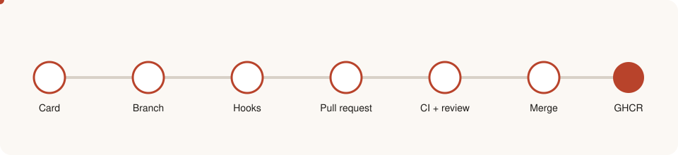
</p>

# راهنمای مشارکت در DiRouter

این راهنما نحوهٔ راه‌اندازی محیط توسعه، نوشتن کدی که با ساختار مخزن هم‌خوان باشد، ثبت commit، باز کردن pull request و گذراندن بازبینی را شرح می‌دهد. این سند مرجع واحد قوانین مشارکت است. تصمیم‌های معماری در [ADRها](adr/README.fa.md)، اصطلاحات دامنه در [واژه‌نامه](GLOSSARY.fa.md) و pipeline در [CI.md](CI.fa.md) نگهداری می‌شوند.

> **مهم:** هر تغییر باید کد، کامنت و مستندات را هم‌خوان نگه دارد. مستندات دوزبانه است: هر سند یک فایل انگلیسی با پسوند `.md` و یک فایل فارسی با پسوند `.fa.md` دارد؛ به [سیاست مستندات](#documentation-policy-fa) مراجعه کنید.

## فهرست

1. [چرخهٔ مشارکت](#1-چرخهٔ-مشارکت)
2. [نقشهٔ مخزن](#2-نقشهٔ-مخزن)
3. [محیط توسعه](#3-محیط-توسعه)
4. [گردش کار روزانه](#4-گردش-کار-روزانه)
5. [ابزارهای کیفیت کد](#5-ابزارهای-کیفیت-کد)
6. [Git hookها](#6-git-hookها)
7. [پیام‌های commit](#7-commit-messages-fa)
8. [شاخه‌ها و pull request](#8-branches-fa)
9. [قراردادهای کد](#9-قراردادهای-کد)
10. [کامنت‌ها و نام‌گذاری](#10-comments-fa)
11. [پول و مقادیر پولی](#11-پول-و-مقادیر-پولی)
12. [خطاها و کاتالوگ خطا](#12-خطاها-و-کاتالوگ-خطا)
13. [تست](#13-تست)
14. [متغیرهای محیطی](#14-متغیرهای-محیطی)
15. [بازبینی pull request](#15-بازبینی-pull-request)
16. [قوانین معماری که نباید شکسته شوند](#16-قوانین-معماری-که-نباید-شکسته-شوند)
17. [چک‌لیست بازبینی](#17-review-checklist-fa)
18. [عیب‌یابی](#18-troubleshooting-fa)
19. [سیاست مستندات](#documentation-policy-fa)

---

## 1. چرخهٔ مشارکت

هر تغییر از مراحل یکسانی عبور می‌کند. Husky، lint-staged، commitlint و GitHub Actions بیشتر این مراحل را اجرا می‌کنند، اما طراحی و توضیحات pull request بر عهدهٔ نویسنده است.

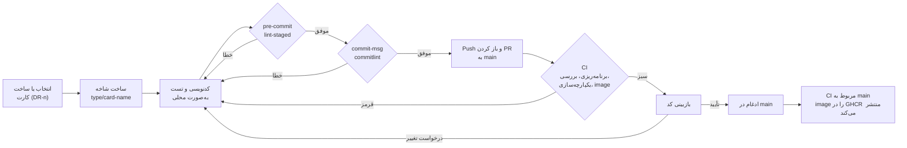

| مرحله   | عامل       | ابزار یا خروجی                  | دروازهٔ کنترل                             |
| ------- | ---------- | ------------------------------- | ----------------------------------------- |
| برنامه  | نویسنده    | کارت `DR-n` و نام شاخه          | محدودهٔ توافق‌شده در کارت                 |
| نوشتن   | نویسنده    | ویرایشگر با `.editorconfig`     | تست‌های محلی موفق                         |
| Commit  | Git hookها | `lint-staged`، `commitlint`     | قالب‌بندی، lint و پیام commit             |
| بازبینی | بازبین     | Pull request                    | چک‌لیست [بخش ۱۷](#17-review-checklist-fa) |
| تأیید   | GitHub     | `.github/workflows/ci.yml`      | سبز بودن همهٔ jobهای الزامی               |
| انتشار  | Pipeline   | image در GHCR روی `main` یا tag | فقط برای push‌های مورد اعتماد             |

## 2. نقشهٔ مخزن

این مخزن pnpm workspace و Turborepo است. اپ‌ها (`apps/*`) می‌توانند به پکیج‌ها (`packages/*`) وابسته باشند؛ پکیج‌ها هرگز به اپ وابسته نیستند.

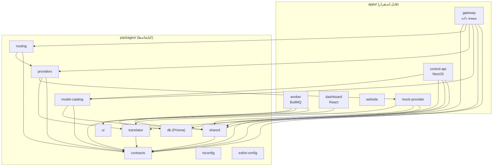

| مسیر                     | کاربرد                                                                |
| ------------------------ | --------------------------------------------------------------------- |
| `apps/gateway`           | صفحهٔ داده. endpointهای سازگار با OpenAI و Anthropic را ارائه می‌کند. |
| `apps/control-api`       | API مدیریت، احراز هویت، RBAC و انتشار snapshot.                       |
| `apps/worker`            | مصرف usage event، نوشتن ledger و log و تطبیق بودجه.                   |
| `apps/dashboard`         | داشبورد مدیریتی فارسی RTL (React + Vite).                             |
| `apps/website`           | سایت عمومی فارسی و دموی مسیریابی.                                     |
| `apps/mock-provider`     | upstream ساختگی با خطای تزریقی برای توسعه و تست.                      |
| `packages/contracts`     | schemaهای Zod، مدل canonical، snapshot، usage event و کدهای خطا.      |
| `packages/shared`        | logger، خطاها، اعتبارسنجی env، رمزنگاری، ULID، HMAC و کمکی‌های پول.   |
| `packages/db`            | Prisma schema، migrationها و client تولیدشده.                         |
| `packages/model-catalog` | قیمت و قابلیت مدل‌ها.                                                 |
| `packages/translator`    | ترجمهٔ درخواست، پاسخ و stream بین قالب‌های API.                       |
| `packages/providers`     | adapterهای provider و طبقه‌بندی خطا.                                  |
| `packages/routing`       | router، executor، سلامت و bulkhead.                                   |
| `packages/ui`            | کامپوننت‌های مشترک React.                                             |
| `packages/tsconfig`      | پیکربندی مشترک TypeScript.                                            |
| `packages/eslint-config` | پیکربندی مشترک ESLint.                                                |
| `deploy/`                | Dockerfileها، Traefik، Prometheus، Grafana و قالب‌های nginx.          |
| `scripts/`               | برنامه‌ریزی CI، اجرای integration، benchmark و ابزارهای توسعه.        |
| `adr/`                   | Architecture Decision Recordها.                                       |

<a id="3-development-environment-fa"></a>

## 3. محیط توسعه

### پیش‌نیازها

| ابزار    | نسخه                     | دلیل                                              |
| -------- | ------------------------ | ------------------------------------------------- |
| Node.js  | 22 LTS (`>=22.12 <23`)   | `engines` در `package.json` و `.nvmrc` (نسخهٔ ۲۲) |
| pnpm     | 10.x (پین‌شده `10.13.1`) | فیلد `packageManager` و protocol کاری workspace   |
| Corepack | همراه Node               | نسخهٔ pnpm پین‌شده را خودکار می‌خواند             |
| Docker   | Engine + Compose         | PostgreSQL، Valkey، Traefik و stack محلی          |
| Git      | نسخهٔ نسبتاً جدید        | hookها و کنترل نسخه                               |

### راه‌اندازی اولیه

```bash
corepack enable          # فعال‌سازی pnpm پین‌شده
pnpm install             # نصب وابستگی‌ها و ثبت Husky (اسکریپت prepare)
pnpm build               # build پکیج‌ها به ترتیب وابستگی
pnpm test                # اجرای تست‌های واحد
```

`pnpm install` اسکریپت `prepare` را اجرا می‌کند که Husky را نصب می‌کند. بنابراین hookها از اولین نصب فعال هستند و دستور جداگانه‌ای لازم نیست.

### اجرای stack

```bash
./scripts/bootstrap.sh                                            # ساخت .env با رازهای تصادفی (chmod 600)
docker compose -f compose.yaml -f compose.dev.yaml up -d --build --wait
make seed                                                         # داده‌های توسعه و کلید dev
```

آدرس‌های توسعه توسط Traefik روی `*.localhost` مسیریابی می‌شوند. فهرست کامل در [README.md](README.fa.md) است.

## 4. گردش کار روزانه

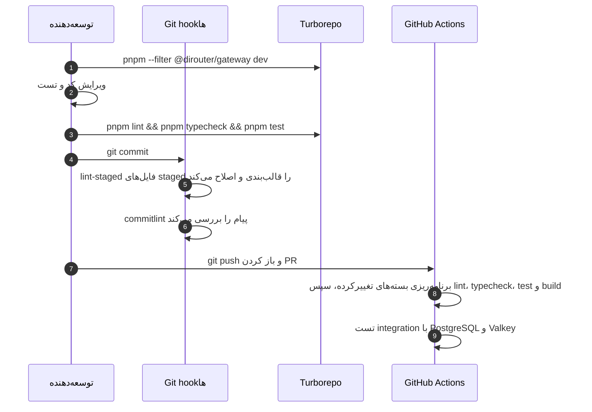

دستورهای پرکاربرد:

| دستور                                 | اثر                                                 |
| ------------------------------------- | --------------------------------------------------- |
| `pnpm --filter @dirouter/gateway dev` | فقط gateway را در حالت watch اجرا می‌کند.           |
| `pnpm --filter @dirouter/shared test` | تست‌های یک پکیج را اجرا می‌کند.                     |
| `pnpm -r exec vitest run <file>`      | یک فایل تست را در کل workspace اجرا می‌کند.         |
| `pnpm format` / `pnpm format:check`   | نوشتن یا بررسی قالب‌بندی Prettier.                  |
| `pnpm test:integration`               | کانتینرهای موقت PostgreSQL و Valkey را اجرا می‌کند. |
| `make lint`                           | lint، typecheck و بررسی قالب در یک دستور.           |

## 5. ابزارهای کیفیت کد

| ابزار                      | پیکربندی                 | دستور                                   |
| -------------------------- | ------------------------ | --------------------------------------- |
| TypeScript (strict)        | `packages/tsconfig`      | `pnpm typecheck`                        |
| ESLint (flat و type-aware) | `packages/eslint-config` | `pnpm lint`                             |
| Prettier                   | `.prettierrc.json`       | `pnpm format` / `pnpm format:check`     |
| EditorConfig               | `.editorconfig`          | ویرایشگرهای پشتیبان آن را اعمال می‌کنند |

تنظیمات مهم `.prettierrc.json`: نقل‌قول تک، trailing comma با مقدار `all`، عرض چاپ `100`، نقطه‌ویرگول، پرانتز همیشگی برای arrow function و پایان خط LF.

قواعدی که هر پکیج رعایت می‌کند:

- هر اپ و پکیج یک `eslint.config.js` دارد که پیکربندی `node` یا `react` را از `@dirouter/eslint-config` وارد می‌کند.
- استفاده از `console.*` ممنوع است. از `createLogger` در `@dirouter/shared` استفاده کنید.
- از import نوع صریح استفاده کنید (`import { type X }`)؛ `verbatimModuleSyntax` فعال است.
- TypeScript با حالت strict اجرا می‌شود. از `any` پرهیز کنید و به‌جای آن `unknown` را با narrowing به کار ببرید.

## 6. Git hookها

Hookها در `.husky/` قرار دارند و `pnpm install` آن‌ها را ثبت می‌کند.

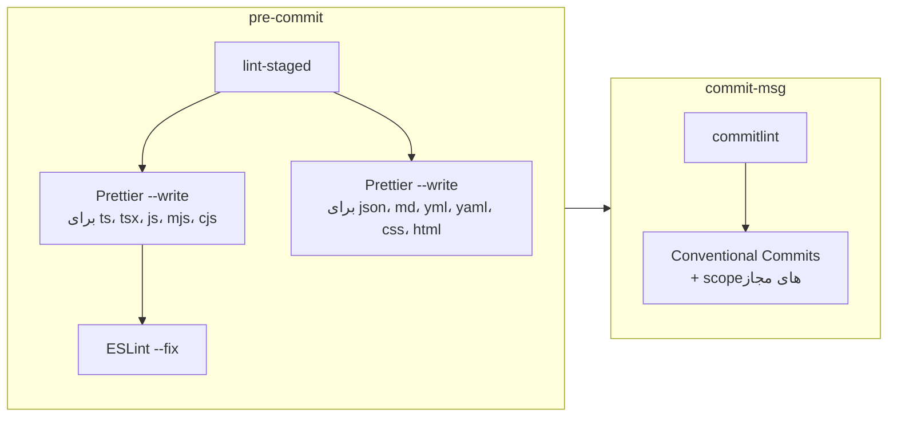

| Hook         | اجرا می‌کند                        | زمان شکست                                                                  |
| ------------ | ---------------------------------- | -------------------------------------------------------------------------- |
| `pre-commit` | `pnpm exec lint-staged`            | خطاهای lint که ESLint نمی‌تواند خودکار اصلاح کند، commit را متوقف می‌کنند. |
| `commit-msg` | `pnpm exec commitlint --edit "$1"` | type نامعتبر، scope ناشناخته یا نبود subject.                              |

از `--no-verify` برای عبور از hookها استفاده نکنید. CI همان بررسی‌ها را اجرا می‌کند و commit دورزده‌شده بعداً شکست می‌خورد.

<a id="7-commit-messages-fa"></a>

## 7. پیام‌های commit

commitها از [Conventional Commits](https://www.conventionalcommits.org/) پیروی می‌کنند:

```text
<type>(<scope>): <subject>

[body]

[footer]
```

typeهای مجاز: `feat`، `fix`، `docs`، `style`، `refactor`، `perf`، `test`، `build`، `ci`، `chore`، `revert`.

scope اختیاری است. اگر ذکر شود باید یکی از مقادیر تعریف‌شده در `commitlint.config.js` باشد:

| Scope           | کاربرد                      |
| --------------- | --------------------------- |
| `gateway`       | `apps/gateway`              |
| `control-api`   | `apps/control-api`          |
| `worker`        | `apps/worker`               |
| `dashboard`     | `apps/dashboard`            |
| `mock-provider` | `apps/mock-provider`        |
| `contracts`     | `packages/contracts`        |
| `shared`        | `packages/shared`           |
| `db`            | `packages/db`               |
| `model-catalog` | `packages/model-catalog`    |
| `ui`            | `packages/ui`               |
| `tsconfig`      | `packages/tsconfig`         |
| `eslint-config` | `packages/eslint-config`    |
| `deploy`        | `deploy/`، فایل‌های Compose |
| `docs`          | فقط مستندات                 |
| `ci`            | `.github/`، `scripts/ci`    |
| `deps`          | به‌روزرسانی وابستگی‌ها      |
| `repo`          | پیکربندی ریشهٔ مخزن         |

نمونه:

```text
feat(gateway): add circuit breaker per provider
fix(shared): redact x-api-key header in logs
docs(gateway): document timeout settings
```

تغییر ناسازگار (breaking) را با `!` بعد از type یا scope، یا با footer با عنوان `BREAKING CHANGE:` مشخص کنید:

```text
feat(contracts)!: rename ConfigSnapshot.version to revision

BREAKING CHANGE: gatewayهای قدیمی‌تر از 1.4 snapshotهای با فیلد جدید را رد می‌کنند.
Refs: DR-42
```

شناسهٔ کارت DiTask را در footer بیاورید، برای نمونه `Refs: DR-12`.

<a id="8-branches-fa"></a>

## 8. شاخه‌ها و pull request

- شاخهٔ پیش‌فرض `main` است.
- نام شاخه را `<type>/<card>-<short-name>` بگذارید، برای نمونه `feat/4.1-gateway-skeleton`.
- pull request را به `main` باز کنید. CI برای هر pull request به `main` اجرا می‌شود.
- فقط پس از موفقیت CI و بازبینی کد ادغام کنید.

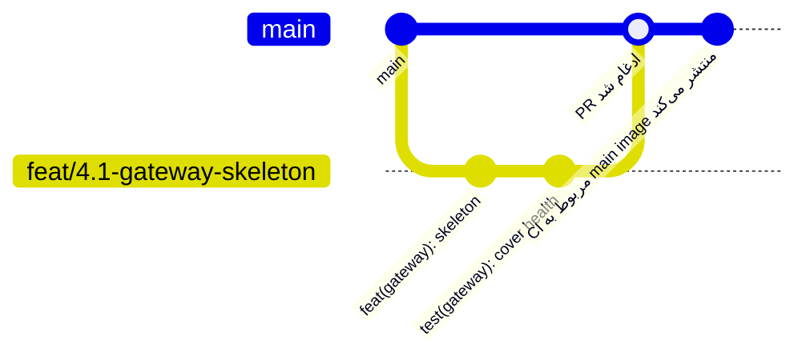

چک‌لیست توضیحات pull request:

- چه تغییر کرده و چرا، همراه با کارت (`DR-n`).
- ریسک: کدام مسیر (hot path، control plane، ماندگاری) تحت تأثیر است.
- تست‌های اضافه یا به‌روزشده و روش بررسی آن‌ها.
- تغییر پیکربندی، متغیر محیطی یا migration، همراه با لینک مستنداتی که به‌روز کرده‌اید.
- تصویر صفحه برای تغییرات داشبورد (متن فارسی و انگلیسی و چیدمان RTL).

## 9. قراردادهای کد

- ماژول‌ها ESM هستند (`"type": "module"`). import نسبی باید پسوند `.js` داشته باشد، برای نمونه `import { x } from './router.js'`.
- schemaها و type‌های مشترک فقط در `@dirouter/contracts` تعریف شوند. در اپ‌ها تکرار نشوند.
- کدهای خطا پایدارند. می‌توانید کد جدید اضافه کنید؛ حذف کد یا تغییر معنای آن مجاز نیست. به `ERROR_CODES` در `packages/contracts` مراجعه کنید.
- مقادیر پولی را در مرز API به‌صورت رشتهٔ اعشاری USD و در PostgreSQL به‌صورت `Decimal(18,8)` نگه دارید.
- محاسبات پولی را با کمکی‌های fixed-point مبتنی بر BigInt از `@dirouter/shared` انجام دهید. هرگز از عدد اعشاری شناور برای پول استفاده نکنید.

### جهت وابستگی

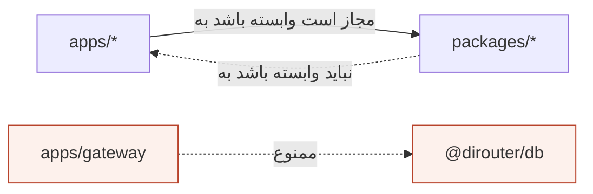

gateway نباید به `@dirouter/db` وابسته باشد. این قاعده، اجرای ADR-006 در سطح کد است.

<a id="10-comments-fa"></a>

## 10. کامنت‌ها و نام‌گذاری

- کامنت‌های کد باید **انگلیسی** باشند.
- **چرایی** را کامنت کنید، نه **چیستی**. نام‌ها باید چیستی را توضیح دهند.
- کامنت‌ها کوتاه و نزدیک کدی باشند که توضیح می‌دهند. اگر کد تغییر کرد و کامنت دیگر درست نیست، آن را حذف یا به‌روز کنید.
- کد کامنت‌شده را در مخزن نگه ندارید.
- برای کار برنامه‌ریزی‌شده از `TODO(DR-n):` همراه شناسهٔ کارت استفاده کنید. `TODO` بدون ارجاع در بازبینی پذیرفته نمی‌شود.

## 11. پول و مقادیر پولی

پول حساس‌ترین بخش سیستم است. خطای گرد کردن می‌تواند مشتری را بیش‌ازحد شارژ کند یا بودجه را نشت دهد.

| نمایش                 | کجا                  | قاعده                                           |
| --------------------- | -------------------- | ----------------------------------------------- |
| رشتهٔ اعشاری USD      | مرز API و contractها | حداکثر هشت رقم اعشار، برای نمونه `"0.00123400"` |
| `UsdUnits` (`bigint`) | محاسبات داخل فرایند  | `1 USD = 10^8` واحد داخلی                       |
| `Decimal(18,8)`       | PostgreSQL           | منبع حقیقت ledger                               |
| قیمت در میلیون توکن   | model catalog        | USD به‌ازای ۱٬۰۰۰٬۰۰۰ توکن                      |

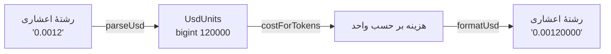

از `parseUsd`، `formatUsd`، `costForTokens`، `sumUsd` و `percentOf` در `packages/shared/src/money.ts` استفاده کنید.

## 12. خطاها و کاتالوگ خطا

خطاها کد پایدار DiRouter و همان قالب API ورودی (OpenAI یا Anthropic) را دارند.

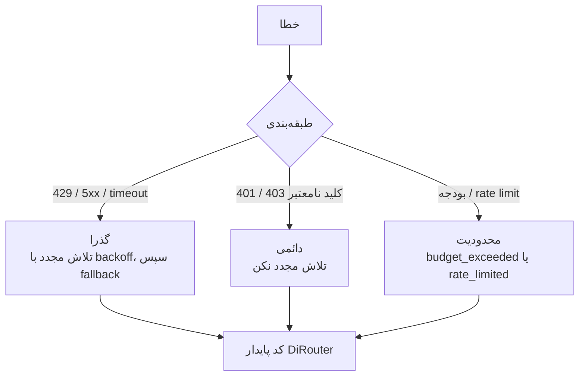

هنگام افزودن مسیر خطای جدید:

1. اگر یکی از `ERROR_CODES` مناسب است، همان را استفاده کنید.
2. در غیر این صورت کد جدید اضافه کنید. کد موجود را برای معنای دیگری استفاده نکنید.
3. تستی بنویسید که HTTP status و کد را بررسی کند.
4. کد را در [docs/concepts/errors.md](docs/concepts/errors.fa.md) مستند کنید.

## 13. تست

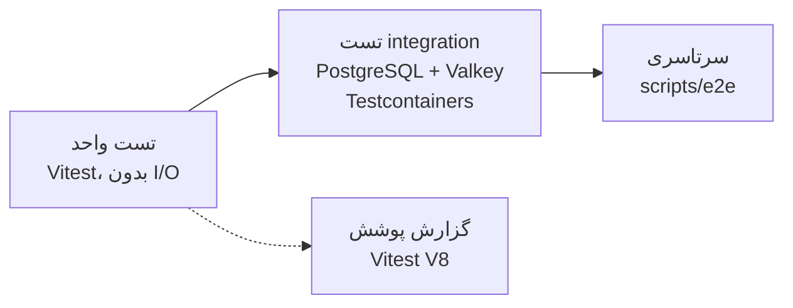

| سطح         | دستور                   | محدوده                                     |
| ----------- | ----------------------- | ------------------------------------------ |
| واحد        | `pnpm test`             | منطق خالص هر پکیج یا اپ. سریع و بدون شبکه. |
| integration | `pnpm test:integration` | کانتینرهای واقعی PostgreSQL و Valkey.      |
| سرتاسری     | `pnpm test:e2e`         | جریان کامل روی stack در حال اجرا.          |
| benchmark   | `scripts/bench`         | سربار gateway و سناریوهای k6.              |

راهنما:

- رفتار را تست کنید، نه جزئیات پیاده‌سازی.
- هر رفع باگ باید تست regression داشته باشد.
- به زمان دیواری وابسته نباشید. در کدی که timeout دارد از fake timer استفاده کنید.
- مسیر hot gateway نباید تماس دیتابیس اضافه کند. تست‌های integration این مرز را پوشش می‌دهند.

## 14. متغیرهای محیطی

- هر متغیر با یک schema در یکی از فایل‌های `packages/shared/src/env.ts`، `apps/gateway/src/main.ts`، `apps/control-api/src/env.ts`، `apps/worker/src/env.ts` یا `apps/mock-provider/src/main.ts` اعتبارسنجی می‌شود.
- هر متغیری که در source خوانده می‌شود باید در [docs/env-reference.md](docs/env-reference.fa.md) باشد. اسکریپت `scripts/ci/check-env-docs.mjs` وقتی متغیر مستندنشده یا مستندی بدون خواندن در کد باشد شکست می‌خورد.
- هرگز راز را commit نکنید. `.env` در git نادیده گرفته می‌شود؛ `.env.example` فقط placeholder دارد.
- هنگام افزودن متغیر، `.env.example` را در همان تغییر به‌روز کنید.

<a id="documentation-policy-fa"></a>

## سیاست مستندات

هر سند در دو فایل جدا نگهداری می‌شود: یک فایل انگلیسی و یک فایل فارسی که نامش به `.fa.md` ختم می‌شود. لینک‌های زبان در بالای هر فایل بین این دو جابه‌جا می‌کنند.

| فایل انگلیسی      | فایل فارسی           |
| ----------------- | -------------------- |
| `README.md`       | `README.fa.md`       |
| `docs/runbook.md` | `docs/runbook.fa.md` |
| `adr/0001-*.md`   | `adr/0001-*.fa.md`   |

| مکان                         | محتوای زبانی                           |
| ---------------------------- | -------------------------------------- |
| فایل‌های Markdown ریشه       | فایل‌های جدا با پسوند `.md` و `.fa.md` |
| `adr/`                       | فایل‌های جدا برای هر ADR               |
| `docs/`                      | فایل‌های جدا برای هر راهنما            |
| کامنت‌های کد                 | فقط انگلیسی                            |
| رابط کاربری و پیام‌های محصول | فارسی و انگلیسی، طبق نیاز محصول        |

قواعد:

1. فایل انگلیسی و فایل فارسی را در یک تغییر به‌روز کنید. تغییری که فقط یک زبان را به‌روز کند ناقص است.
2. این دو فایل را هم‌راستا نگه دارید: عنوان‌ها، دستورها، جدول‌ها و نمودارها یکسان باشند.
3. شناسه‌های فنی را در هر دو فایل دقیقاً همان‌طور بنویسید: مسیر فایل، دستور، نام متغیر محیطی، کلید JSON و کد خطا.
4. فایل‌های فارسی از فارسی رسمی و فنی استفاده می‌کنند و اصطلاحات رایج را با حروف لاتین نگه می‌دارند (Gateway، Provider، snapshot).
5. فایل فارسی با پسوند `.fa.md` ساخته می‌شود؛ هرگز بخش فارسی را به انتهای فایل انگلیسی اضافه نکنید.
6. هنگام افزودن سند جدید، هر دو فایل را بسازید و لینک‌های زبان را سالم نگه دارید.
7. پژوهش رقبا، برنامهٔ sprint، خروجی board، اسکریپت‌های تولیدکننده و یادداشت‌های تأیید محلی نباید در مخزن باشند.

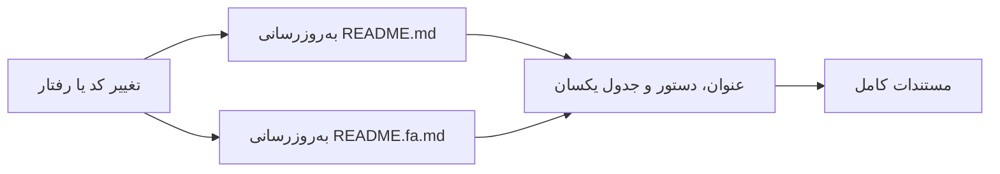

## 15. بازبینی pull request

بازبین‌ها به ترتیب زیر بررسی می‌کنند:

1. **درستی:** رفتار با کارت هم‌خوان است و تست‌ها آن را ثابت می‌کنند.
2. **مرزها:** جهت وابستگی و قانون استقلال data plane رعایت شده است.
3. **پول و محدودیت‌ها:** پول عدد اعشاری شناور ندارد و محدودیت‌ها و بودجه‌ها به‌صورت ایمن شکست می‌خورند.
4. **خطاها:** کدها پایدار و مستندشده‌اند.
5. **مشاهده‌پذیری:** logها از `createLogger` استفاده می‌کنند، رازها را پنهان می‌کنند و metricها در صورت نیاز به‌روز شده‌اند.
6. **مستندات:** هر دو بخش زبانی به‌روز شده‌اند و مستندات env با کد هم‌خوان است.

## 16. قوانین معماری که نباید شکسته شوند

| قانون                                                                    | دلیل                                                                                               |
| ------------------------------------------------------------------------ | -------------------------------------------------------------------------------------------------- |
| مسیر hot gateway هیچ وابستگی به دیتابیس ندارد.                           | صفحهٔ داده با آخرین snapshot معتبر کار می‌کند ([ADR-006](adr/0006-data-plane-independence.fa.md)). |
| رمزهای provider در snapshot به‌صورت ciphertext AES-256-GCM هستند.        | gateway فقط در حافظه و با `MASTER_KEY` رمزگشایی می‌کند.                                            |
| fallback برای stream فقط قبل از رسیدن اولین بایت به کلاینت انجام می‌شود. | کلاینت هرگز نباید پاسخ ناقص از دو provider دریافت کند.                                             |
| انتشار usage غیرهمزمان است.                                              | پاسخ به کلاینت هرگز منتظر ماندگاری نمی‌ماند.                                                       |
| نوشتن ledger از کلید idempotency استفاده می‌کند.                         | تلاش مجدد صف و replay outbox نباید دو بار شارژ کنند.                                               |
| `contracts` هیچ وابستگی داخلی به پکیج دیگر ندارد.                        | لایهٔ schema پایدار و قابل استفاده مجدد می‌ماند.                                                   |

<a id="17-review-checklist-fa"></a>

## 17. چک‌لیست بازبینی

این متن را در توضیحات pull request بیاورید و هر مورد را علامت بزنید.

- [ ] شناسهٔ کارت (`DR-n`) در نام شاخه و footer commit آمده است.
- [ ] `pnpm lint`، `pnpm typecheck`، `pnpm test` و `pnpm build` به‌صورت محلی موفق‌اند.
- [ ] رفتار جدید تست دارد؛ رفع باگ تست regression دارد.
- [ ] `console.*` وجود ندارد؛ logها از `createLogger` عبور می‌کنند.
- [ ] پول با عدد اعشاری شناور محاسبه نشده است.
- [ ] schemaهای مشترک فقط در `@dirouter/contracts` تعریف شده‌اند.
- [ ] کدهای خطا پایدارند؛ کد جدید مستند شده است.
- [ ] متغیرهای محیطی در `.env.example` و `docs/env-reference.md` هستند.
- [ ] کامنت‌های کد انگلیسی‌اند.
- [ ] فایل انگلیسی `.md` و فایل فارسی `.fa.md` مستندات هر دو به‌روز شده‌اند.
- [ ] migrationها افزایشی هستند یا برنامهٔ rollback دارند.

<a id="18-troubleshooting-fa"></a>

## 18. عیب‌یابی

| علامت                                           | علت                                       | راه‌حل                                                                      |
| ----------------------------------------------- | ----------------------------------------- | --------------------------------------------------------------------------- |
| عدم تطابق نسخهٔ `pnpm`                          | Corepack فعال نیست                        | `corepack enable` را اجرا کنید و سپس `pnpm install` بزنید.                  |
| رد commit با `scope-enum`                       | scope در فهرست مجاز نیست                  | scope مجاز از [بخش ۷](#7-commit-messages-fa) را بزنید یا scope را حذف کنید. |
| رد commit با `type-enum`                        | type پشتیبانی نمی‌شود                     | یکی از typeهای مجاز را استفاده کنید.                                        |
| `pre-commit` خطای ESLint گزارش می‌دهد           | قاعده به‌صورت خودکار اصلاح نمی‌شود        | خطوط گزارش‌شده را اصلاح کنید و دوباره stage کنید.                           |
| `check-env-docs` در CI شکست می‌خورد             | متغیر بدون مستندسازی اضافه یا حذف شده است | `docs/env-reference.md` را در همان تغییر به‌روز کنید.                       |
| Turbo برای تغییر فقط مستندات کاری انجام نمی‌دهد | مستندات بخشی از build اپ‌ها نیستند        | رفتار مورد انتظار است؛ CI وظیفهٔ اپ انتخاب نمی‌کند.                         |
| تست‌های integration کانتینر نمی‌سازند           | Docker اجرا نیست                          | Docker Desktop یا daemon را راه‌اندازی کنید.                                |

</div>
