<p align="center">
  
</p>

[English](#english) · [فارسی](#persian)

<a id="english"></a>

# Contributing to DiRouter

This guide explains how to set up a development environment, write code that matches the repository, commit changes, open a pull request, and pass review. It is the single source of truth for contributor rules. Architecture decisions live in the [ADRs](adr/README.md), domain terms in the [glossary](GLOSSARY.md), and the CI pipeline in [CI.md](CI.md).

> **Important:** every change must keep code, comments, and documentation consistent. Documentation is bilingual (English and Persian); see [Documentation policy](#documentation-policy).

## Contents

1. [Contribution lifecycle](#1-contribution-lifecycle)
2. [Repository map](#2-repository-map)
3. [Development environment](#3-development-environment)
4. [Daily workflow](#4-daily-workflow)
5. [Code quality tools](#5-code-quality-tools)
6. [Git hooks](#6-git-hooks)
7. [Commit messages](#7-commit-messages)
8. [Branches and pull requests](#8-branches-and-pull-requests)
9. [Code conventions](#9-code-conventions)
10. [Comments and naming](#10-comments-and-naming)
11. [Money and monetary values](#11-money-and-monetary-values)
12. [Errors and the error catalog](#12-errors-and-the-error-catalog)
13. [Testing](#13-testing)
14. [Environment variables](#14-environment-variables)
15. [Pull request description and review](#15-pull-request-description-and-review)
16. [Architecture rules you must not break](#16-architecture-rules-you-must-not-break)
17. [Review checklist](#17-review-checklist)
18. [Troubleshooting](#18-troubleshooting)
19. [Documentation policy](#documentation-policy)

---

## 1. Contribution lifecycle

Every change moves through the same stages. Automation (Husky, lint-staged, commitlint, and GitHub Actions) enforces most of them, but the author remains responsible for the design and the description.

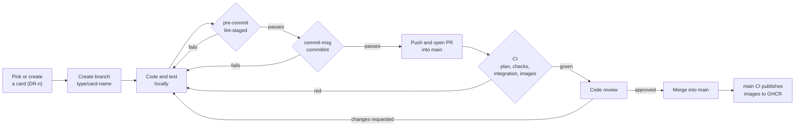

| Stage  | Who acts  | Tool or artifact             | Gate                                            |
| ------ | --------- | ---------------------------- | ----------------------------------------------- |
| Plan   | Author    | Card `DR-n`, branch name     | Scope agreed in the card                        |
| Write  | Author    | Editor with `.editorconfig`  | Local tests pass                                |
| Commit | Git hooks | `lint-staged`, `commitlint`  | Format, lint, commit message                    |
| Review | Reviewer  | Pull request                 | Checklist in [section 17](#17-review-checklist) |
| Verify | GitHub    | `.github/workflows/ci.yml`   | All required jobs green                         |
| Ship   | Pipeline  | GHCR images on `main` or tag | Only for trusted pushes                         |

## 2. Repository map

The monorepo uses pnpm workspaces and Turborepo. Applications (`apps/*`) may depend on packages (`packages/*`); packages never depend on applications.

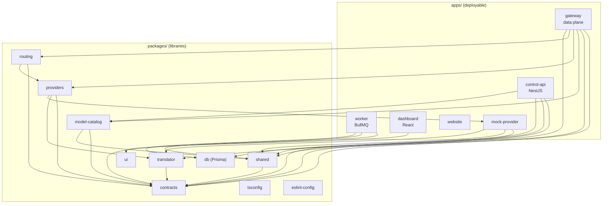

| Path                     | Purpose                                                            |
| ------------------------ | ------------------------------------------------------------------ |
| `apps/gateway`           | Data plane. Serves OpenAI and Anthropic compatible endpoints.      |
| `apps/control-api`       | Administration API, authentication, RBAC, snapshot publication.    |
| `apps/worker`            | Consumes usage events, writes ledger and logs, reconciles budgets. |
| `apps/dashboard`         | Persian RTL administrative interface (React + Vite).               |
| `apps/website`           | Public Persian site and routing demo.                              |
| `apps/mock-provider`     | Synthetic upstream with injected errors for development and tests. |
| `packages/contracts`     | Zod schemas, canonical model, snapshot, usage event, error codes.  |
| `packages/shared`        | Logger, errors, env validation, crypto, ULID, HMAC, money helpers. |
| `packages/db`            | Prisma schema, migrations, and generated client.                   |
| `packages/model-catalog` | Model prices and capabilities.                                     |
| `packages/translator`    | Request, response, and stream translation between API formats.     |
| `packages/providers`     | Provider adapters and error classification.                        |
| `packages/routing`       | Router, executor, health, bulkhead.                                |
| `packages/ui`            | Shared React components.                                           |
| `packages/tsconfig`      | Shared TypeScript configurations.                                  |
| `packages/eslint-config` | Shared ESLint configurations.                                      |
| `deploy/`                | Dockerfiles, Traefik, Prometheus, Grafana, nginx templates.        |
| `scripts/`               | CI planning, integration runner, benchmarks, development helpers.  |
| `adr/`                   | Architecture Decision Records.                                     |

## 3. Development environment

### Requirements

| Tool     | Version                 | Why                                              |
| -------- | ----------------------- | ------------------------------------------------ |
| Node.js  | 22 LTS (`>=22.12 <23`)  | `engines` in `package.json` and `.nvmrc` (22)    |
| pnpm     | 10.x (pinned `10.13.1`) | `packageManager` field, workspace protocol       |
| Corepack | Bundled with Node       | Reads the pinned pnpm version automatically      |
| Docker   | Engine + Compose        | Local PostgreSQL, Valkey, Traefik, and the stack |
| Git      | Any recent version      | Hooks and version control                        |

### First-time setup

```bash
corepack enable          # activates the pinned pnpm
pnpm install             # installs dependencies and registers Husky hooks (prepare script)
pnpm build               # builds packages in dependency order
pnpm test                # runs the unit tests
```

`pnpm install` runs the `prepare` script, which installs Husky. Hooks are therefore active from the first install; you do not need a separate command.

### Running the stack

```bash
./scripts/bootstrap.sh                                            # creates .env with random secrets (chmod 600)
docker compose -f compose.yaml -f compose.dev.yaml up -d --build --wait
make seed                                                         # development data and a dev key
```

Development URLs are routed by Traefik on `*.localhost`. See [README.md](README.md) for the full list.

## 4. Daily workflow

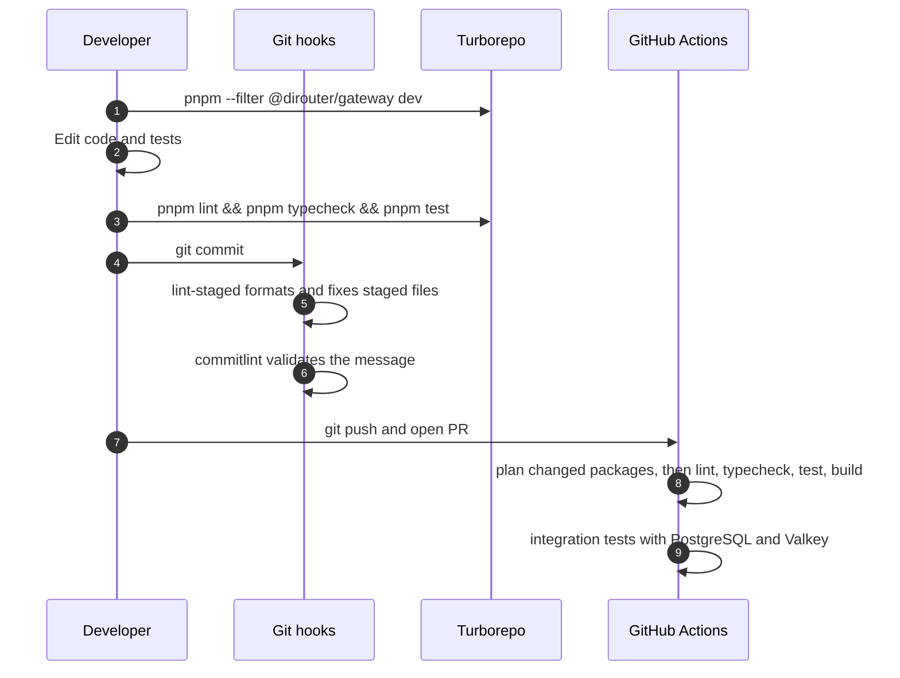

Useful commands:

| Command                               | Effect                                              |
| ------------------------------------- | --------------------------------------------------- |
| `pnpm --filter @dirouter/gateway dev` | Runs only the gateway in watch mode.                |
| `pnpm --filter @dirouter/shared test` | Runs the tests of one package.                      |
| `pnpm -r exec vitest run <file>`      | Runs a single test file across the workspace.       |
| `pnpm format` / `pnpm format:check`   | Writes or checks Prettier formatting.               |
| `pnpm test:integration`               | Starts disposable PostgreSQL and Valkey containers. |
| `make lint`                           | Lint, typecheck, and format check in one command.   |

## 5. Code quality tools

| Tool                                    | Configuration            | Command                             |
| --------------------------------------- | ------------------------ | ----------------------------------- |
| TypeScript (strict)                     | `packages/tsconfig`      | `pnpm typecheck`                    |
| ESLint (flat, type-aware configuration) | `packages/eslint-config` | `pnpm lint`                         |
| Prettier                                | `.prettierrc.json`       | `pnpm format` / `pnpm format:check` |
| EditorConfig                            | `.editorconfig`          | Applied by supporting editors       |

Key settings from `.prettierrc.json`: single quotes, trailing commas (`all`), print width `100`, semicolons, arrow parentheses always, and LF line endings.

Rules that every package follows:

- Each application and package has an `eslint.config.js` that imports the `node` or `react` configuration from `@dirouter/eslint-config`.
- `console.*` is prohibited. Use `createLogger` from `@dirouter/shared`.
- Use explicit type imports (`import { type X }`); `verbatimModuleSyntax` is enabled.
- Strict TypeScript is required. Avoid `any`; prefer `unknown` and narrow it.

## 6. Git hooks

Hooks are stored in `.husky/` and registered by `pnpm install`.

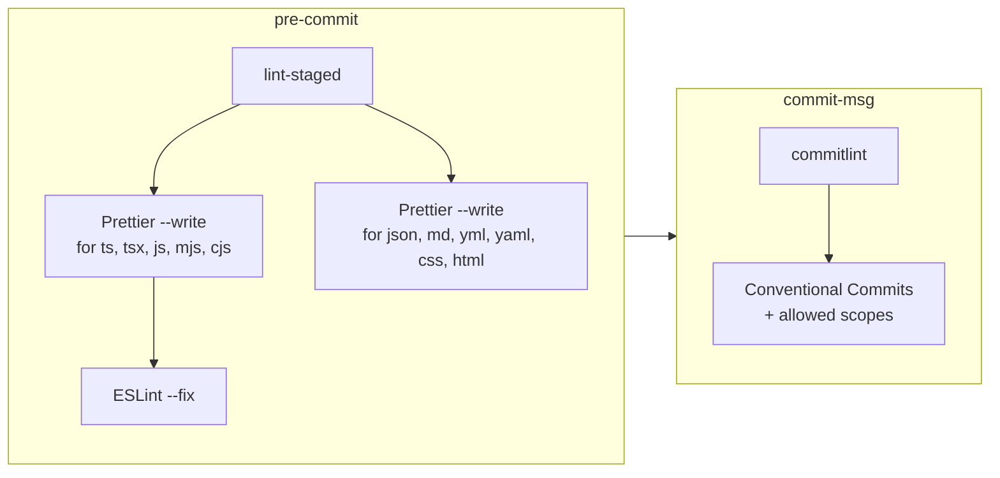

| Hook         | Runs                               | When it fails                                             |
| ------------ | ---------------------------------- | --------------------------------------------------------- |
| `pre-commit` | `pnpm exec lint-staged`            | Lint errors that ESLint cannot auto-fix block the commit. |
| `commit-msg` | `pnpm exec commitlint --edit "$1"` | Invalid type, unknown scope, or missing subject.          |

Do not bypass hooks with `--no-verify`. CI runs the same checks, so a bypassed commit only fails later.

## 7. Commit messages

Commits follow [Conventional Commits](https://www.conventionalcommits.org/):

```text
<type>(<scope>): <subject>

[body]

[footer]
```

Allowed types: `feat`, `fix`, `docs`, `style`, `refactor`, `perf`, `test`, `build`, `ci`, `chore`, `revert`.

The scope is optional. When supplied, it must be one of the values defined in `commitlint.config.js`:

| Scope           | Use it for               |
| --------------- | ------------------------ |
| `gateway`       | `apps/gateway`           |
| `control-api`   | `apps/control-api`       |
| `worker`        | `apps/worker`            |
| `dashboard`     | `apps/dashboard`         |
| `mock-provider` | `apps/mock-provider`     |
| `contracts`     | `packages/contracts`     |
| `shared`        | `packages/shared`        |
| `db`            | `packages/db`            |
| `model-catalog` | `packages/model-catalog` |
| `ui`            | `packages/ui`            |
| `tsconfig`      | `packages/tsconfig`      |
| `eslint-config` | `packages/eslint-config` |
| `deploy`        | `deploy/`, Compose files |
| `docs`          | Documentation only       |
| `ci`            | `.github/`, `scripts/ci` |
| `deps`          | Dependency updates       |
| `repo`          | Root configuration       |

Examples:

```text
feat(gateway): add circuit breaker per provider
fix(shared): redact x-api-key header in logs
docs(gateway): document timeout settings
```

Mark a breaking change with `!` after the type or scope, or with a `BREAKING CHANGE:` footer:

```text
feat(contracts)!: rename ConfigSnapshot.version to revision

BREAKING CHANGE: gateways older than 1.4 reject snapshots that use the new field.
Refs: DR-42
```

Include the DiTask card reference in the footer, for example `Refs: DR-12`.

## 8. Branches and pull requests

- The default branch is `main`.
- Name branches `<type>/<card>-<short-name>`, for example `feat/4.1-gateway-skeleton`.
- Open a pull request against `main`. CI runs on every pull request to `main`.
- Merge only after CI and code review pass.

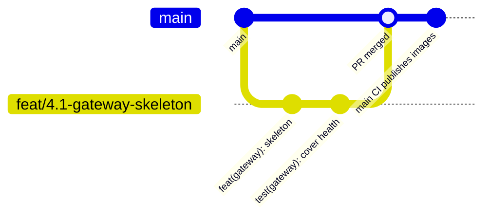

Pull request description checklist:

- What changed and why, linked to the card (`DR-n`).
- Risk: which runtime path (hot path, control plane, persistence) is affected.
- Tests added or updated, and how you verified them.
- Configuration, environment variable, or migration changes, with links to the documentation you updated.
- Screenshots for dashboard changes (Persian and English text, RTL layout).

## 9. Code conventions

- Modules use ESM (`"type": "module"`). Relative imports include the `.js` extension, for example `import { x } from './router.js'`.
- Define shared schemas and types only in `@dirouter/contracts`. Do not duplicate them in applications.
- Error codes are stable. You may add codes; you must not remove a code or change its meaning. See `ERROR_CODES` in `packages/contracts`.
- Store monetary values as USD decimal strings at API boundaries and as `Decimal(18,8)` in PostgreSQL.
- Use the BigInt fixed-point helpers from `@dirouter/shared` for money arithmetic. Never use floating-point numbers for money.

### Dependency direction

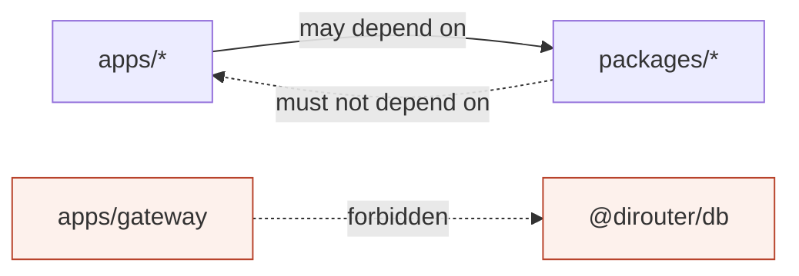

The gateway must not depend on `@dirouter/db`. This is the code-level enforcement of [ADR-006](adr/0006-data-plane-independence.md).

## 10. Comments and naming

- Write code comments in English.
- Comment the **why**, not the **what**. Names should explain the what.
- Keep comments short and close to the code they describe. Remove a comment when the code changes and the comment no longer applies.
- Do not leave commented-out code in the repository.
- Use `TODO(DR-n):` with a card reference for planned work. Plain `TODO` without a reference is not accepted in review.

## 11. Money and monetary values

Money is the most sensitive area of the system. Rounding errors can overcharge customers or leak budget.

| Representation        | Where                     | Rule                                                      |
| --------------------- | ------------------------- | --------------------------------------------------------- |
| USD decimal string    | API boundaries, contracts | Up to eight fractional digits, for example `"0.00123400"` |
| `UsdUnits` (`bigint`) | In-process arithmetic     | `1 USD = 10^8` internal units                             |
| `Decimal(18,8)`       | PostgreSQL                | Source of truth for the ledger                            |
| Price per million     | Model catalog             | USD per 1,000,000 tokens                                  |

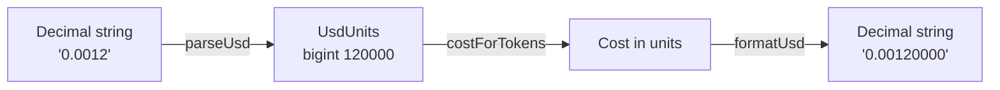

Use `parseUsd`, `formatUsd`, `costForTokens`, `sumUsd`, and `percentOf` from `packages/shared/src/money.ts`.

## 12. Errors and the error catalog

Errors use a stable DiRouter code and the same format as the inbound API (OpenAI or Anthropic).

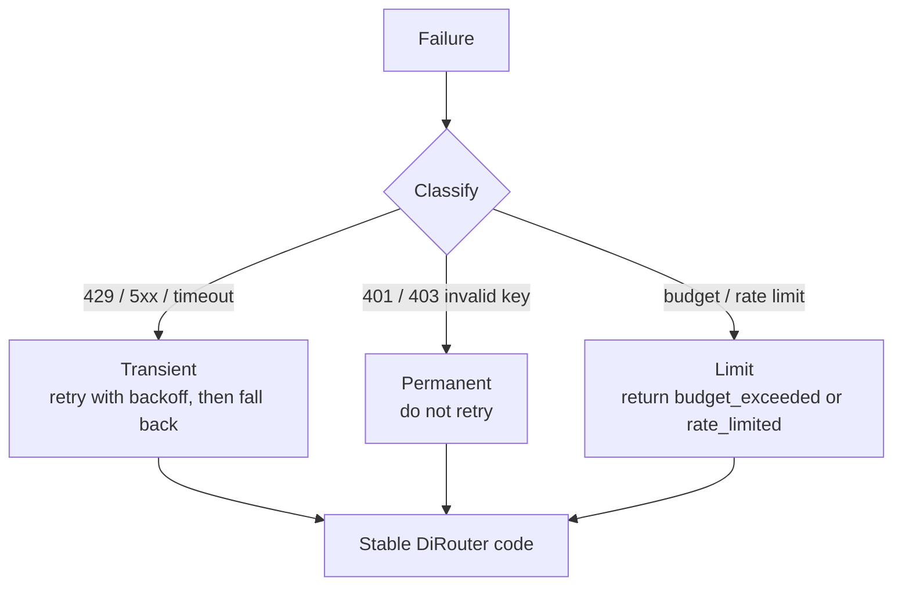

When you add a new failure path:

1. Choose an existing code from `ERROR_CODES` if one fits.
2. Otherwise add a new code. Do not reuse a code for a different meaning.
3. Add a test that asserts the HTTP status and the code.
4. Document the code in [docs/concepts/errors.md](docs/concepts/errors.md).

## 13. Testing

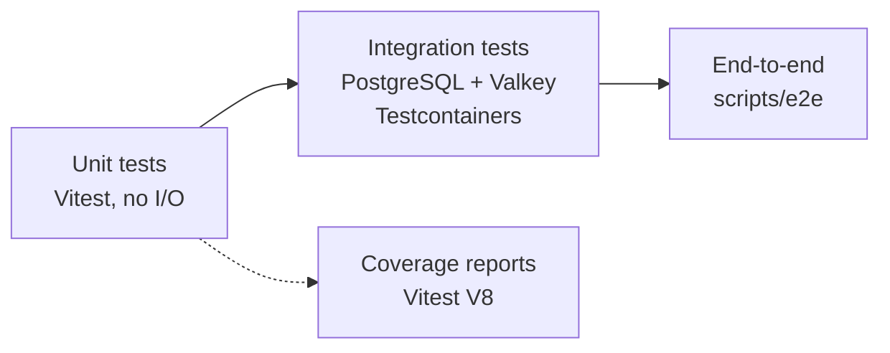

| Level       | Command                 | Scope                                            |
| ----------- | ----------------------- | ------------------------------------------------ |
| Unit        | `pnpm test`             | Pure logic per package or app. Fast, no network. |
| Integration | `pnpm test:integration` | Real PostgreSQL and Valkey containers.           |
| End-to-end  | `pnpm test:e2e`         | Full flow through the running stack.             |
| Benchmarks  | `scripts/bench`         | Gateway overhead and k6 scenarios.               |

Guidelines:

- Test behavior, not implementation details.
- Every bug fix includes a regression test.
- Do not depend on wall-clock time. Use fake timers where the code uses timeouts.
- The gateway hot path must not gain a database call. Integration tests cover this boundary.

## 14. Environment variables

- Each variable is validated by a schema in one of these files: `packages/shared/src/env.ts`, `apps/gateway/src/main.ts`, `apps/control-api/src/env.ts`, `apps/worker/src/env.ts`, or `apps/mock-provider/src/main.ts`.
- Every variable read in source must appear in [docs/env-reference.md](docs/env-reference.md). The check `scripts/ci/check-env-docs.mjs` fails when a variable is undocumented or when the documentation lists a variable that the source no longer reads.
- Never commit secrets. `.env` is git-ignored; `.env.example` contains placeholders only.
- Update `.env.example` in the same change when you add a variable.

<a id="documentation-policy"></a>

## Documentation policy

All documentation in this repository is bilingual. Every versioned Markdown file has an English section and a Persian section, selected with the links at the top of the page.

| Location                | Language content                                  |
| ----------------------- | ------------------------------------------------- |
| Root Markdown files     | English and Persian in one file                   |
| `adr/`                  | English and Persian in each record                |
| `docs/`                 | Detailed guides, English and Persian in each file |
| Code comments           | English only                                      |
| Product UI and messages | Persian and English, as required by the product   |

Rules:

1. Write the English section and the Persian section in the same change. A change that updates one language only is incomplete.
2. Keep both sections aligned: the same headings, the same commands, the same tables, and the same diagrams.
3. Keep technical identifiers exactly as written in both sections: file paths, commands, environment variable names, JSON keys, and error codes.
4. Persian sections use formal technical Persian and keep established technical terms in Latin script (Gateway, Provider, snapshot).
5. Private competitor research, sprint plans, board exports, generator scripts, and local verification notes do not belong in the repository.

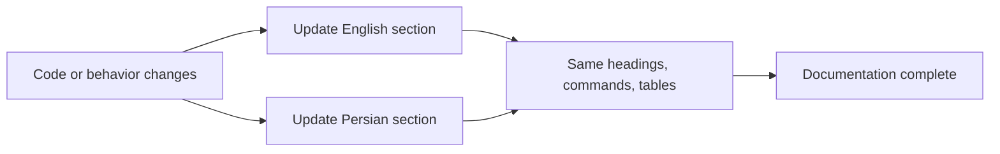

## 15. Pull request description and review

Reviewers check, in this order:

1. **Correctness:** the behavior matches the card and the tests prove it.
2. **Boundaries:** dependency direction and the data-plane independence rule hold.
3. **Money and limits:** no floating-point money; limits and budgets fail safely.
4. **Errors:** codes are stable and documented.
5. **Observability:** logs use `createLogger`, redact secrets, and metrics are updated where relevant.
6. **Documentation:** both language sections are updated; env docs match the source.

## 16. Architecture rules you must not break

| Rule                                                                   | Why                                                                                                     |
| ---------------------------------------------------------------------- | ------------------------------------------------------------------------------------------------------- |
| The gateway hot path has no database dependency.                       | Data plane keeps serving with the last valid snapshot ([ADR-006](adr/0006-data-plane-independence.md)). |
| Provider secrets are AES-256-GCM ciphertext in snapshots.              | Gateway decrypts only in memory with `MASTER_KEY`.                                                      |
| Stream fallback only happens before the first byte reaches the client. | Clients must never receive a partial response from two providers.                                       |
| Usage publication is asynchronous.                                     | The client response never waits for persistence.                                                        |
| Ledger writes use an idempotency key.                                  | Queue retries and outbox replays must not charge twice.                                                 |
| `contracts` has no internal package dependencies.                      | Keeps the schema layer stable and reusable.                                                             |

## 17. Review checklist

Copy this into your pull request description and tick each item.

- [ ] Card reference (`DR-n`) is in the branch name and commit footer.
- [ ] `pnpm lint`, `pnpm typecheck`, `pnpm test`, and `pnpm build` pass locally.
- [ ] New behavior has tests; bug fixes have a regression test.
- [ ] No `console.*`; logs go through `createLogger`.
- [ ] No floating-point money.
- [ ] Shared schemas are defined in `@dirouter/contracts` only.
- [ ] Error codes are stable; new codes are documented.
- [ ] Environment variables are in `.env.example` and `docs/env-reference.md`.
- [ ] Code comments are in English.
- [ ] English and Persian documentation sections are both updated.
- [ ] Migrations are additive or have a rollback plan.

## 18. Troubleshooting

| Symptom                                     | Cause                                           | Fix                                                          |
| ------------------------------------------- | ----------------------------------------------- | ------------------------------------------------------------ |
| `pnpm` version mismatch                     | Corepack is not enabled                         | Run `corepack enable`, then `pnpm install`.                  |
| Commit rejected with `scope-enum`           | Scope is not in the allowed list                | Use a scope from [section 7](#7-commit-messages) or omit it. |
| Commit rejected with `type-enum`            | Unsupported type                                | Use one of the allowed types.                                |
| `pre-commit` reports ESLint errors          | Rule cannot be auto-fixed                       | Fix the reported lines and stage again.                      |
| `check-env-docs` fails in CI                | Variable added or removed without documentation | Update `docs/env-reference.md` in the same change.           |
| Turbo builds nothing for a docs-only change | Docs are not part of an app build               | Expected; CI selects no application tasks.                   |
| Integration tests cannot start containers   | Docker is not running                           | Start Docker Desktop or the Docker daemon.                   |

---

<a id="persian"></a>

# راهنمای مشارکت در DiRouter

این راهنما نحوهٔ راه‌اندازی محیط توسعه، نوشتن کدی که با ساختار مخزن هم‌خوان باشد، ثبت commit، باز کردن pull request و گذراندن بازبینی را شرح می‌دهد. این سند مرجع واحد قوانین مشارکت است. تصمیم‌های معماری در [ADRها](adr/README.md)، اصطلاحات دامنه در [واژه‌نامه](GLOSSARY.md) و pipeline در [CI.md](CI.md) نگهداری می‌شوند.

> **مهم:** هر تغییر باید کد، کامنت و مستندات را هم‌خوان نگه دارد. مستندات دوزبانه (انگلیسی و فارسی) هستند؛ به [سیاست مستندات](#documentation-policy-fa) مراجعه کنید.

## فهرست

1. [چرخهٔ مشارکت](#1-چرخهٔ-مشارکت)
2. [نقشهٔ مخزن](#2-نقشهٔ-مخزن)
3. [محیط توسعه](#3-محیط-توسعه)
4. [گردش کار روزانه](#4-گردش-کار-روزانه)
5. [ابزارهای کیفیت کد](#5-ابزارهای-کیفیت-کد)
6. [Git hookها](#6-git-hookها)
7. [پیام‌های commit](#7-پیام‌های-commit)
8. [شاخه‌ها و pull request](#8-شاخه‌ها-و-pull-request)
9. [قراردادهای کد](#9-قراردادهای-کد)
10. [کامنت‌ها و نام‌گذاری](#10-کامنت‌ها-و-نام‌گذاری)
11. [پول و مقادیر پولی](#11-پول-و-مقادیر-پولی)
12. [خطاها و کاتالوگ خطا](#12-خطاها-و-کاتالوگ-خطا)
13. [تست](#13-تست)
14. [متغیرهای محیطی](#14-متغیرهای-محیطی)
15. [بازبینی pull request](#15-بازبینی-pull-request)
16. [قوانین معماری که نباید شکسته شوند](#16-قوانین-معماری-که-نباید-شکسته-شوند)
17. [چک‌لیست بازبینی](#17-چک‌لیست-بازبینی)
18. [عیب‌یابی](#18-عیب‌یابی)
19. [سیاست مستندات](#documentation-policy-fa)

---

## 1. چرخهٔ مشارکت

هر تغییر از مراحل یکسانی عبور می‌کند. Husky، lint-staged، commitlint و GitHub Actions بیشتر این مراحل را اجرا می‌کنند، اما طراحی و توضیحات pull request بر عهدهٔ نویسنده است.

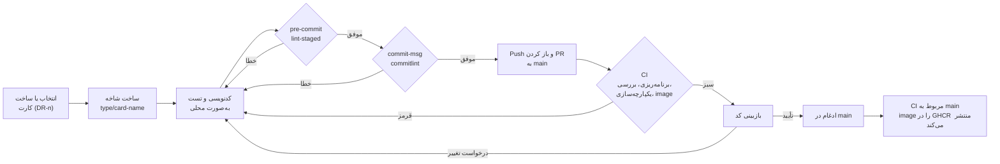

| مرحله   | عامل       | ابزار یا خروجی                  | دروازهٔ کنترل                         |
| ------- | ---------- | ------------------------------- | ------------------------------------- |
| برنامه  | نویسنده    | کارت `DR-n` و نام شاخه          | محدودهٔ توافق‌شده در کارت             |
| نوشتن   | نویسنده    | ویرایشگر با `.editorconfig`     | تست‌های محلی موفق                     |
| Commit  | Git hookها | `lint-staged`، `commitlint`     | قالب‌بندی، lint و پیام commit         |
| بازبینی | بازبین     | Pull request                    | چک‌لیست [بخش ۱۷](#17-چک‌لیست-بازبینی) |
| تأیید   | GitHub     | `.github/workflows/ci.yml`      | سبز بودن همهٔ jobهای الزامی           |
| انتشار  | Pipeline   | image در GHCR روی `main` یا tag | فقط برای push‌های مورد اعتماد         |

## 2. نقشهٔ مخزن

این مخزن pnpm workspace و Turborepo است. اپ‌ها (`apps/*`) می‌توانند به پکیج‌ها (`packages/*`) وابسته باشند؛ پکیج‌ها هرگز به اپ وابسته نیستند.


| مسیر                     | کاربرد                                                                |
| ------------------------ | --------------------------------------------------------------------- |
| `apps/gateway`           | صفحهٔ داده. endpointهای سازگار با OpenAI و Anthropic را ارائه می‌کند. |
| `apps/control-api`       | API مدیریت، احراز هویت، RBAC و انتشار snapshot.                       |
| `apps/worker`            | مصرف usage event، نوشتن ledger و log و تطبیق بودجه.                   |
| `apps/dashboard`         | داشبورد مدیریتی فارسی RTL (React + Vite).                             |
| `apps/website`           | سایت عمومی فارسی و دموی مسیریابی.                                     |
| `apps/mock-provider`     | upstream ساختگی با خطای تزریقی برای توسعه و تست.                      |
| `packages/contracts`     | schemaهای Zod، مدل canonical، snapshot، usage event و کدهای خطا.      |
| `packages/shared`        | logger، خطاها، اعتبارسنجی env، رمزنگاری، ULID، HMAC و کمکی‌های پول.   |
| `packages/db`            | Prisma schema، migrationها و client تولیدشده.                         |
| `packages/model-catalog` | قیمت و قابلیت مدل‌ها.                                                 |
| `packages/translator`    | ترجمهٔ درخواست، پاسخ و stream بین قالب‌های API.                       |
| `packages/providers`     | adapterهای provider و طبقه‌بندی خطا.                                  |
| `packages/routing`       | router، executor، سلامت و bulkhead.                                   |
| `packages/ui`            | کامپوننت‌های مشترک React.                                             |
| `packages/tsconfig`      | پیکربندی مشترک TypeScript.                                            |
| `packages/eslint-config` | پیکربندی مشترک ESLint.                                                |
| `deploy/`                | Dockerfileها، Traefik، Prometheus، Grafana و قالب‌های nginx.          |
| `scripts/`               | برنامه‌ریزی CI، اجرای integration، benchmark و ابزارهای توسعه.        |
| `adr/`                   | Architecture Decision Recordها.                                       |

## 3. محیط توسعه

### پیش‌نیازها

| ابزار    | نسخه                     | دلیل                                              |
| -------- | ------------------------ | ------------------------------------------------- |
| Node.js  | 22 LTS (`>=22.12 <23`)   | `engines` در `package.json` و `.nvmrc` (نسخهٔ ۲۲) |
| pnpm     | 10.x (پین‌شده `10.13.1`) | فیلد `packageManager` و protocol کاری workspace   |
| Corepack | همراه Node               | نسخهٔ pnpm پین‌شده را خودکار می‌خواند             |
| Docker   | Engine + Compose         | PostgreSQL، Valkey، Traefik و stack محلی          |
| Git      | نسخهٔ نسبتاً جدید        | hookها و کنترل نسخه                               |

### راه‌اندازی اولیه

```bash
corepack enable          # فعال‌سازی pnpm پین‌شده
pnpm install             # نصب وابستگی‌ها و ثبت Husky (اسکریپت prepare)
pnpm build               # build پکیج‌ها به ترتیب وابستگی
pnpm test                # اجرای تست‌های واحد
```

`pnpm install` اسکریپت `prepare` را اجرا می‌کند که Husky را نصب می‌کند. بنابراین hookها از اولین نصب فعال هستند و دستور جداگانه‌ای لازم نیست.

### اجرای stack

```bash
./scripts/bootstrap.sh                                            # ساخت .env با رازهای تصادفی (chmod 600)
docker compose -f compose.yaml -f compose.dev.yaml up -d --build --wait
make seed                                                         # داده‌های توسعه و کلید dev
```

آدرس‌های توسعه توسط Traefik روی `*.localhost` مسیریابی می‌شوند. فهرست کامل در [README.md](README.md) است.

## 4. گردش کار روزانه

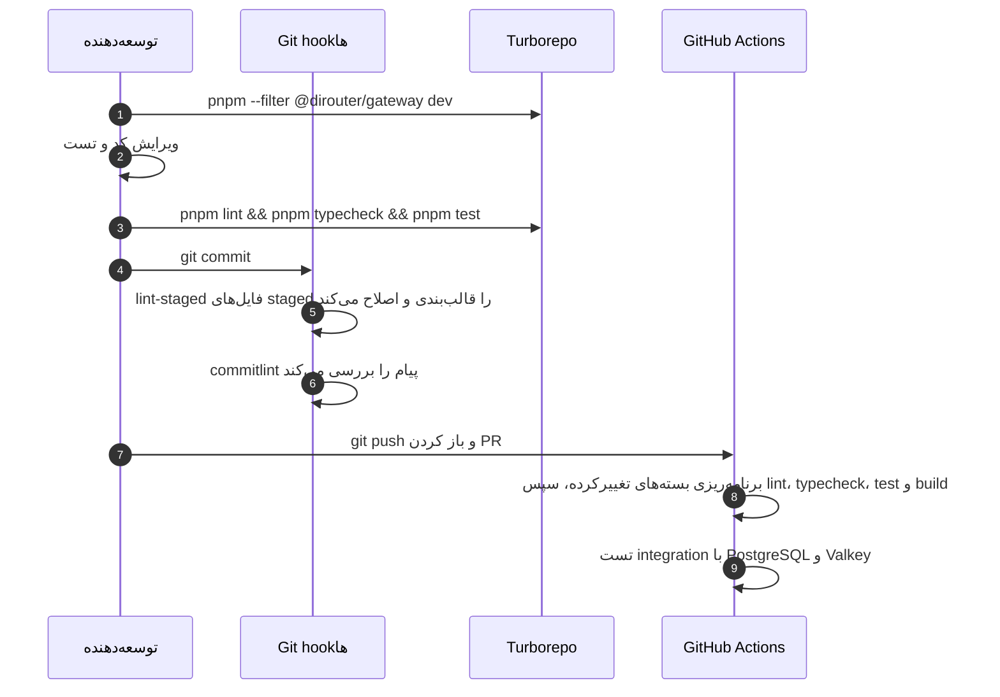

دستورهای پرکاربرد:

| دستور                                 | اثر                                                 |
| ------------------------------------- | --------------------------------------------------- |
| `pnpm --filter @dirouter/gateway dev` | فقط gateway را در حالت watch اجرا می‌کند.           |
| `pnpm --filter @dirouter/shared test` | تست‌های یک پکیج را اجرا می‌کند.                     |
| `pnpm -r exec vitest run <file>`      | یک فایل تست را در کل workspace اجرا می‌کند.         |
| `pnpm format` / `pnpm format:check`   | نوشتن یا بررسی قالب‌بندی Prettier.                  |
| `pnpm test:integration`               | کانتینرهای موقت PostgreSQL و Valkey را اجرا می‌کند. |
| `make lint`                           | lint، typecheck و بررسی قالب در یک دستور.           |

## 5. ابزارهای کیفیت کد

| ابزار                      | پیکربندی                 | دستور                                   |
| -------------------------- | ------------------------ | --------------------------------------- |
| TypeScript (strict)        | `packages/tsconfig`      | `pnpm typecheck`                        |
| ESLint (flat و type-aware) | `packages/eslint-config` | `pnpm lint`                             |
| Prettier                   | `.prettierrc.json`       | `pnpm format` / `pnpm format:check`     |
| EditorConfig               | `.editorconfig`          | ویرایشگرهای پشتیبان آن را اعمال می‌کنند |

تنظیمات مهم `.prettierrc.json`: نقل‌قول تک، trailing comma با مقدار `all`، عرض چاپ `100`، نقطه‌ویرگول، پرانتز همیشگی برای arrow function و پایان خط LF.

قواعدی که هر پکیج رعایت می‌کند:

- هر اپ و پکیج یک `eslint.config.js` دارد که پیکربندی `node` یا `react` را از `@dirouter/eslint-config` وارد می‌کند.
- استفاده از `console.*` ممنوع است. از `createLogger` در `@dirouter/shared` استفاده کنید.
- از import نوع صریح استفاده کنید (`import { type X }`)؛ `verbatimModuleSyntax` فعال است.
- TypeScript با حالت strict اجرا می‌شود. از `any` پرهیز کنید و به‌جای آن `unknown` را با narrowing به کار ببرید.

## 6. Git hookها

Hookها در `.husky/` قرار دارند و `pnpm install` آن‌ها را ثبت می‌کند.


| Hook         | اجرا می‌کند                        | زمان شکست                                                                  |
| ------------ | ---------------------------------- | -------------------------------------------------------------------------- |
| `pre-commit` | `pnpm exec lint-staged`            | خطاهای lint که ESLint نمی‌تواند خودکار اصلاح کند، commit را متوقف می‌کنند. |
| `commit-msg` | `pnpm exec commitlint --edit "$1"` | type نامعتبر، scope ناشناخته یا نبود subject.                              |

از `--no-verify` برای عبور از hookها استفاده نکنید. CI همان بررسی‌ها را اجرا می‌کند و commit دورزده‌شده بعداً شکست می‌خورد.

## 7. پیام‌های commit

commitها از [Conventional Commits](https://www.conventionalcommits.org/) پیروی می‌کنند:

```text
<type>(<scope>): <subject>

[body]

[footer]
```

typeهای مجاز: `feat`، `fix`، `docs`، `style`، `refactor`، `perf`، `test`، `build`، `ci`، `chore`، `revert`.

scope اختیاری است. اگر ذکر شود باید یکی از مقادیر تعریف‌شده در `commitlint.config.js` باشد:

| Scope           | کاربرد                      |
| --------------- | --------------------------- |
| `gateway`       | `apps/gateway`              |
| `control-api`   | `apps/control-api`          |
| `worker`        | `apps/worker`               |
| `dashboard`     | `apps/dashboard`            |
| `mock-provider` | `apps/mock-provider`        |
| `contracts`     | `packages/contracts`        |
| `shared`        | `packages/shared`           |
| `db`            | `packages/db`               |
| `model-catalog` | `packages/model-catalog`    |
| `ui`            | `packages/ui`               |
| `tsconfig`      | `packages/tsconfig`         |
| `eslint-config` | `packages/eslint-config`    |
| `deploy`        | `deploy/`، فایل‌های Compose |
| `docs`          | فقط مستندات                 |
| `ci`            | `.github/`، `scripts/ci`    |
| `deps`          | به‌روزرسانی وابستگی‌ها      |
| `repo`          | پیکربندی ریشهٔ مخزن         |

نمونه:

```text
feat(gateway): add circuit breaker per provider
fix(shared): redact x-api-key header in logs
docs(gateway): document timeout settings
```

تغییر ناسازگار (breaking) را با `!` بعد از type یا scope، یا با footer با عنوان `BREAKING CHANGE:` مشخص کنید:

```text
feat(contracts)!: rename ConfigSnapshot.version to revision

BREAKING CHANGE: gatewayهای قدیمی‌تر از 1.4 snapshotهای با فیلد جدید را رد می‌کنند.
Refs: DR-42
```

شناسهٔ کارت DiTask را در footer بیاورید، برای نمونه `Refs: DR-12`.

## 8. شاخه‌ها و pull request

- شاخهٔ پیش‌فرض `main` است.
- نام شاخه را `<type>/<card>-<short-name>` بگذارید، برای نمونه `feat/4.1-gateway-skeleton`.
- pull request را به `main` باز کنید. CI برای هر pull request به `main` اجرا می‌شود.
- فقط پس از موفقیت CI و بازبینی کد ادغام کنید.


چک‌لیست توضیحات pull request:

- چه تغییر کرده و چرا، همراه با کارت (`DR-n`).
- ریسک: کدام مسیر (hot path، control plane، ماندگاری) تحت تأثیر است.
- تست‌های اضافه یا به‌روزشده و روش بررسی آن‌ها.
- تغییر پیکربندی، متغیر محیطی یا migration، همراه با لینک مستنداتی که به‌روز کرده‌اید.
- تصویر صفحه برای تغییرات داشبورد (متن فارسی و انگلیسی و چیدمان RTL).

## 9. قراردادهای کد

- ماژول‌ها ESM هستند (`"type": "module"`). import نسبی باید پسوند `.js` داشته باشد، برای نمونه `import { x } from './router.js'`.
- schemaها و type‌های مشترک فقط در `@dirouter/contracts` تعریف شوند. در اپ‌ها تکرار نشوند.
- کدهای خطا پایدارند. می‌توانید کد جدید اضافه کنید؛ حذف کد یا تغییر معنای آن مجاز نیست. به `ERROR_CODES` در `packages/contracts` مراجعه کنید.
- مقادیر پولی را در مرز API به‌صورت رشتهٔ اعشاری USD و در PostgreSQL به‌صورت `Decimal(18,8)` نگه دارید.
- محاسبات پولی را با کمکی‌های fixed-point مبتنی بر BigInt از `@dirouter/shared` انجام دهید. هرگز از عدد اعشاری شناور برای پول استفاده نکنید.

### جهت وابستگی

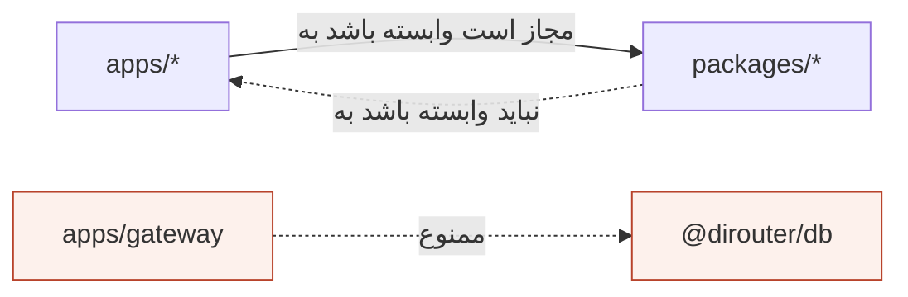

gateway نباید به `@dirouter/db` وابسته باشد. این قاعده، اجرای ADR-006 در سطح کد است.

## 10. کامنت‌ها و نام‌گذاری

- کامنت‌های کد باید **انگلیسی** باشند.
- **چرایی** را کامنت کنید، نه **چیستی**. نام‌ها باید چیستی را توضیح دهند.
- کامنت‌ها کوتاه و نزدیک کدی باشند که توضیح می‌دهند. اگر کد تغییر کرد و کامنت دیگر درست نیست، آن را حذف یا به‌روز کنید.
- کد کامنت‌شده را در مخزن نگه ندارید.
- برای کار برنامه‌ریزی‌شده از `TODO(DR-n):` همراه شناسهٔ کارت استفاده کنید. `TODO` بدون ارجاع در بازبینی پذیرفته نمی‌شود.

## 11. پول و مقادیر پولی

پول حساس‌ترین بخش سیستم است. خطای گرد کردن می‌تواند مشتری را بیش‌ازحد شارژ کند یا بودجه را نشت دهد.

| نمایش                 | کجا                  | قاعده                                           |
| --------------------- | -------------------- | ----------------------------------------------- |
| رشتهٔ اعشاری USD      | مرز API و contractها | حداکثر هشت رقم اعشار، برای نمونه `"0.00123400"` |
| `UsdUnits` (`bigint`) | محاسبات داخل فرایند  | `1 USD = 10^8` واحد داخلی                       |
| `Decimal(18,8)`       | PostgreSQL           | منبع حقیقت ledger                               |
| قیمت در میلیون توکن   | model catalog        | USD به‌ازای ۱٬۰۰۰٬۰۰۰ توکن                      |

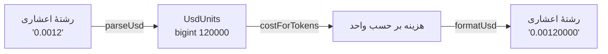

از `parseUsd`، `formatUsd`، `costForTokens`، `sumUsd` و `percentOf` در `packages/shared/src/money.ts` استفاده کنید.

## 12. خطاها و کاتالوگ خطا

خطاها کد پایدار DiRouter و همان قالب API ورودی (OpenAI یا Anthropic) را دارند.

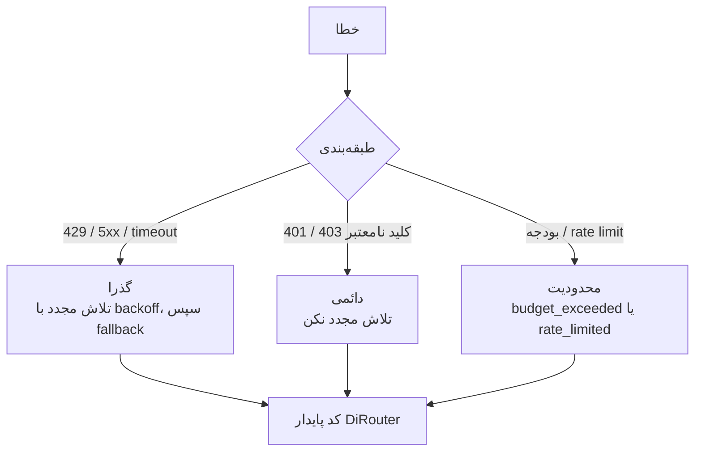

هنگام افزودن مسیر خطای جدید:

1. اگر یکی از `ERROR_CODES` مناسب است، همان را استفاده کنید.
2. در غیر این صورت کد جدید اضافه کنید. کد موجود را برای معنای دیگری استفاده نکنید.
3. تستی بنویسید که HTTP status و کد را بررسی کند.
4. کد را در [docs/concepts/errors.md](docs/concepts/errors.md) مستند کنید.

## 13. تست

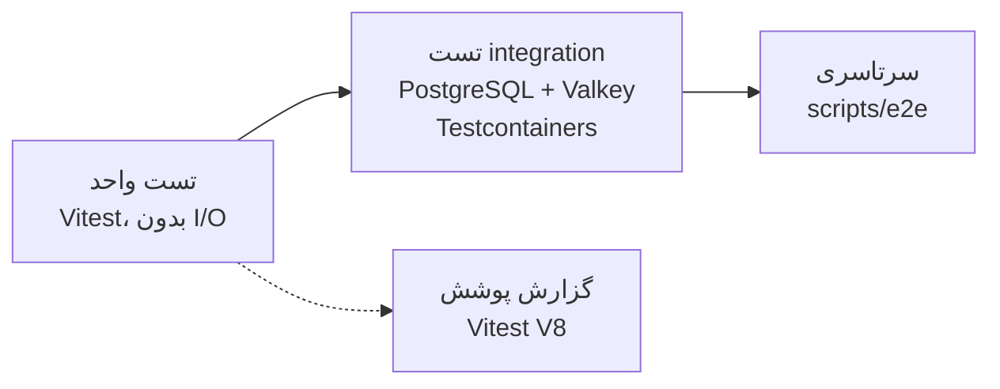

| سطح         | دستور                   | محدوده                                     |
| ----------- | ----------------------- | ------------------------------------------ |
| واحد        | `pnpm test`             | منطق خالص هر پکیج یا اپ. سریع و بدون شبکه. |
| integration | `pnpm test:integration` | کانتینرهای واقعی PostgreSQL و Valkey.      |
| سرتاسری     | `pnpm test:e2e`         | جریان کامل روی stack در حال اجرا.          |
| benchmark   | `scripts/bench`         | سربار gateway و سناریوهای k6.              |

راهنما:

- رفتار را تست کنید، نه جزئیات پیاده‌سازی.
- هر رفع باگ باید تست regression داشته باشد.
- به زمان دیواری وابسته نباشید. در کدی که timeout دارد از fake timer استفاده کنید.
- مسیر hot gateway نباید تماس دیتابیس اضافه کند. تست‌های integration این مرز را پوشش می‌دهند.

## 14. متغیرهای محیطی

- هر متغیر با یک schema در یکی از فایل‌های `packages/shared/src/env.ts`، `apps/gateway/src/main.ts`، `apps/control-api/src/env.ts`، `apps/worker/src/env.ts` یا `apps/mock-provider/src/main.ts` اعتبارسنجی می‌شود.
- هر متغیری که در source خوانده می‌شود باید در [docs/env-reference.md](docs/env-reference.md) باشد. اسکریپت `scripts/ci/check-env-docs.mjs` وقتی متغیر مستندنشده یا مستندی بدون خواندن در کد باشد شکست می‌خورد.
- هرگز راز را commit نکنید. `.env` در git نادیده گرفته می‌شود؛ `.env.example` فقط placeholder دارد.
- هنگام افزودن متغیر، `.env.example` را در همان تغییر به‌روز کنید.

<a id="documentation-policy-fa"></a>

## سیاست مستندات

همهٔ مستندات این مخزن دوزبانه‌اند. هر فایل Markdown نسخه‌دار یک بخش انگلیسی و یک بخش فارسی دارد که از لینک‌های بالای صفحه انتخاب می‌شوند.

| مکان                         | محتوای زبانی                                 |
| ---------------------------- | -------------------------------------------- |
| فایل‌های Markdown ریشه       | انگلیسی و فارسی در یک فایل                   |
| `adr/`                       | انگلیسی و فارسی در هر ADR                    |
| `docs/`                      | راهنماهای تفصیلی، انگلیسی و فارسی در هر فایل |
| کامنت‌های کد                 | فقط انگلیسی                                  |
| رابط کاربری و پیام‌های محصول | فارسی و انگلیسی، طبق نیاز محصول              |

قواعد:

1. بخش انگلیسی و بخش فارسی را در یک تغییر بنویسید. تغییری که فقط یک زبان را به‌روز کند ناقص است.
2. دو بخش را هم‌راستا نگه دارید: عنوان‌ها، دستورها، جدول‌ها و نمودارها یکسان باشند.
3. شناسه‌های فنی را در هر دو بخش دقیقاً همان‌طور بنویسید: مسیر فایل، دستور، نام متغیر محیطی، کلید JSON و کد خطا.
4. بخش فارسی از فارسی رسمی و فنی استفاده می‌کند و اصطلاحات رایج را با حروف لاتین نگه می‌دارد (Gateway، Provider، snapshot).
5. پژوهش رقبا، برنامهٔ sprint، خروجی board، اسکریپت‌های تولیدکننده و یادداشت‌های تأیید محلی نباید در مخزن باشند.

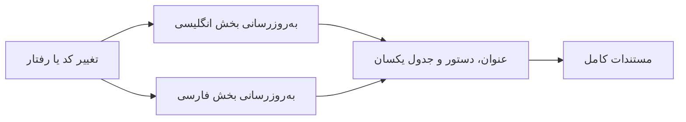

## 15. بازبینی pull request

بازبین‌ها به ترتیب زیر بررسی می‌کنند:

1. **درستی:** رفتار با کارت هم‌خوان است و تست‌ها آن را ثابت می‌کنند.
2. **مرزها:** جهت وابستگی و قانون استقلال data plane رعایت شده است.
3. **پول و محدودیت‌ها:** پول عدد اعشاری شناور ندارد و محدودیت‌ها و بودجه‌ها به‌صورت ایمن شکست می‌خورند.
4. **خطاها:** کدها پایدار و مستندشده‌اند.
5. **مشاهده‌پذیری:** logها از `createLogger` استفاده می‌کنند، رازها را پنهان می‌کنند و metricها در صورت نیاز به‌روز شده‌اند.
6. **مستندات:** هر دو بخش زبانی به‌روز شده‌اند و مستندات env با کد هم‌خوان است.

## 16. قوانین معماری که نباید شکسته شوند

| قانون                                                                    | دلیل                                                                                            |
| ------------------------------------------------------------------------ | ----------------------------------------------------------------------------------------------- |
| مسیر hot gateway هیچ وابستگی به دیتابیس ندارد.                           | صفحهٔ داده با آخرین snapshot معتبر کار می‌کند ([ADR-006](adr/0006-data-plane-independence.md)). |
| رمزهای provider در snapshot به‌صورت ciphertext AES-256-GCM هستند.        | gateway فقط در حافظه و با `MASTER_KEY` رمزگشایی می‌کند.                                         |
| fallback برای stream فقط قبل از رسیدن اولین بایت به کلاینت انجام می‌شود. | کلاینت هرگز نباید پاسخ ناقص از دو provider دریافت کند.                                          |
| انتشار usage غیرهمزمان است.                                              | پاسخ به کلاینت هرگز منتظر ماندگاری نمی‌ماند.                                                    |
| نوشتن ledger از کلید idempotency استفاده می‌کند.                         | تلاش مجدد صف و replay outbox نباید دو بار شارژ کنند.                                            |
| `contracts` هیچ وابستگی داخلی به پکیج دیگر ندارد.                        | لایهٔ schema پایدار و قابل استفاده مجدد می‌ماند.                                                |

## 17. چک‌لیست بازبینی

این متن را در توضیحات pull request بیاورید و هر مورد را علامت بزنید.

- [ ] شناسهٔ کارت (`DR-n`) در نام شاخه و footer commit آمده است.
- [ ] `pnpm lint`، `pnpm typecheck`، `pnpm test` و `pnpm build` به‌صورت محلی موفق‌اند.
- [ ] رفتار جدید تست دارد؛ رفع باگ تست regression دارد.
- [ ] `console.*` وجود ندارد؛ logها از `createLogger` عبور می‌کنند.
- [ ] پول با عدد اعشاری شناور محاسبه نشده است.
- [ ] schemaهای مشترک فقط در `@dirouter/contracts` تعریف شده‌اند.
- [ ] کدهای خطا پایدارند؛ کد جدید مستند شده است.
- [ ] متغیرهای محیطی در `.env.example` و `docs/env-reference.md` هستند.
- [ ] کامنت‌های کد انگلیسی‌اند.
- [ ] هر دو بخش انگلیسی و فارسی مستندات به‌روز شده‌اند.
- [ ] migrationها افزایشی هستند یا برنامهٔ rollback دارند.

## 18. عیب‌یابی

| علامت                                           | علت                                       | راه‌حل                                                                   |
| ----------------------------------------------- | ----------------------------------------- | ------------------------------------------------------------------------ |
| عدم تطابق نسخهٔ `pnpm`                          | Corepack فعال نیست                        | `corepack enable` را اجرا کنید و سپس `pnpm install` بزنید.               |
| رد commit با `scope-enum`                       | scope در فهرست مجاز نیست                  | scope مجاز از [بخش ۷](#7-پیام‌های-commit) را بزنید یا scope را حذف کنید. |
| رد commit با `type-enum`                        | type پشتیبانی نمی‌شود                     | یکی از typeهای مجاز را استفاده کنید.                                     |
| `pre-commit` خطای ESLint گزارش می‌دهد           | قاعده به‌صورت خودکار اصلاح نمی‌شود        | خطوط گزارش‌شده را اصلاح کنید و دوباره stage کنید.                        |
| `check-env-docs` در CI شکست می‌خورد             | متغیر بدون مستندسازی اضافه یا حذف شده است | `docs/env-reference.md` را در همان تغییر به‌روز کنید.                    |
| Turbo برای تغییر فقط مستندات کاری انجام نمی‌دهد | مستندات بخشی از build اپ‌ها نیستند        | رفتار مورد انتظار است؛ CI وظیفهٔ اپ انتخاب نمی‌کند.                      |
| تست‌های integration کانتینر نمی‌سازند           | Docker اجرا نیست                          | Docker Desktop یا daemon را راه‌اندازی کنید.                             |
