[English](CONTRIBUTING.md) · [فارسی](CONTRIBUTING.fa.md)

<p align="center">
  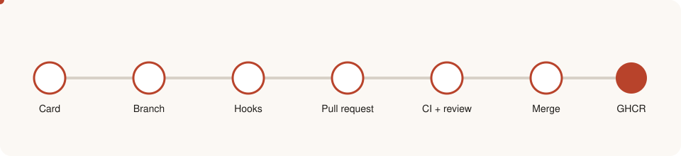
</p>

# Contributing to DiRouter

This guide explains how to set up a development environment, write code that matches the repository, commit changes, open a pull request, and pass review. It is the single source of truth for contributor rules. Architecture decisions live in the [ADRs](adr/README.md), domain terms in the [glossary](GLOSSARY.md), and the CI pipeline in [CI.md](CI.md).

> **Important:** every change must keep code, comments, and documentation consistent. Documentation is bilingual: each document exists as an English `.md` file and a Persian `.fa.md` file; see [Documentation policy](#documentation-policy).

## Contents

1. [Contribution lifecycle](#1-contribution-lifecycle)
2. [Repository map](#2-repository-map)
3. [Development environment](#3-development-environment)
4. [Daily workflow](#4-daily-workflow)
5. [Code quality tools](#5-code-quality-tools)
6. [Git hooks](#6-git-hooks)
7. [Commit messages](#7-commit-messages)
8. [Branches and pull requests](#8-branches-and-pull-requests)
9. [Code conventions](#9-code-conventions)
10. [Comments and naming](#10-comments-and-naming)
11. [Money and monetary values](#11-money-and-monetary-values)
12. [Errors and the error catalog](#12-errors-and-the-error-catalog)
13. [Testing](#13-testing)
14. [Environment variables](#14-environment-variables)
15. [Pull request description and review](#15-pull-request-description-and-review)
16. [Architecture rules you must not break](#16-architecture-rules-you-must-not-break)
17. [Review checklist](#17-review-checklist)
18. [Troubleshooting](#18-troubleshooting)
19. [Documentation policy](#documentation-policy)

---

## 1. Contribution lifecycle

Every change moves through the same stages. Automation (Husky, lint-staged, commitlint, and GitHub Actions) enforces most of them, but the author remains responsible for the design and the description.

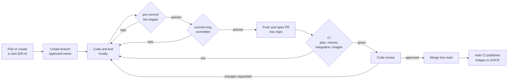

| Stage  | Who acts  | Tool or artifact             | Gate                                            |
| ------ | --------- | ---------------------------- | ----------------------------------------------- |
| Plan   | Author    | Card `DR-n`, branch name     | Scope agreed in the card                        |
| Write  | Author    | Editor with `.editorconfig`  | Local tests pass                                |
| Commit | Git hooks | `lint-staged`, `commitlint`  | Format, lint, commit message                    |
| Review | Reviewer  | Pull request                 | Checklist in [section 17](#17-review-checklist) |
| Verify | GitHub    | `.github/workflows/ci.yml`   | All required jobs green                         |
| Ship   | Pipeline  | GHCR images on `main` or tag | Only for trusted pushes                         |

## 2. Repository map

The monorepo uses pnpm workspaces and Turborepo. Applications (`apps/*`) may depend on packages (`packages/*`); packages never depend on applications.

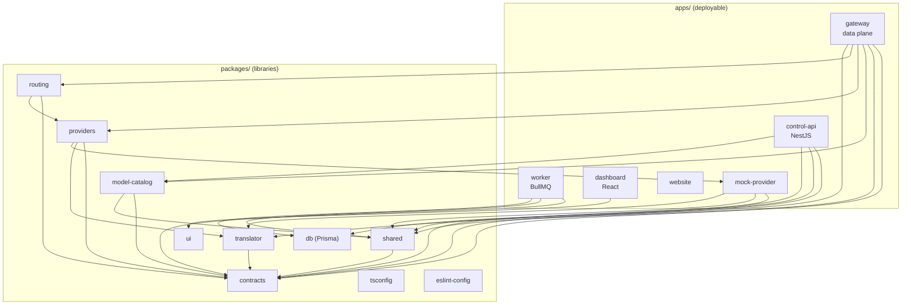

| Path                     | Purpose                                                            |
| ------------------------ | ------------------------------------------------------------------ |
| `apps/gateway`           | Data plane. Serves OpenAI and Anthropic compatible endpoints.      |
| `apps/control-api`       | Administration API, authentication, RBAC, snapshot publication.    |
| `apps/worker`            | Consumes usage events, writes ledger and logs, reconciles budgets. |
| `apps/dashboard`         | Persian RTL administrative interface (React + Vite).               |
| `apps/website`           | Public Persian site and routing demo.                              |
| `apps/mock-provider`     | Synthetic upstream with injected errors for development and tests. |
| `packages/contracts`     | Zod schemas, canonical model, snapshot, usage event, error codes.  |
| `packages/shared`        | Logger, errors, env validation, crypto, ULID, HMAC, money helpers. |
| `packages/db`            | Prisma schema, migrations, and generated client.                   |
| `packages/model-catalog` | Model prices and capabilities.                                     |
| `packages/translator`    | Request, response, and stream translation between API formats.     |
| `packages/providers`     | Provider adapters and error classification.                        |
| `packages/routing`       | Router, executor, health, bulkhead.                                |
| `packages/ui`            | Shared React components.                                           |
| `packages/tsconfig`      | Shared TypeScript configurations.                                  |
| `packages/eslint-config` | Shared ESLint configurations.                                      |
| `deploy/`                | Dockerfiles, Traefik, Prometheus, Grafana, nginx templates.        |
| `scripts/`               | CI planning, integration runner, benchmarks, development helpers.  |
| `adr/`                   | Architecture Decision Records.                                     |

## 3. Development environment

### Requirements

| Tool     | Version                 | Why                                              |
| -------- | ----------------------- | ------------------------------------------------ |
| Node.js  | 22 LTS (`>=22.12 <23`)  | `engines` in `package.json` and `.nvmrc` (22)    |
| pnpm     | 10.x (pinned `10.13.1`) | `packageManager` field, workspace protocol       |
| Corepack | Bundled with Node       | Reads the pinned pnpm version automatically      |
| Docker   | Engine + Compose        | Local PostgreSQL, Valkey, Traefik, and the stack |
| Git      | Any recent version      | Hooks and version control                        |

### First-time setup

```bash
corepack enable          # activates the pinned pnpm
pnpm install             # installs dependencies and registers Husky hooks (prepare script)
pnpm build               # builds packages in dependency order
pnpm test                # runs the unit tests
```

`pnpm install` runs the `prepare` script, which installs Husky. Hooks are therefore active from the first install; you do not need a separate command.

### Running the stack

```bash
./scripts/bootstrap.sh                                            # creates .env with random secrets (chmod 600)
docker compose -f compose.yaml -f compose.dev.yaml up -d --build --wait
make seed                                                         # development data and a dev key
```

Development URLs are routed by Traefik on `*.localhost`. See [README.md](README.md) for the full list.

## 4. Daily workflow

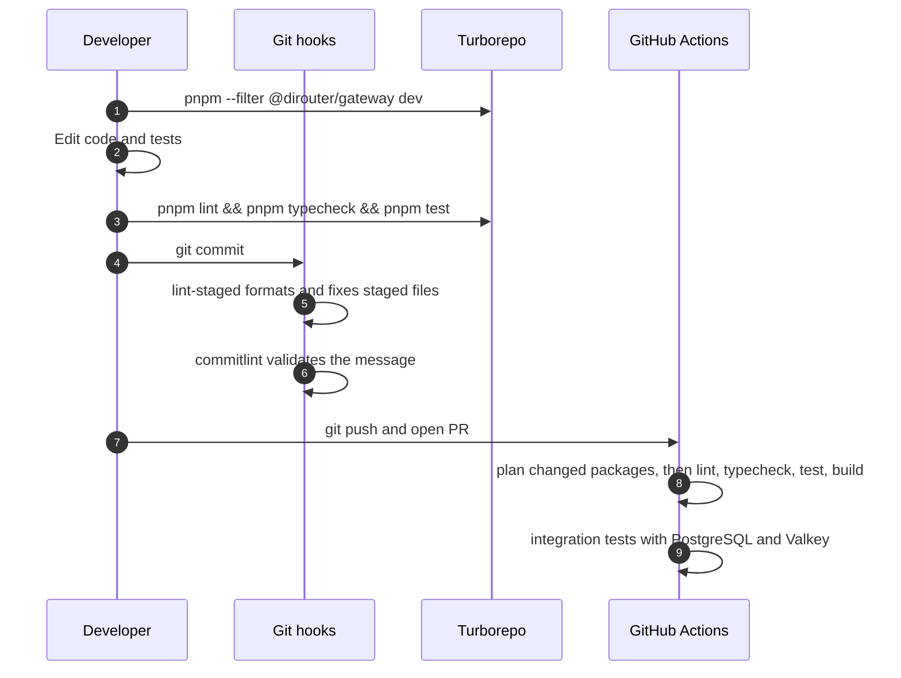

Useful commands:

| Command                               | Effect                                              |
| ------------------------------------- | --------------------------------------------------- |
| `pnpm --filter @dirouter/gateway dev` | Runs only the gateway in watch mode.                |
| `pnpm --filter @dirouter/shared test` | Runs the tests of one package.                      |
| `pnpm -r exec vitest run <file>`      | Runs a single test file across the workspace.       |
| `pnpm format` / `pnpm format:check`   | Writes or checks Prettier formatting.               |
| `pnpm test:integration`               | Starts disposable PostgreSQL and Valkey containers. |
| `make lint`                           | Lint, typecheck, and format check in one command.   |

## 5. Code quality tools

| Tool                                    | Configuration            | Command                             |
| --------------------------------------- | ------------------------ | ----------------------------------- |
| TypeScript (strict)                     | `packages/tsconfig`      | `pnpm typecheck`                    |
| ESLint (flat, type-aware configuration) | `packages/eslint-config` | `pnpm lint`                         |
| Prettier                                | `.prettierrc.json`       | `pnpm format` / `pnpm format:check` |
| EditorConfig                            | `.editorconfig`          | Applied by supporting editors       |

Key settings from `.prettierrc.json`: single quotes, trailing commas (`all`), print width `100`, semicolons, arrow parentheses always, and LF line endings.

Rules that every package follows:

- Each application and package has an `eslint.config.js` that imports the `node` or `react` configuration from `@dirouter/eslint-config`.
- `console.*` is prohibited. Use `createLogger` from `@dirouter/shared`.
- Use explicit type imports (`import { type X }`); `verbatimModuleSyntax` is enabled.
- Strict TypeScript is required. Avoid `any`; prefer `unknown` and narrow it.

## 6. Git hooks

Hooks are stored in `.husky/` and registered by `pnpm install`.

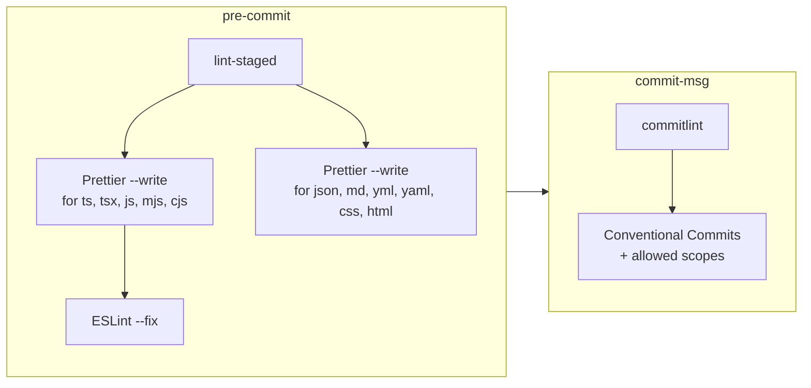

| Hook         | Runs                               | When it fails                                             |
| ------------ | ---------------------------------- | --------------------------------------------------------- |
| `pre-commit` | `pnpm exec lint-staged`            | Lint errors that ESLint cannot auto-fix block the commit. |
| `commit-msg` | `pnpm exec commitlint --edit "$1"` | Invalid type, unknown scope, or missing subject.          |

Do not bypass hooks with `--no-verify`. CI runs the same checks, so a bypassed commit only fails later.

## 7. Commit messages

Commits follow [Conventional Commits](https://www.conventionalcommits.org/):

```text
<type>(<scope>): <subject>

[body]

[footer]
```

Allowed types: `feat`, `fix`, `docs`, `style`, `refactor`, `perf`, `test`, `build`, `ci`, `chore`, `revert`.

The scope is optional. When supplied, it must be one of the values defined in `commitlint.config.js`:

| Scope           | Use it for               |
| --------------- | ------------------------ |
| `gateway`       | `apps/gateway`           |
| `control-api`   | `apps/control-api`       |
| `worker`        | `apps/worker`            |
| `dashboard`     | `apps/dashboard`         |
| `mock-provider` | `apps/mock-provider`     |
| `contracts`     | `packages/contracts`     |
| `shared`        | `packages/shared`        |
| `db`            | `packages/db`            |
| `model-catalog` | `packages/model-catalog` |
| `ui`            | `packages/ui`            |
| `tsconfig`      | `packages/tsconfig`      |
| `eslint-config` | `packages/eslint-config` |
| `deploy`        | `deploy/`, Compose files |
| `docs`          | Documentation only       |
| `ci`            | `.github/`, `scripts/ci` |
| `deps`          | Dependency updates       |
| `repo`          | Root configuration       |

Examples:

```text
feat(gateway): add circuit breaker per provider
fix(shared): redact x-api-key header in logs
docs(gateway): document timeout settings
```

Mark a breaking change with `!` after the type or scope, or with a `BREAKING CHANGE:` footer:

```text
feat(contracts)!: rename ConfigSnapshot.version to revision

BREAKING CHANGE: gateways older than 1.4 reject snapshots that use the new field.
Refs: DR-42
```

Include the DiTask card reference in the footer, for example `Refs: DR-12`.

## 8. Branches and pull requests

- The default branch is `main`.
- Name branches `<type>/<card>-<short-name>`, for example `feat/4.1-gateway-skeleton`.
- Open a pull request against `main`. CI runs on every pull request to `main`.
- Merge only after CI and code review pass.

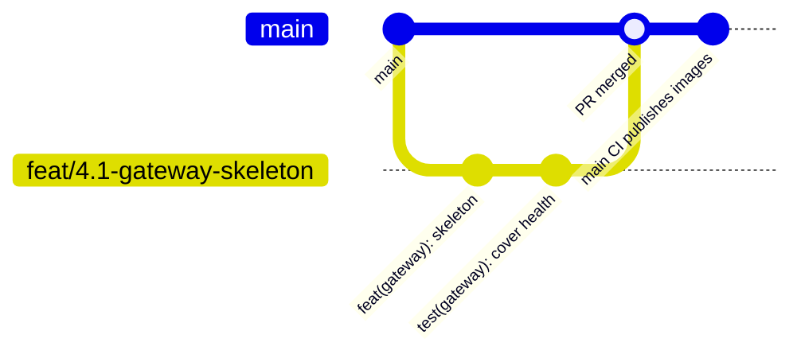

Pull request description checklist:

- What changed and why, linked to the card (`DR-n`).
- Risk: which runtime path (hot path, control plane, persistence) is affected.
- Tests added or updated, and how you verified them.
- Configuration, environment variable, or migration changes, with links to the documentation you updated.
- Screenshots for dashboard changes (Persian and English text, RTL layout).

## 9. Code conventions

- Modules use ESM (`"type": "module"`). Relative imports include the `.js` extension, for example `import { x } from './router.js'`.
- Define shared schemas and types only in `@dirouter/contracts`. Do not duplicate them in applications.
- Error codes are stable. You may add codes; you must not remove a code or change its meaning. See `ERROR_CODES` in `packages/contracts`.
- Store monetary values as USD decimal strings at API boundaries and as `Decimal(18,8)` in PostgreSQL.
- Use the BigInt fixed-point helpers from `@dirouter/shared` for money arithmetic. Never use floating-point numbers for money.

### Dependency direction

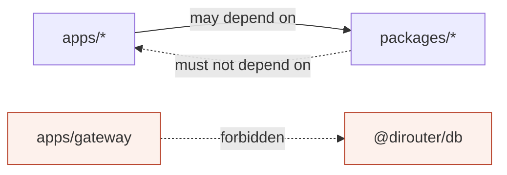

The gateway must not depend on `@dirouter/db`. This is the code-level enforcement of [ADR-006](adr/0006-data-plane-independence.md).

## 10. Comments and naming

- Write code comments in English.
- Comment the **why**, not the **what**. Names should explain the what.
- Keep comments short and close to the code they describe. Remove a comment when the code changes and the comment no longer applies.
- Do not leave commented-out code in the repository.
- Use `TODO(DR-n):` with a card reference for planned work. Plain `TODO` without a reference is not accepted in review.

## 11. Money and monetary values

Money is the most sensitive area of the system. Rounding errors can overcharge customers or leak budget.

| Representation        | Where                     | Rule                                                      |
| --------------------- | ------------------------- | --------------------------------------------------------- |
| USD decimal string    | API boundaries, contracts | Up to eight fractional digits, for example `"0.00123400"` |
| `UsdUnits` (`bigint`) | In-process arithmetic     | `1 USD = 10^8` internal units                             |
| `Decimal(18,8)`       | PostgreSQL                | Source of truth for the ledger                            |
| Price per million     | Model catalog             | USD per 1,000,000 tokens                                  |

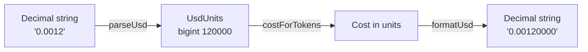

Use `parseUsd`, `formatUsd`, `costForTokens`, `sumUsd`, and `percentOf` from `packages/shared/src/money.ts`.

## 12. Errors and the error catalog

Errors use a stable DiRouter code and the same format as the inbound API (OpenAI or Anthropic).

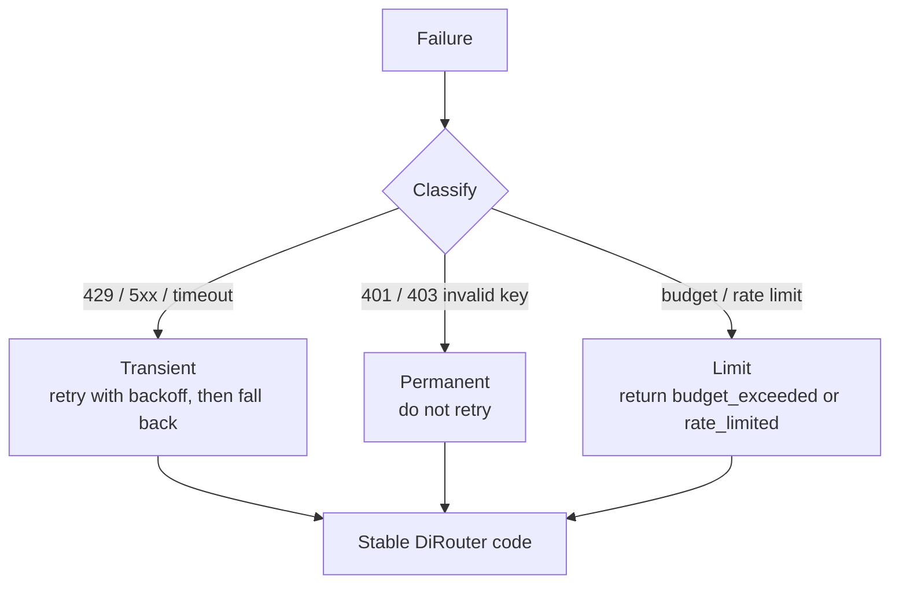

When you add a new failure path:

1. Choose an existing code from `ERROR_CODES` if one fits.
2. Otherwise add a new code. Do not reuse a code for a different meaning.
3. Add a test that asserts the HTTP status and the code.
4. Document the code in [docs/concepts/errors.md](docs/concepts/errors.md).

## 13. Testing

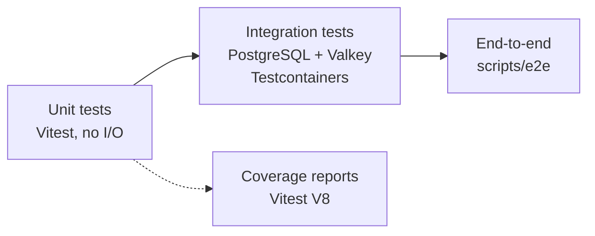

| Level       | Command                 | Scope                                            |
| ----------- | ----------------------- | ------------------------------------------------ |
| Unit        | `pnpm test`             | Pure logic per package or app. Fast, no network. |
| Integration | `pnpm test:integration` | Real PostgreSQL and Valkey containers.           |
| End-to-end  | `pnpm test:e2e`         | Full flow through the running stack.             |
| Benchmarks  | `scripts/bench`         | Gateway overhead and k6 scenarios.               |

Guidelines:

- Test behavior, not implementation details.
- Every bug fix includes a regression test.
- Do not depend on wall-clock time. Use fake timers where the code uses timeouts.
- The gateway hot path must not gain a database call. Integration tests cover this boundary.

## 14. Environment variables

- Each variable is validated by a schema in one of these files: `packages/shared/src/env.ts`, `apps/gateway/src/main.ts`, `apps/control-api/src/env.ts`, `apps/worker/src/env.ts`, or `apps/mock-provider/src/main.ts`.
- Every variable read in source must appear in [docs/env-reference.md](docs/env-reference.md). The check `scripts/ci/check-env-docs.mjs` fails when a variable is undocumented or when the documentation lists a variable that the source no longer reads.
- Never commit secrets. `.env` is git-ignored; `.env.example` contains placeholders only.
- Update `.env.example` in the same change when you add a variable.

<a id="documentation-policy"></a>

## Documentation policy

Every document exists in two separate files: an English file and a Persian file whose name ends in `.fa.md`. The language links at the top of each file switch between them.

| English file      | Persian file         |
| ----------------- | -------------------- |
| `README.md`       | `README.fa.md`       |
| `docs/runbook.md` | `docs/runbook.fa.md` |
| `adr/0001-*.md`   | `adr/0001-*.fa.md`   |

| Location                | Language content                                |
| ----------------------- | ----------------------------------------------- |
| Root Markdown files     | Separate `.md` and `.fa.md` files               |
| `adr/`                  | Separate `.md` and `.fa.md` files per record    |
| `docs/`                 | Separate `.md` and `.fa.md` files per guide     |
| Code comments           | English only                                    |
| Product UI and messages | Persian and English, as required by the product |

Rules:

1. Update the English file and the Persian file in the same change. A change that updates one language only is incomplete.
2. Keep the pair aligned: the same headings, the same commands, the same tables, and the same diagrams.
3. Keep technical identifiers exactly as written in both files: file paths, commands, environment variable names, JSON keys, and error codes.
4. Persian files use formal technical Persian and keep established technical terms in Latin script (Gateway, Provider, snapshot).
5. Persian files use `.fa.md`; never add a Persian section to the bottom of an English file.
6. When you add a new document, add both files and keep the language links working.
7. Private competitor research, sprint plans, board exports, generator scripts, and local verification notes do not belong in the repository.

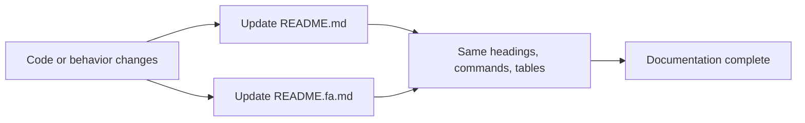

## 15. Pull request description and review

Reviewers check, in this order:

1. **Correctness:** the behavior matches the card and the tests prove it.
2. **Boundaries:** dependency direction and the data-plane independence rule hold.
3. **Money and limits:** no floating-point money; limits and budgets fail safely.
4. **Errors:** codes are stable and documented.
5. **Observability:** logs use `createLogger`, redact secrets, and metrics are updated where relevant.
6. **Documentation:** both language sections are updated; env docs match the source.

## 16. Architecture rules you must not break

| Rule                                                                   | Why                                                                                                     |
| ---------------------------------------------------------------------- | ------------------------------------------------------------------------------------------------------- |
| The gateway hot path has no database dependency.                       | Data plane keeps serving with the last valid snapshot ([ADR-006](adr/0006-data-plane-independence.md)). |
| Provider secrets are AES-256-GCM ciphertext in snapshots.              | Gateway decrypts only in memory with `MASTER_KEY`.                                                      |
| Stream fallback only happens before the first byte reaches the client. | Clients must never receive a partial response from two providers.                                       |
| Usage publication is asynchronous.                                     | The client response never waits for persistence.                                                        |
| Ledger writes use an idempotency key.                                  | Queue retries and outbox replays must not charge twice.                                                 |
| `contracts` has no internal package dependencies.                      | Keeps the schema layer stable and reusable.                                                             |

## 17. Review checklist

Copy this into your pull request description and tick each item.

- [ ] Card reference (`DR-n`) is in the branch name and commit footer.
- [ ] `pnpm lint`, `pnpm typecheck`, `pnpm test`, and `pnpm build` pass locally.
- [ ] New behavior has tests; bug fixes have a regression test.
- [ ] No `console.*`; logs go through `createLogger`.
- [ ] No floating-point money.
- [ ] Shared schemas are defined in `@dirouter/contracts` only.
- [ ] Error codes are stable; new codes are documented.
- [ ] Environment variables are in `.env.example` and `docs/env-reference.md`.
- [ ] Code comments are in English.
- [ ] English `.md` and Persian `.fa.md` documentation files are both updated.
- [ ] Migrations are additive or have a rollback plan.

## 18. Troubleshooting

| Symptom                                     | Cause                                           | Fix                                                          |
| ------------------------------------------- | ----------------------------------------------- | ------------------------------------------------------------ |
| `pnpm` version mismatch                     | Corepack is not enabled                         | Run `corepack enable`, then `pnpm install`.                  |
| Commit rejected with `scope-enum`           | Scope is not in the allowed list                | Use a scope from [section 7](#7-commit-messages) or omit it. |
| Commit rejected with `type-enum`            | Unsupported type                                | Use one of the allowed types.                                |
| `pre-commit` reports ESLint errors          | Rule cannot be auto-fixed                       | Fix the reported lines and stage again.                      |
| `check-env-docs` fails in CI                | Variable added or removed without documentation | Update `docs/env-reference.md` in the same change.           |
| Turbo builds nothing for a docs-only change | Docs are not part of an app build               | Expected; CI selects no application tasks.                   |
| Integration tests cannot start containers   | Docker is not running                           | Start Docker Desktop or the Docker daemon.                   |
