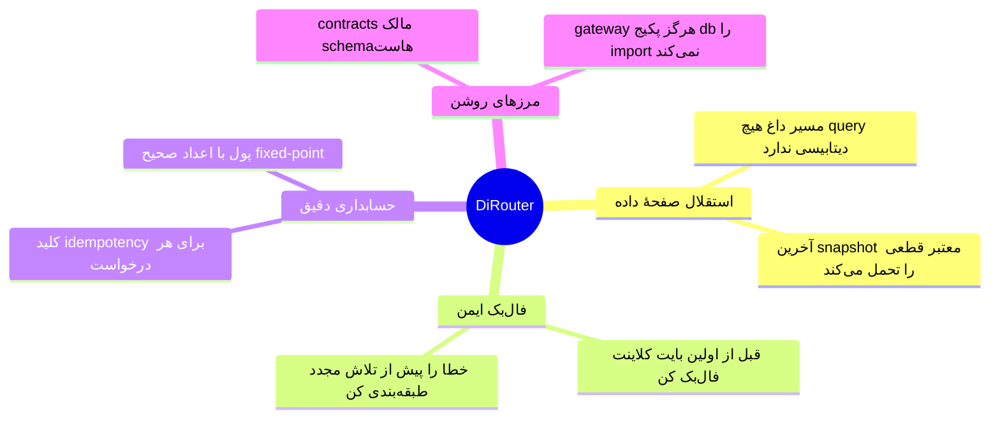
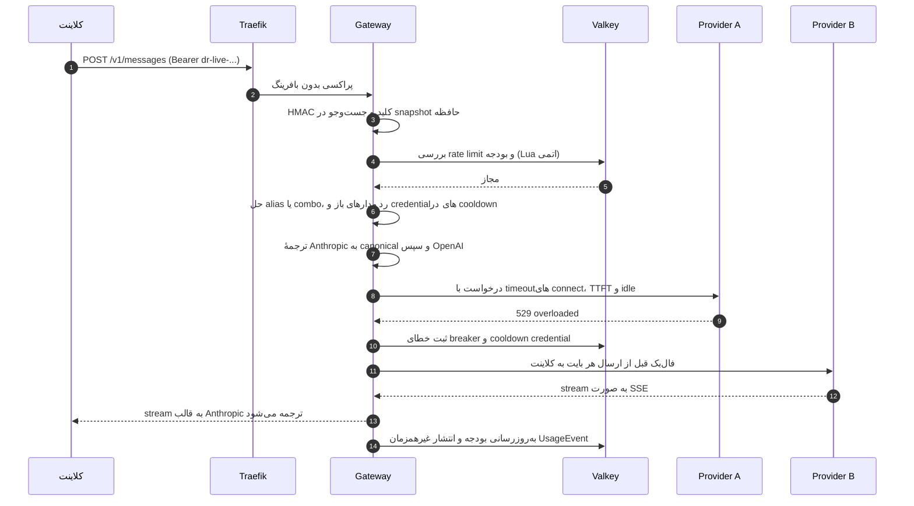
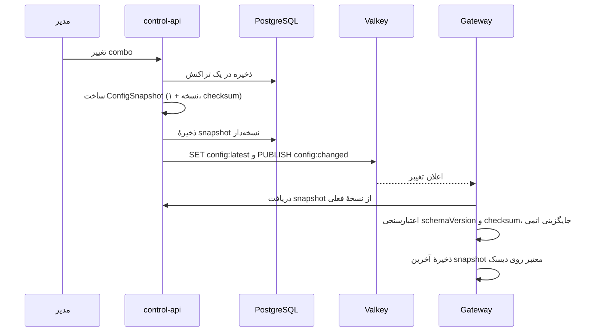
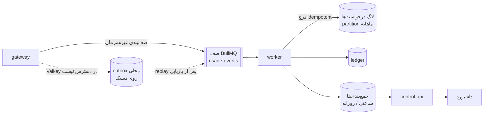
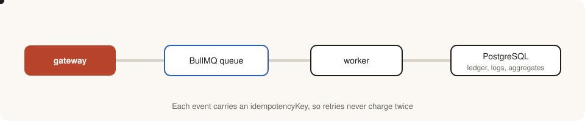
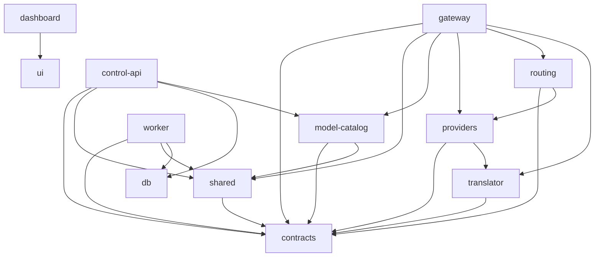
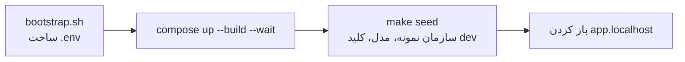
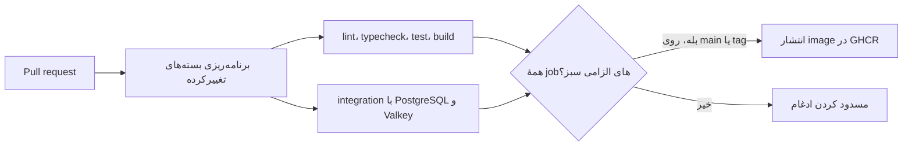

[English](README.fa.md) · [فارسی](README.fa.md)

<div dir="rtl">

# DiRouter

DiRouter یک گیت‌وی تاب‌آور برای مدل‌های زبانی بزرگ (LLM) است. endpointهای سازگار با OpenAI و Anthropic را ارائه می‌کند و امکانات عملیاتی لازم برای ترافیک واقعی را اضافه می‌کند: فال‌بک بین provider و credential، circuit breaker، محدودیت نرخ توزیع‌شده، بودجه و حسابداری مصرف.

## فهرست

- [چرا DiRouter](#چرا-dirouter)
- [اصول بنیادین](#اصول-بنیادین)
- [چرخهٔ عمر درخواست](#چرخهٔ-عمر-درخواست)
- [چرخهٔ عمر پیکربندی](#چرخهٔ-عمر-پیکربندی)
- [مصرف و حسابداری](#مصرف-و-حسابداری)
- [ماتریس تاب‌آوری](#resilience-matrix-fa)
- [اجزا](#اجزا)
- [ساختار مخزن](#ساختار-مخزن)
- [پشتهٔ فناوری](#پشتهٔ-فناوری)
- [شروع سریع با Docker](#شروع-سریع-با-docker)
- [اتصال provider واقعی](#اتصال-provider-واقعی)
- [توسعهٔ مستقیم](#توسعهٔ-مستقیم)
- [دستورها](#دستورها)
- [یکپارچگی مداوم (CI)](#یکپارچگی-مداوم-ci)
- [مستندات و مشارکت](#مستندات-و-مشارکت)

## چرا DiRouter

تیم‌هایی که مستقیم به provider‌های LLM وصل می‌شوند با مشکل‌های تکراری روبه‌رو هستند:

| مشکل                                | بدون DiRouter                                | با DiRouter                                                       |
| ----------------------------------- | -------------------------------------------- | ----------------------------------------------------------------- |
| provider خطای 529 یا 5xx می‌دهد     | برنامه شکست می‌خورد یا خودش تلاش مجدد می‌کند | gateway قبل از رسیدن هر بایت به کلاینت تلاش مجدد و فال‌بک می‌کند  |
| سهمیهٔ یک کلید تمام می‌شود          | درخواست‌ها شکست می‌خورند تا کلید عوض شود     | آن credential خنک می‌شود و credential دیگری ترافیک را پاسخ می‌دهد |
| هزینه‌ها بدون کنترل بالا می‌روند    | هزینه فقط در کنسول provider دیده می‌شود      | بودجه به ازای کلید و پروژه جلوی هزینهٔ اضافه را می‌گیرد           |
| هر SDK قالب متفاوتی دارد            | کد به یک provider وابسته می‌شود              | یک endpoint بین قالب OpenAI و Anthropic ترجمه می‌کند              |
| تغییر پیکربندی نیاز به استقرار دارد | ری‌استارت و انتشارهای پرریسک                 | یک snapshot نسخه‌دار به gatewayهای در حال اجرا ارسال می‌شود       |

## اصول بنیادین



| اصل                        | معنی                                                                  | مرجع                                              |
| -------------------------- | --------------------------------------------------------------------- | ------------------------------------------------- |
| استقلال صفحهٔ داده         | اگر صفحهٔ کنترل قطع باشد، ترافیک موجود ادامه می‌یابد.                 | [ADR-006](adr/0006-data-plane-independence.fa.md) |
| ایمنی fallback برای stream | stream فقط قبل از ارسال اولین بایت provider را عوض می‌کند.            | [معماری](ARCHITECTURE.fa.md)                      |
| حسابداری idempotent        | تلاش مجدد صف و replay از outbox هیچ درخواستی را دوبار شارژ نمی‌کند.   | [مسیر usage](docs/usage-pipeline.fa.md)           |
| پول به‌صورت عدد صحیح       | مبالغ با واحد BigInt (`1 USD = 10^8`) محاسبه می‌شوند، نه اعشار شناور. | [واژه‌نامه](GLOSSARY.fa.md)                       |

## چرخهٔ عمر درخواست

هر درخواست از هشت مرحله عبور می‌کند. gateway همهٔ آن‌ها را بدون پرس‌وجو از PostgreSQL انجام می‌دهد.



نمای متحرک مسیر فال‌بک. بستهٔ قرمز به Provider A می‌رسد و خطا می‌دهد؛ سپس بستهٔ آبی به Provider B می‌رسد.

<p align="center">
  
</p>

| مرحله | نام        | آنچه رخ می‌دهد                                                                                                                                                 |
| ----- | ---------- | -------------------------------------------------------------------------------------------------------------------------------------------------------------- |
| ۱     | ورود       | کلید مجازی را از `Authorization: Bearer` یا `x-api-key` می‌خواند و با HMAC-SHA256 هش می‌کند.                                                                   |
| ۲     | اعتبارسنجی | بدنه را با `@dirouter/contracts` بررسی می‌کند؛ فیلدهای ناشناخته تا جایی که API اجازه دهد نگه داشته می‌شوند.                                                    |
| ۳     | محدودیت‌ها | بررسی RPM، TPM، همزمانی و بودجه برای کلید، پروژه و تیم را با اسکریپت‌های Lua اتمی انجام می‌دهد. اگر Valkey قطع باشد، limiter محلی و `failMode` تصمیم می‌گیرند. |
| ۴     | مسیریابی   | نام را به alias، combo یا مدل تبدیل می‌کند و فهرست مرتب‌شدهٔ هدف‌ها را می‌سازد.                                                                                |
| ۵     | ترجمه      | ابتدا به مدل canonical و سپس به API مقصد تبدیل می‌کند. تعداد مترجم‌ها N + M است، نه N × M.                                                                     |
| ۶     | ارسال      | timeoutهای لایه‌ای، تلاش مجدد با backoff و jitter و فال‌بک به هدف بعدی را اعمال می‌کند.                                                                        |
| ۷     | پاسخ       | پاسخ یا stream را به قالب درخواست‌کننده برمی‌گرداند و کدهای خطای پایدار می‌دهد.                                                                                |
| ۸     | حسابداری   | هزینه را محاسبه می‌کند، شمارنده‌های بودجه را به‌روز می‌کند و `UsageEvent` را بدون انتظار در صف می‌گذارد.                                                       |

اتمام بودجه با `budget_exceeded` و HTTP 429 پاسخ داده می‌شود.

## چرخهٔ عمر پیکربندی

مدیر پیکربندی را در داشبورد تغییر می‌دهد. gatewayها بدون ری‌استارت یک snapshot نسخه‌دار دریافت می‌کنند.



- `ConfigSnapshot` یک `schemaVersion` برای قالب و یک `version` یکنواخت دارد. gateway نسخه‌های قدیمی‌تر و schemaVersion ناشناخته را رد می‌کند.
- رمزهای provider فقط به‌صورت ciphertext با AES-256-GCM منتقل می‌شوند. gateway فقط در حافظه و با `MASTER_KEY` آن‌ها را رمزگشایی می‌کند.
- اگر control-api هنگام راه‌اندازی در دسترس نباشد، gateway با snapshot روی دیسک شروع می‌کند.

## مصرف و حسابداری



<p align="center">
  
</p>

- هر رویداد یک `idempotencyKey` دارد. تلاش مجدد صف و replay از outbox نمی‌توانند یک درخواست را دوبار شارژ کنند؛ نوشتن در دیتابیس با کلید یکتا و `ON CONFLICT ... DO NOTHING` انجام می‌شود.
- Valkey شمارنده‌های زندهٔ بودجه را نگه می‌دارد. PostgreSQL منبع حقیقت حسابداری است و worker به‌صورت دوره‌ای شمارنده‌ها را با آن تطبیق می‌دهد.
- پرس‌وجوهای داشبورد از جدول‌های جمع‌بندی می‌خوانند، نه از لاگ خام.

<a id="resilience-matrix-fa"></a>

## ماتریس تاب‌آوری

| ریسک                                    | پاسخ                                                                          |
| --------------------------------------- | ----------------------------------------------------------------------------- |
| خطای گذرای provider (429، 5xx، timeout) | طبقه‌بندی خطا، تلاش مجدد با backoff و jitter، سپس فال‌بک در combo             |
| قطع کامل provider                       | circuit breaker برای provider و مدل با probeهای نیمه‌باز                      |
| یک credential به سقف خود می‌رسد         | همان credential خنک می‌شود و ترافیک با credential دیگر ادامه می‌یابد          |
| provider کند                            | timeoutهای جدا برای connect، TTFT و idle، و bulkhead همزمانی برای هر provider |
| قطعی control-api یا PostgreSQL          | ادامهٔ کار با snapshotهای حافظه و دیسک                                        |
| قطعی Valkey                             | limiter محلی، `failMode` قابل پیکربندی و outbox محلی usage                    |
| استقرار جدید                            | خاموشی تدریجی: پذیرش درخواست متوقف، streamهای باز تخلیه، سپس خروج             |

## اجزا

| جزء               | مسئولیت‌ها                                                                       | وابستگی‌های سخت زمان اجرا                                      |
| ----------------- | -------------------------------------------------------------------------------- | -------------------------------------------------------------- |
| **Traefik**       | TLS، مسیریابی مسیرها، health check و SSE بدون بافر                               | ندارد                                                          |
| **gateway**       | سازگاری API، مسیریابی، فال‌بک، circuit breaker، محدودیت‌ها، بودجه و انتشار usage | ندارد، وقتی snapshot معتبر موجود باشد؛ Valkey فال‌بک محلی دارد |
| **control-api**   | API مدیریت، احراز هویت داشبورد، RBAC، رمزنگاری credential و انتشار snapshot      | PostgreSQL، Valkey                                             |
| **worker**        | مصرف رویداد usage، نوشتن ledger و لاگ، جدول‌های جمع‌بندی و نگه‌داری partition    | PostgreSQL، Valkey                                             |
| **dashboard**     | رابط مدیریتی فارسی RTL                                                           | control-api                                                    |
| **mock-provider** | upstream ساختگی با خطاهای 429 و 5xx و تأخیر تزریقی برای تست                      | ندارد                                                          |
| **Valkey**        | شمارنده‌ها، وضعیت cooldown و breaker، pub/sub پیکربندی، صف BullMQ                | ندارد                                                          |
| **PostgreSQL 17** | منبع حقیقت پیکربندی، کاربران، ledger و لاگ‌های partitioned درخواست‌ها            | ندارد                                                          |

## ساختار مخزن

```text
code/
├─ apps/
│  ├─ gateway/        صفحهٔ داده برای درخواست‌های LLM؛ بدون وابستگی به PostgreSQL
│  ├─ control-api/    احراز هویت، مدیریت پیکربندی، انتشار snapshot
│  ├─ worker/         مصرف صف usage، جمع‌بندی، نگه‌داری داده و تطبیق بودجه
│  ├─ dashboard/      داشبورد فارسی RTL (React + Vite)
│  ├─ website/        سایت عمومی فارسی و دموی مسیریابی
│  └─ mock-provider/  upstream ساختگی با تزریق خطا برای توسعه و تست
├─ packages/          contracts، shared، db، model-catalog، providers، translator، routing، ui، پیکربندی‌ها
├─ deploy/            imageها، Traefik، Prometheus، Grafana، قالب‌های nginx
├─ scripts/           برنامه‌ریزی CI، اجرای integration، benchmark، ابزارهای توسعه
├─ adr/               Architecture Decision Recordها
└─ docs/              راهنماهای تفصیلی (انگلیسی .md و فارسی .fa.md)
```



اپ‌ها می‌توانند به پکیج‌ها وابسته باشند؛ پکیج‌ها به اپ وابسته نیستند. `contracts` وابستگی داخلی ندارد و gateway نباید به `@dirouter/db` وابسته باشد.

## پشتهٔ فناوری

| لایه                       | انتخاب                                                                      | مرجع                                             |
| -------------------------- | --------------------------------------------------------------------------- | ------------------------------------------------ |
| Gateway                    | NestJS با آداپتر Fastify و مسیر داغ سبک                                     | [ADR-001](adr/0001-gateway-nestjs-fastify.fa.md) |
| control-api و worker       | NestJS                                                                      | [ADR-001](adr/0001-gateway-nestjs-fastify.fa.md) |
| پایگاه داده                | PostgreSQL 17 با Prisma                                                     | [ADR-002](adr/0002-postgresql-prisma.fa.md)      |
| شمارنده‌ها، cache، pub/sub | Valkey                                                                      | [ADR-003](adr/0003-valkey.fa.md)                 |
| پراکسی معکوس               | Traefik v3                                                                  | [ADR-004](adr/0004-traefik-reverse-proxy.fa.md)  |
| صف رویدادها                | BullMQ روی Valkey                                                           | [ADR-005](adr/0005-bullmq-event-queue.fa.md)     |
| داشبورد                    | React، Vite، TypeScript، TanStack Router و Query، shadcn/ui، Tailwind (RTL) | —                                                |
| schemaها                   | Zod در `@dirouter/contracts` با خروجی JSON Schema                           | —                                                |
| مونorepo                   | pnpm workspaces، Turborepo، TypeScript strict، ESM                          | —                                                |
| استقرار                    | Docker و Docker Compose (توسعه، production، HA)                             | —                                                |

## شروع سریع با Docker

**زمان تقریبی:** چند دقیقه، بسته به دانلود image و اولین build. این مسیر با provider ساختگی اجرا می‌شود و برای production نیست.

پیش‌نیازها: Docker Engine با Docker Compose، `curl` و OpenSSL. پورت‌های 80 و 443 باید آزاد باشند.



```bash
cd code
./scripts/bootstrap.sh
docker compose -f compose.yaml -f compose.dev.yaml up -d --build --wait
make seed
```

`bootstrap.sh` فایل `.env` را با رازهای تصادفی و مجوز 600 می‌سازد. اگر `.env` وجود داشته باشد بازنویسی نمی‌شود؛ روی نصب موجود از `--force` استفاده نکنید. `make seed` سازمان، مدل‌ها، alias و کلیدهای **توسعه** می‌سازد و providerها را به mock وصل می‌کند.

| سرویس             | آدرس                           |
| ----------------- | ------------------------------ |
| داشبورد           | http://app.localhost           |
| سلامت Gateway     | http://api.localhost/healthz   |
| سلامت Control API | http://admin.localhost/healthz |
| ایمیل توسعه       | http://localhost:58025         |

ورود اختیاری به داشبورد: ایمیل `admin@dirouter.local` و رمز تولیدشده در `.data/seed-admin.env` (فایل محلی، git-ignored و با مجوز 600).

### اولین درخواست

کلید زیر کلید ثابت **mock توسعه** است. در production کلید یک‌بارنمایش خودتان را بسازید.

```bash
export DIROUTER_KEY='dr-dev-local-0000000000000000'
curl -fsS http://api.localhost/v1/chat/completions \
  -H "Authorization: Bearer $DIROUTER_KEY" \
  -H 'Content-Type: application/json' \
  -d '{
    "model": "gpt-4.1",
    "messages": [{"role":"user","content":"Hello"}]
  }'
```

پاسخ موفق یک Chat Completion از mock است. در داده‌های seed، alias `gpt-4.1` ابتدا `mock/down` و سپس `mock/small` را امتحان می‌کند؛ بنابراین `X-Dirouter-Attempts` ممکن است بیشتر از یک باشد. برای دیدن provider پاسخ‌دهنده:

```bash
curl -sS -D - -o /dev/null http://api.localhost/v1/chat/completions \
  -H "Authorization: Bearer $DIROUTER_KEY" \
  -H 'Content-Type: application/json' \
  -d '{"model":"mock/small","messages":[{"role":"user","content":"Hello"}]}'
# انتظار: HTTP 200 و X-Dirouter-Provider: mock
```

## اتصال provider واقعی

1. وارد داشبورد شوید. در نصب کاملاً خالی، `/setup` سازمان، OWNER، provider اختیاری و اولین کلید را می‌سازد. در محیط seed شده از login استفاده کنید.
2. در **Providerها** نوع و Base URL را انتخاب کنید، credential واقعی را وارد کنید، با **تست** اتصال را بررسی کنید و با **کشف مدل‌ها** مدل‌های upstream را ببینید.
3. در **مدل‌ها و Combo** مدل بسازید یا مدل‌های کشف‌شده را اضافه کنید. قیمت و context را کنترل کنید و در صورت نیاز combo و alias بسازید.
4. در **سازمان** پروژه بسازید. در **کلیدهای مجازی** کلید را به پروژه وصل کنید و مدل‌های مجاز، RPM و TPM، همزمانی، انقضا و بودجه را محدود کنید.
5. کلید کامل فقط یک بار نمایش داده می‌شود. آن را در مدیر راز نگه دارید و در URL، Git یا لاگ قرار ندهید.
6. مدل یا alias و endpoint واقعی (مثلاً `https://api.example.com/v1`) را با همان curl بالا امتحان کنید و `localhost` را با دامنهٔ خود عوض کنید.

جزئیات هر صفحه و سناریوهای «اول اشتراک و بعد API ارزان» و «فال‌بک بین چند credential» در [راهنمای کاربر داشبورد](docs/user-guide/README.fa.md) است.

## توسعهٔ مستقیم

برای hot reload بیرون از Docker به Node.js 22 LTS و pnpm 10 نیاز دارید. PostgreSQL، Valkey و متغیرهای `.env` باید در دسترس باشند؛ برای راه‌اندازی کامل از مسیر Docker بالا استفاده کنید.

```bash
corepack enable   # نسخهٔ pinned pnpm را از packageManager می‌خواند
pnpm install
pnpm build
pnpm dev
```

| اپ            | آدرس پیش‌فرض                           |
| ------------- | -------------------------------------- |
| gateway       | http://localhost:8080/healthz          |
| control-api   | http://localhost:3000/healthz          |
| mock-provider | http://localhost:8090/healthz          |
| dashboard     | http://localhost:5173                  |
| website       | http://localhost:5174                  |
| worker        | بدون HTTP عمومی؛ پردازش صف و نوشتن لاگ |

## دستورها

| دستور                               | کار                                        |
| ----------------------------------- | ------------------------------------------ |
| `pnpm build`                        | build همهٔ اپ‌ها و پکیج‌ها با کش Turborepo |
| `pnpm dev`                          | اجرای اپ‌ها در حالت watch                  |
| `pnpm test`                         | تست‌های Vitest                             |
| `pnpm lint`                         | ESLint روی workspace                       |
| `pnpm typecheck`                    | بررسی TypeScript                           |
| `pnpm format` / `pnpm format:check` | نوشتن یا بررسی قالب‌بندی Prettier          |

برای یک اپ: `pnpm --filter @dirouter/gateway dev`. راهنمای سایت عمومی: [apps/website/README.md](apps/website/README.fa.md).

## یکپارچگی مداوم (CI)

GitHub Actions روی pull requestها و `main` اجرا می‌شود. بسته‌های تغییرکرده و وابسته‌های آن‌ها را برنامه‌ریزی می‌کند و سپس lint، typecheck، تست و build را اجرا می‌کند. تست‌های integration روی کانتینرهای PostgreSQL و Valkey اجرا می‌شوند. پس از موفقیت بررسی‌ها روی `main` یا یک tag نسخه، imageها در GHCR منتشر می‌شوند. جزئیات در [CI.md](CI.fa.md) است.



## مستندات و مشارکت

- [فهرست مستندات](DOCUMENTATION.fa.md) و [راهنمای مشارکت](CONTRIBUTING.fa.md)
- [استقرار production](docs/deploy-production.fa.md)، [مرجع متغیرهای محیطی](docs/env-reference.fa.md) و [Runbook](docs/runbook.fa.md)
- [مشاهده‌پذیری](docs/observability.fa.md)، [مسیر usage](docs/usage-pipeline.fa.md) و [داده‌های seed](docs/seed.fa.md)

همهٔ مستندات این مخزن دوزبانه‌اند. هر سند دو فایل جداست — یک فایل انگلیسی با پسوند `.md` و یک فایل فارسی با پسوند `.fa.md` — و لینک‌های زبان در بالای هر صفحه بین آن‌ها جابه‌جا می‌کنند. [سیاست مستندات](CONTRIBUTING.fa.md#documentation-policy-fa) را ببینید.

</div>
