<p align="center">
  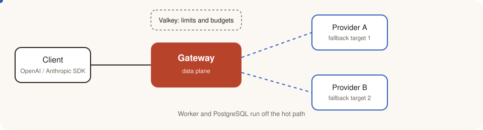
</p>

<p align="center">
  <strong>DiRouter</strong> · LLM gateway for resilient routing, fallback, limits, budgets, and usage accounting<br/>
  <strong>DiRouter</strong> · گیت‌وی LLM برای مسیریابی تاب‌آور، فال‌بک، محدودیت‌ها، بودجه و حسابداری مصرف
</p>

<p align="center">
  <a href="https://dirouter.ir/">
    <picture>
      <source media="(prefers-color-scheme: dark)" srcset="https://dirouter.ir/brand/logo-dark.svg" />
      <source media="(prefers-color-scheme: light)" srcset="https://dirouter.ir/brand/logo.svg" />
      
    </picture>
  </a>
  <br/>
  <strong>Sponsor:</strong> <a href="https://dirouter.ir/">https://dirouter.ir/</a><br/>
  <strong>اسپانسر پروژه:</strong> <a href="https://dirouter.ir/">https://dirouter.ir/</a>
</p>

[English](#english) · [فارسی](#persian)

---

## At a glance / نگاه کلی

DiRouter sits between your applications and many LLM providers. Your code talks to one OpenAI- or Anthropic-compatible endpoint; DiRouter decides which provider and credential serve each request, falls back when something fails, and records what was spent.

DiRouter بین برنامه‌های شما و چند provider مدل زبانی قرار می‌گیرد. کد شما با یک endpoint سازگار با OpenAI یا Anthropic کار می‌کند؛ DiRouter تصمیم می‌گیرد کدام provider و credential هر درخواست را پاسخ دهد، در خطا به مسیر بعدی فال‌بک می‌کند و هزینه را ثبت می‌کند.

### System map / نقشهٔ سامانه

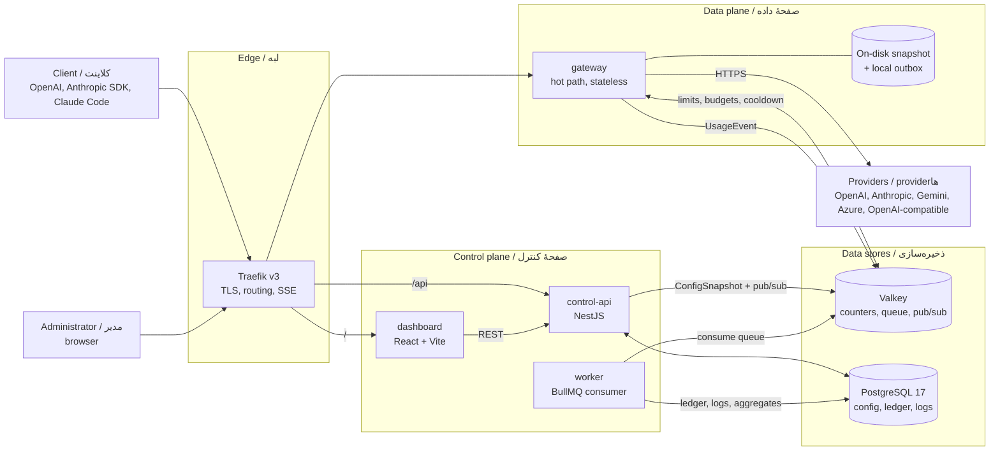

The most important rule is shown by the dotted boundary: **the data plane never depends on the control plane at request time.** If PostgreSQL, control-api, or the worker goes down, traffic keeps flowing with the last valid configuration.

مهم‌ترین قاعده در همین نمودار دیده می‌شود: **صفحهٔ داده در زمان درخواست به صفحهٔ کنترل وابسته نیست.** اگر PostgreSQL، control-api یا worker از کار بیفتند، ترافیک با آخرین پیکربندی معتبر ادامه می‌یابد.

---

<a id="english"></a>

# DiRouter

DiRouter is a resilient gateway for Large Language Models. It exposes OpenAI- and Anthropic-compatible endpoints and adds the operational features production traffic needs: provider and credential fallback, circuit breakers, distributed rate limits, budgets, and usage accounting.

## Contents

- [Why DiRouter](#why-dirouter)
- [Core principles](#core-principles)
- [Request lifecycle](#request-lifecycle)
- [Configuration lifecycle](#configuration-lifecycle)
- [Usage and accounting](#usage-and-accounting)
- [Resilience matrix](#resilience-matrix)
- [Components](#components)
- [Repository layout](#repository-layout)
- [Technology stack](#technology-stack)
- [Quick start with Docker](#quick-start-with-docker)
- [Connecting a real provider](#connecting-a-real-provider)
- [Local development](#local-development)
- [Commands](#commands)
- [Continuous integration](#continuous-integration)
- [Documentation and contributing](#documentation-and-contributing)

## Why DiRouter

Teams that call LLM providers directly face recurring problems:

| Problem                                 | Without DiRouter                              | With DiRouter                                                         |
| --------------------------------------- | --------------------------------------------- | --------------------------------------------------------------------- |
| A provider returns 529 or 5xx           | The application fails or retries by itself    | The gateway retries and falls back before any byte reaches the client |
| One API key reaches its quota           | Requests fail until someone rotates the key   | That credential cools down and another one serves traffic             |
| Costs grow without control              | Spend is visible only in the provider console | Per-key and per-project budgets stop overspending                     |
| Each SDK speaks a different format      | Code is tied to one provider                  | One endpoint translates between OpenAI and Anthropic formats          |
| Configuration changes need a deployment | Restarts and risky rollouts                   | A versioned snapshot is pushed to running gateways                    |

## Core principles

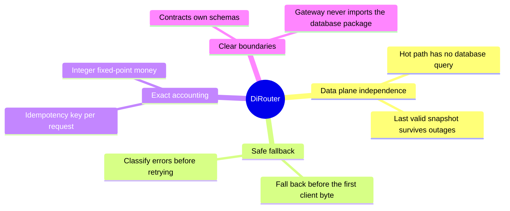

| Principle               | Meaning                                                          | Record                                         |
| ----------------------- | ---------------------------------------------------------------- | ---------------------------------------------- |
| Data plane independence | Existing traffic continues if the control plane is unavailable.  | [ADR-006](adr/0006-data-plane-independence.md) |
| Stream fallback safety  | A stream switches provider only before the first byte is sent.   | [Architecture](ARCHITECTURE.md)                |
| Idempotent accounting   | Queue retries and outbox replays never charge a request twice.   | [Usage pipeline](docs/usage-pipeline.md)       |
| Money as integers       | Amounts use BigInt units (`1 USD = 10^8`), never floating point. | [Glossary](GLOSSARY.md)                        |

## Request lifecycle

A request passes through eight stages. The gateway performs all of them without querying PostgreSQL.

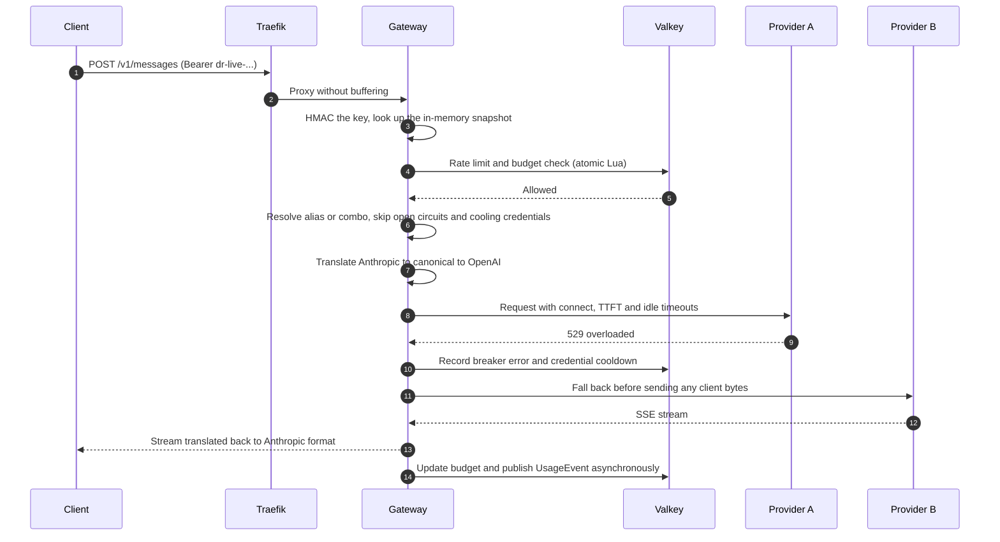

Animated view of the fallback path. The red packet hits Provider A, which fails; the blue packet then reaches Provider B.

<p align="center">
  
</p>

| Stage | Name        | What happens                                                                                                                                             |
| ----- | ----------- | -------------------------------------------------------------------------------------------------------------------------------------------------------- |
| 1     | Ingress     | Reads the virtual key from `Authorization: Bearer` or `x-api-key` and hashes it with HMAC-SHA256.                                                        |
| 2     | Validation  | Validates the body with `@dirouter/contracts`; unknown fields are kept where the API allows.                                                             |
| 3     | Limits      | Applies key, project, and team RPM, TPM, concurrency, and budget checks in atomic Lua scripts. If Valkey is down, a local limiter and `failMode` decide. |
| 4     | Routing     | Resolves the name to an alias, combo, or model, and builds an ordered list of targets.                                                                   |
| 5     | Translation | Converts to the canonical model, then to the upstream API. N + M translators, not N × M.                                                                 |
| 6     | Dispatch    | Applies layered timeouts, retries with jittered backoff, and falls back to the next target.                                                              |
| 7     | Response    | Converts the response or stream back to the caller's format, with stable error codes.                                                                    |
| 8     | Accounting  | Calculates cost, updates budget counters, and enqueues a `UsageEvent` without waiting.                                                                   |

Budget exhaustion returns `budget_exceeded` with HTTP 429.

## Configuration lifecycle

Administrators change configuration in the dashboard. Gateways receive a versioned snapshot without restarting.

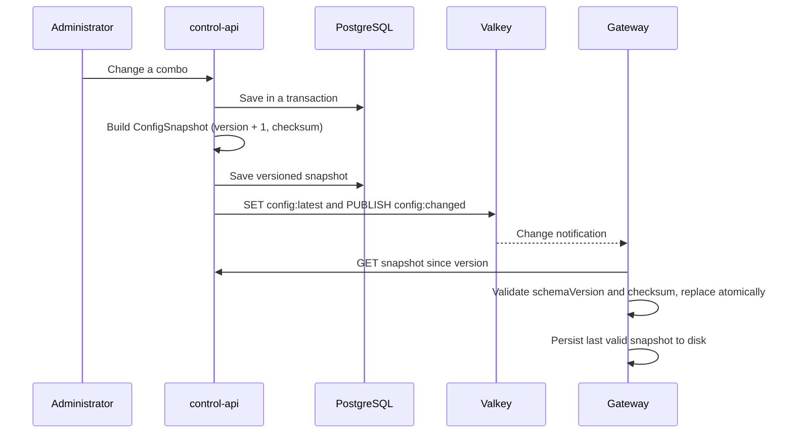

- A `ConfigSnapshot` has a `schemaVersion` for its format and a monotonic `version`. Gateways reject older versions and unknown schema versions.
- Provider secrets appear only as AES-256-GCM ciphertext. The gateway decrypts them in memory with `MASTER_KEY`.
- If control-api is unavailable at startup, the gateway starts from its on-disk snapshot.

## Usage and accounting

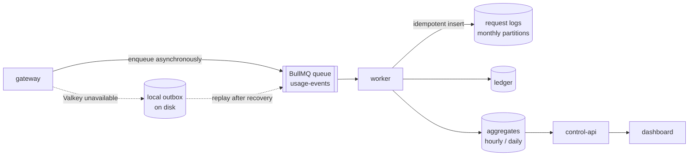

<p align="center">
  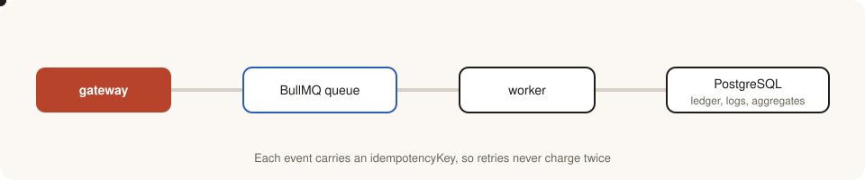
</p>

- Every event carries an `idempotencyKey`. Queue retries and outbox replays cannot charge the same request twice; database writes use a unique key with `ON CONFLICT ... DO NOTHING`.
- Valkey holds live budget counters. PostgreSQL is the accounting source of truth, and the worker periodically reconciles the counters against it.
- Dashboard queries read aggregate tables, not raw logs.

## Resilience matrix

| Risk                                         | Response                                                                            |
| -------------------------------------------- | ----------------------------------------------------------------------------------- |
| Transient provider error (429, 5xx, timeout) | Classify the error, retry with backoff and jitter, then fall back through the combo |
| Complete provider outage                     | Provider and model circuit breakers with half-open probes                           |
| A credential reaches its limit               | Cool that credential down and continue with another                                 |
| Slow provider                                | Separate connect, TTFT, and idle timeouts, plus a per-provider concurrency bulkhead |
| control-api or PostgreSQL outage             | Continue with in-memory and on-disk snapshots                                       |
| Valkey outage                                | Local limiter, configurable `failMode`, local usage outbox                          |
| New deployment                               | Graceful shutdown: stop accepting requests, drain open streams, then exit           |

## Components

| Component         | Responsibilities                                                                                | Hard runtime dependencies                                      |
| ----------------- | ----------------------------------------------------------------------------------------------- | -------------------------------------------------------------- |
| **Traefik**       | TLS, path routing, health checks, unbuffered SSE                                                | None                                                           |
| **gateway**       | API compatibility, routing, fallback, circuit breakers, limits, budgets, usage publication      | None when a valid snapshot exists; Valkey has a local fallback |
| **control-api**   | Administrative API, dashboard authentication, RBAC, credential encryption, snapshot publication | PostgreSQL, Valkey                                             |
| **worker**        | Usage event consumption, ledger and log writes, aggregate tables, partition maintenance         | PostgreSQL, Valkey                                             |
| **dashboard**     | Persian RTL administrative interface                                                            | control-api                                                    |
| **mock-provider** | Synthetic upstream with injected 429 and 5xx responses and delays for tests                     | None                                                           |
| **Valkey**        | Counters, cooldown and breaker state, config pub/sub, BullMQ queue                              | None                                                           |
| **PostgreSQL 17** | Source of truth for configuration, users, the ledger, and partitioned request logs              | None                                                           |

## Repository layout

```text
code/
├─ apps/
│  ├─ gateway/        Data plane for LLM requests; no PostgreSQL dependency
│  ├─ control-api/    Authentication, configuration management, snapshot publication
│  ├─ worker/         Usage queue consumer, aggregation, retention, budget reconciliation
│  ├─ dashboard/      Persian RTL dashboard (React + Vite)
│  ├─ website/        Public Persian site and routing demo
│  └─ mock-provider/  Synthetic upstream with fault injection for development and tests
├─ packages/          contracts, shared, db, model-catalog, providers, translator, routing, ui, configs
├─ deploy/            Images, Traefik, Prometheus, Grafana, nginx templates
├─ scripts/           CI planning, integration runner, benchmarks, dev helpers
├─ adr/               Architecture Decision Records
└─ docs/              Detailed guides (English and Persian)
```

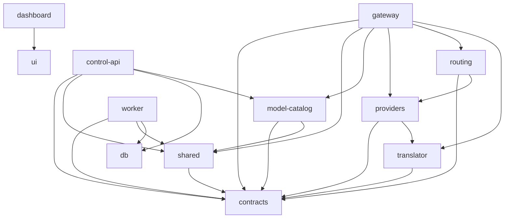

Apps may depend on packages; packages never depend on apps. `contracts` has no internal dependency, and the gateway must not depend on `@dirouter/db`.

## Technology stack

| Layer                    | Choice                                                                        | Record                                        |
| ------------------------ | ----------------------------------------------------------------------------- | --------------------------------------------- |
| Gateway                  | NestJS with the Fastify adapter and a lightweight hot path                    | [ADR-001](adr/0001-gateway-nestjs-fastify.md) |
| control-api and worker   | NestJS                                                                        | [ADR-001](adr/0001-gateway-nestjs-fastify.md) |
| Database                 | PostgreSQL 17 with Prisma                                                     | [ADR-002](adr/0002-postgresql-prisma.md)      |
| Counters, cache, pub/sub | Valkey                                                                        | [ADR-003](adr/0003-valkey.md)                 |
| Reverse proxy            | Traefik v3                                                                    | [ADR-004](adr/0004-traefik-reverse-proxy.md)  |
| Event queue              | BullMQ on Valkey                                                              | [ADR-005](adr/0005-bullmq-event-queue.md)     |
| Dashboard                | React, Vite, TypeScript, TanStack Router and Query, shadcn/ui, Tailwind (RTL) | —                                             |
| Schemas                  | Zod in `@dirouter/contracts`, with JSON Schema export                         | —                                             |
| Monorepo                 | pnpm workspaces, Turborepo, strict TypeScript, ESM                            | —                                             |
| Deployment               | Docker and Docker Compose (development, production, HA)                       | —                                             |

## Quick start with Docker

**Setup time:** a few minutes, depending on image downloads and the first build. This path runs against a mock provider and is not for production.

Requirements: Docker Engine with Docker Compose, `curl`, and OpenSSL. Ports 80 and 443 must be free.

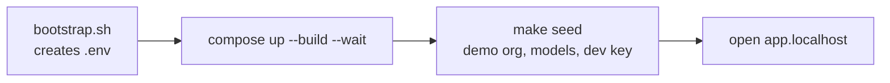

```bash
cd code
./scripts/bootstrap.sh
docker compose -f compose.yaml -f compose.dev.yaml up -d --build --wait
make seed
```

`bootstrap.sh` creates `.env` with random secrets and mode 600. If `.env` exists it is not overwritten, so do not use `--force` on an existing installation. `make seed` creates an organization, models, an alias, and **development** keys, and connects providers to the mock.

| Service            | URL                            |
| ------------------ | ------------------------------ |
| Dashboard          | http://app.localhost           |
| Gateway health     | http://api.localhost/healthz   |
| Control API health | http://admin.localhost/healthz |
| Development email  | http://localhost:58025         |

Optional dashboard login: email `admin@dirouter.local` and the password generated in `.data/seed-admin.env` (a local, git-ignored file with mode 600).

### First request

The key below is the fixed **development mock** key. In production, create your own one-time key.

```bash
export DIROUTER_KEY='dr-dev-local-0000000000000000'
curl -fsS http://api.localhost/v1/chat/completions \
  -H "Authorization: Bearer $DIROUTER_KEY" \
  -H 'Content-Type: application/json' \
  -d '{
    "model": "gpt-4.1",
    "messages": [{"role":"user","content":"Hello"}]
  }'
```

The response is a Chat Completion from the mock. In the seed data, the alias `gpt-4.1` tries `mock/down` first and then falls back to `mock/small`, so `X-Dirouter-Attempts` may be greater than one. To see which provider answered:

```bash
curl -sS -D - -o /dev/null http://api.localhost/v1/chat/completions \
  -H "Authorization: Bearer $DIROUTER_KEY" \
  -H 'Content-Type: application/json' \
  -d '{"model":"mock/small","messages":[{"role":"user","content":"Hello"}]}'
# Expect: HTTP 200 and X-Dirouter-Provider: mock
```

## Connecting a real provider

1. Sign in to the dashboard. On a completely empty installation, `/setup` creates the organization, the OWNER, an optional provider, and the first key. In a seeded environment, use login instead.
2. In **Providers**, choose the type and base URL, enter a real credential, **test** the connection, and run **model discovery**.
3. In **Models and Combos**, create a model or add discovered ones. Check prices and context size, then create combos and aliases as needed.
4. In **Organization**, create a project. In **Virtual keys**, attach the key to the project and limit allowed models, RPM and TPM, concurrency, expiry, and budget.
5. The full key is shown only once. Store it in a secret manager and never put it in a URL, Git, or logs.
6. Test your model or alias and the real endpoint (for example `https://api.example.com/v1`) with the same curl command, replacing `localhost` with your domain.

Details of each page and the scenarios "subscription first, then cheap API" and "fallback across several credentials" are in the [dashboard user guide](docs/user-guide/README.md).

## Local development

For hot reload outside Docker you need Node.js 22 LTS and pnpm 10. PostgreSQL, Valkey, and the `.env` variables must be available; for the complete setup use the Docker path above.

```bash
corepack enable   # reads the pinned pnpm version from packageManager
pnpm install
pnpm build
pnpm dev
```

| App           | Default address                                 |
| ------------- | ----------------------------------------------- |
| gateway       | http://localhost:8080/healthz                   |
| control-api   | http://localhost:3000/healthz                   |
| mock-provider | http://localhost:8090/healthz                   |
| dashboard     | http://localhost:5173                           |
| website       | http://localhost:5174                           |
| worker        | No public HTTP; processes queue and writes logs |

## Commands

| Command                             | Purpose                                              |
| ----------------------------------- | ---------------------------------------------------- |
| `pnpm build`                        | Build all apps and packages with the Turborepo cache |
| `pnpm dev`                          | Run apps in watch mode                               |
| `pnpm test`                         | Vitest tests                                         |
| `pnpm lint`                         | ESLint across the workspace                          |
| `pnpm typecheck`                    | TypeScript checks                                    |
| `pnpm format` / `pnpm format:check` | Prettier write or check                              |

For one app: `pnpm --filter @dirouter/gateway dev`. Website details: [apps/website/README.md](apps/website/README.md).

## Continuous integration

GitHub Actions runs on pull requests and on `main`. It plans the changed packages and their dependents, then runs lint, typecheck, tests, and build. Integration tests run against PostgreSQL and Valkey containers. After checks pass on `main` or a version tag, images are published to GHCR. Details are in [CI.md](CI.md).

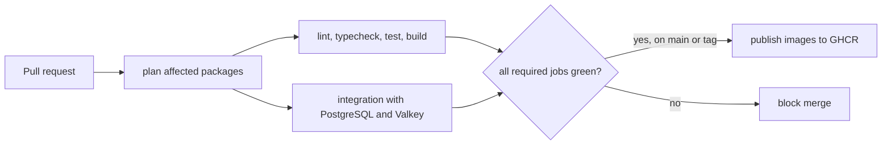

## Documentation and contributing

- [Documentation index](DOCUMENTATION.md) and the [contributing guide](CONTRIBUTING.md)
- [Production deployment](docs/deploy-production.md), [environment reference](docs/env-reference.md), and [runbook](docs/runbook.md)
- [Observability](docs/observability.md), [usage pipeline](docs/usage-pipeline.md), and [seed data](docs/seed.md)

All documentation in this repository is bilingual. Each file has English and Persian sections; the links at the top of every page switch between them.

---

<a id="persian"></a>

# DiRouter

DiRouter یک گیت‌وی تاب‌آور برای مدل‌های زبانی بزرگ (LLM) است. endpointهای سازگار با OpenAI و Anthropic را ارائه می‌کند و امکانات عملیاتی لازم برای ترافیک واقعی را اضافه می‌کند: فال‌بک بین provider و credential، circuit breaker، محدودیت نرخ توزیع‌شده، بودجه و حسابداری مصرف.

## فهرست

- [چرا DiRouter](#چرا-dirouter)
- [اصول بنیادین](#اصول-بنیادین)
- [چرخهٔ عمر درخواست](#چرخهٔ-عمر-درخواست)
- [چرخهٔ عمر پیکربندی](#چرخهٔ-عمر-پیکربندی)
- [مصرف و حسابداری](#مصرف-و-حسابداری)
- [ماتریس تاب‌آوری](#ماتریس-تاب‌آوری)
- [اجزا](#اجزا)
- [ساختار مخزن](#ساختار-مخزن)
- [پشتهٔ فناوری](#پشتهٔ-فناوری)
- [شروع سریع با Docker](#شروع-سریع-با-docker)
- [اتصال provider واقعی](#اتصال-provider-واقعی)
- [توسعهٔ مستقیم](#توسعهٔ-مستقیم)
- [دستورها](#دستورها)
- [یکپارچگی مداوم (CI)](#یکپارچگی-مداوم-ci)
- [مستندات و مشارکت](#مستندات-و-مشارکت)

## چرا DiRouter

تیم‌هایی که مستقیم به provider‌های LLM وصل می‌شوند با مشکل‌های تکراری روبه‌رو هستند:

| مشکل                                | بدون DiRouter                                | با DiRouter                                                       |
| ----------------------------------- | -------------------------------------------- | ----------------------------------------------------------------- |
| provider خطای 529 یا 5xx می‌دهد     | برنامه شکست می‌خورد یا خودش تلاش مجدد می‌کند | gateway قبل از رسیدن هر بایت به کلاینت تلاش مجدد و فال‌بک می‌کند  |
| سهمیهٔ یک کلید تمام می‌شود          | درخواست‌ها شکست می‌خورند تا کلید عوض شود     | آن credential خنک می‌شود و credential دیگری ترافیک را پاسخ می‌دهد |
| هزینه‌ها بدون کنترل بالا می‌روند    | هزینه فقط در کنسول provider دیده می‌شود      | بودجه به ازای کلید و پروژه جلوی هزینهٔ اضافه را می‌گیرد           |
| هر SDK قالب متفاوتی دارد            | کد به یک provider وابسته می‌شود              | یک endpoint بین قالب OpenAI و Anthropic ترجمه می‌کند              |
| تغییر پیکربندی نیاز به استقرار دارد | ری‌استارت و انتشارهای پرریسک                 | یک snapshot نسخه‌دار به gatewayهای در حال اجرا ارسال می‌شود       |

## اصول بنیادین

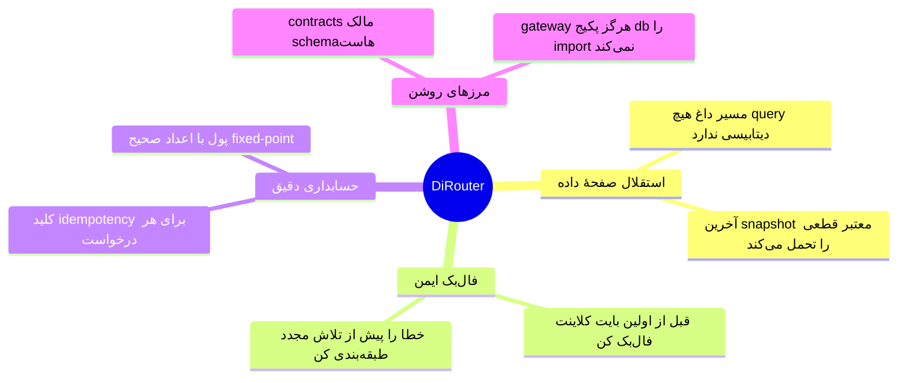

| اصل                        | معنی                                                                  | مرجع                                           |
| -------------------------- | --------------------------------------------------------------------- | ---------------------------------------------- |
| استقلال صفحهٔ داده         | اگر صفحهٔ کنترل قطع باشد، ترافیک موجود ادامه می‌یابد.                 | [ADR-006](adr/0006-data-plane-independence.md) |
| ایمنی fallback برای stream | stream فقط قبل از ارسال اولین بایت provider را عوض می‌کند.            | [معماری](ARCHITECTURE.md)                      |
| حسابداری idempotent        | تلاش مجدد صف و replay از outbox هیچ درخواستی را دوبار شارژ نمی‌کند.   | [مسیر usage](docs/usage-pipeline.md)           |
| پول به‌صورت عدد صحیح       | مبالغ با واحد BigInt (`1 USD = 10^8`) محاسبه می‌شوند، نه اعشار شناور. | [واژه‌نامه](GLOSSARY.md)                       |

## چرخهٔ عمر درخواست

هر درخواست از هشت مرحله عبور می‌کند. gateway همهٔ آن‌ها را بدون پرس‌وجو از PostgreSQL انجام می‌دهد.

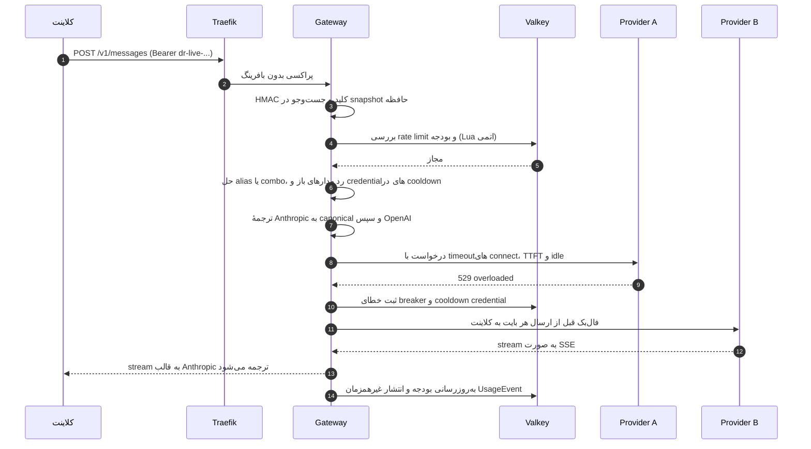

نمای متحرک مسیر فال‌بک. بستهٔ قرمز به Provider A می‌رسد و خطا می‌دهد؛ سپس بستهٔ آبی به Provider B می‌رسد.

<p align="center">
  
</p>

| مرحله | نام        | آنچه رخ می‌دهد                                                                                                                                                 |
| ----- | ---------- | -------------------------------------------------------------------------------------------------------------------------------------------------------------- |
| ۱     | ورود       | کلید مجازی را از `Authorization: Bearer` یا `x-api-key` می‌خواند و با HMAC-SHA256 هش می‌کند.                                                                   |
| ۲     | اعتبارسنجی | بدنه را با `@dirouter/contracts` بررسی می‌کند؛ فیلدهای ناشناخته تا جایی که API اجازه دهد نگه داشته می‌شوند.                                                    |
| ۳     | محدودیت‌ها | بررسی RPM، TPM، همزمانی و بودجه برای کلید، پروژه و تیم را با اسکریپت‌های Lua اتمی انجام می‌دهد. اگر Valkey قطع باشد، limiter محلی و `failMode` تصمیم می‌گیرند. |
| ۴     | مسیریابی   | نام را به alias، combo یا مدل تبدیل می‌کند و فهرست مرتب‌شدهٔ هدف‌ها را می‌سازد.                                                                                |
| ۵     | ترجمه      | ابتدا به مدل canonical و سپس به API مقصد تبدیل می‌کند. تعداد مترجم‌ها N + M است، نه N × M.                                                                     |
| ۶     | ارسال      | timeoutهای لایه‌ای، تلاش مجدد با backoff و jitter و فال‌بک به هدف بعدی را اعمال می‌کند.                                                                        |
| ۷     | پاسخ       | پاسخ یا stream را به قالب درخواست‌کننده برمی‌گرداند و کدهای خطای پایدار می‌دهد.                                                                                |
| ۸     | حسابداری   | هزینه را محاسبه می‌کند، شمارنده‌های بودجه را به‌روز می‌کند و `UsageEvent` را بدون انتظار در صف می‌گذارد.                                                       |

اتمام بودجه با `budget_exceeded` و HTTP 429 پاسخ داده می‌شود.

## چرخهٔ عمر پیکربندی

مدیر پیکربندی را در داشبورد تغییر می‌دهد. gatewayها بدون ری‌استارت یک snapshot نسخه‌دار دریافت می‌کنند.

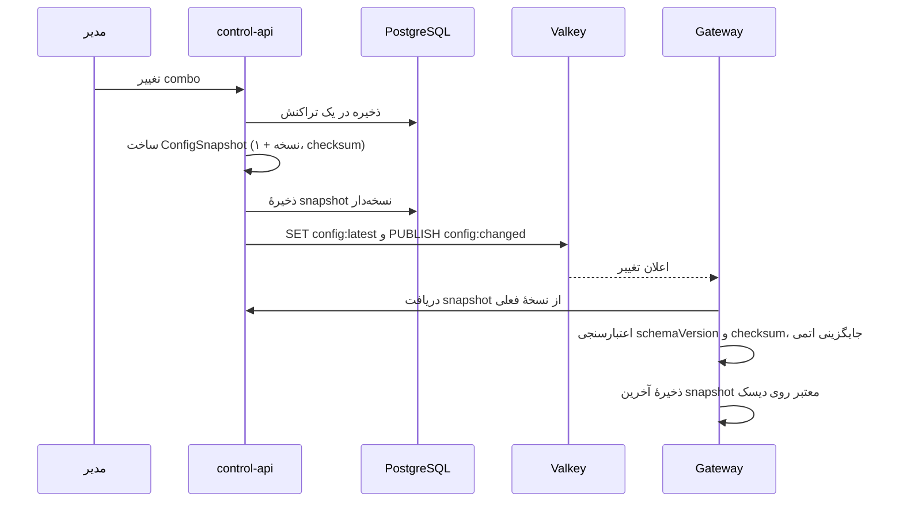

- `ConfigSnapshot` یک `schemaVersion` برای قالب و یک `version` یکنواخت دارد. gateway نسخه‌های قدیمی‌تر و schemaVersion ناشناخته را رد می‌کند.
- رمزهای provider فقط به‌صورت ciphertext با AES-256-GCM منتقل می‌شوند. gateway فقط در حافظه و با `MASTER_KEY` آن‌ها را رمزگشایی می‌کند.
- اگر control-api هنگام راه‌اندازی در دسترس نباشد، gateway با snapshot روی دیسک شروع می‌کند.

## مصرف و حسابداری

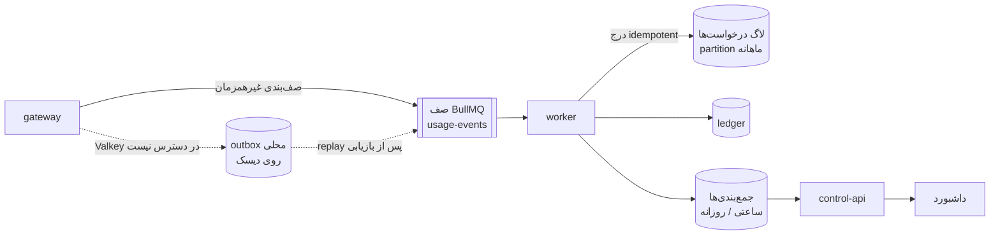

<p align="center">
  
</p>

- هر رویداد یک `idempotencyKey` دارد. تلاش مجدد صف و replay از outbox نمی‌توانند یک درخواست را دوبار شارژ کنند؛ نوشتن در دیتابیس با کلید یکتا و `ON CONFLICT ... DO NOTHING` انجام می‌شود.
- Valkey شمارنده‌های زندهٔ بودجه را نگه می‌دارد. PostgreSQL منبع حقیقت حسابداری است و worker به‌صورت دوره‌ای شمارنده‌ها را با آن تطبیق می‌دهد.
- پرس‌وجوهای داشبورد از جدول‌های جمع‌بندی می‌خوانند، نه از لاگ خام.

## ماتریس تاب‌آوری

| ریسک                                    | پاسخ                                                                          |
| --------------------------------------- | ----------------------------------------------------------------------------- |
| خطای گذرای provider (429، 5xx، timeout) | طبقه‌بندی خطا، تلاش مجدد با backoff و jitter، سپس فال‌بک در combo             |
| قطع کامل provider                       | circuit breaker برای provider و مدل با probeهای نیمه‌باز                      |
| یک credential به سقف خود می‌رسد         | همان credential خنک می‌شود و ترافیک با credential دیگر ادامه می‌یابد          |
| provider کند                            | timeoutهای جدا برای connect، TTFT و idle، و bulkhead همزمانی برای هر provider |
| قطعی control-api یا PostgreSQL          | ادامهٔ کار با snapshotهای حافظه و دیسک                                        |
| قطعی Valkey                             | limiter محلی، `failMode` قابل پیکربندی و outbox محلی usage                    |
| استقرار جدید                            | خاموشی تدریجی: پذیرش درخواست متوقف، streamهای باز تخلیه، سپس خروج             |

## اجزا

| جزء               | مسئولیت‌ها                                                                       | وابستگی‌های سخت زمان اجرا                                      |
| ----------------- | -------------------------------------------------------------------------------- | -------------------------------------------------------------- |
| **Traefik**       | TLS، مسیریابی مسیرها، health check و SSE بدون بافر                               | ندارد                                                          |
| **gateway**       | سازگاری API، مسیریابی، فال‌بک، circuit breaker، محدودیت‌ها، بودجه و انتشار usage | ندارد، وقتی snapshot معتبر موجود باشد؛ Valkey فال‌بک محلی دارد |
| **control-api**   | API مدیریت، احراز هویت داشبورد، RBAC، رمزنگاری credential و انتشار snapshot      | PostgreSQL، Valkey                                             |
| **worker**        | مصرف رویداد usage، نوشتن ledger و لاگ، جدول‌های جمع‌بندی و نگه‌داری partition    | PostgreSQL، Valkey                                             |
| **dashboard**     | رابط مدیریتی فارسی RTL                                                           | control-api                                                    |
| **mock-provider** | upstream ساختگی با خطاهای 429 و 5xx و تأخیر تزریقی برای تست                      | ندارد                                                          |
| **Valkey**        | شمارنده‌ها، وضعیت cooldown و breaker، pub/sub پیکربندی، صف BullMQ                | ندارد                                                          |
| **PostgreSQL 17** | منبع حقیقت پیکربندی، کاربران، ledger و لاگ‌های partitioned درخواست‌ها            | ندارد                                                          |

## ساختار مخزن

```text
code/
├─ apps/
│  ├─ gateway/        صفحهٔ داده برای درخواست‌های LLM؛ بدون وابستگی به PostgreSQL
│  ├─ control-api/    احراز هویت، مدیریت پیکربندی، انتشار snapshot
│  ├─ worker/         مصرف صف usage، جمع‌بندی، نگه‌داری داده و تطبیق بودجه
│  ├─ dashboard/      داشبورد فارسی RTL (React + Vite)
│  ├─ website/        سایت عمومی فارسی و دموی مسیریابی
│  └─ mock-provider/  upstream ساختگی با تزریق خطا برای توسعه و تست
├─ packages/          contracts، shared، db، model-catalog، providers، translator، routing، ui، پیکربندی‌ها
├─ deploy/            imageها، Traefik، Prometheus، Grafana، قالب‌های nginx
├─ scripts/           برنامه‌ریزی CI، اجرای integration، benchmark، ابزارهای توسعه
├─ adr/               Architecture Decision Recordها
└─ docs/              راهنماهای تفصیلی (انگلیسی و فارسی)
```


اپ‌ها می‌توانند به پکیج‌ها وابسته باشند؛ پکیج‌ها به اپ وابسته نیستند. `contracts` وابستگی داخلی ندارد و gateway نباید به `@dirouter/db` وابسته باشد.

## پشتهٔ فناوری

| لایه                       | انتخاب                                                                      | مرجع                                          |
| -------------------------- | --------------------------------------------------------------------------- | --------------------------------------------- |
| Gateway                    | NestJS با آداپتر Fastify و مسیر داغ سبک                                     | [ADR-001](adr/0001-gateway-nestjs-fastify.md) |
| control-api و worker       | NestJS                                                                      | [ADR-001](adr/0001-gateway-nestjs-fastify.md) |
| پایگاه داده                | PostgreSQL 17 با Prisma                                                     | [ADR-002](adr/0002-postgresql-prisma.md)      |
| شمارنده‌ها، cache، pub/sub | Valkey                                                                      | [ADR-003](adr/0003-valkey.md)                 |
| پراکسی معکوس               | Traefik v3                                                                  | [ADR-004](adr/0004-traefik-reverse-proxy.md)  |
| صف رویدادها                | BullMQ روی Valkey                                                           | [ADR-005](adr/0005-bullmq-event-queue.md)     |
| داشبورد                    | React، Vite، TypeScript، TanStack Router و Query، shadcn/ui، Tailwind (RTL) | —                                             |
| schemaها                   | Zod در `@dirouter/contracts` با خروجی JSON Schema                           | —                                             |
| مونorepo                   | pnpm workspaces، Turborepo، TypeScript strict، ESM                          | —                                             |
| استقرار                    | Docker و Docker Compose (توسعه، production، HA)                             | —                                             |

## شروع سریع با Docker

**زمان تقریبی:** چند دقیقه، بسته به دانلود image و اولین build. این مسیر با provider ساختگی اجرا می‌شود و برای production نیست.

پیش‌نیازها: Docker Engine با Docker Compose، `curl` و OpenSSL. پورت‌های 80 و 443 باید آزاد باشند.

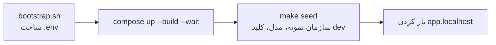

```bash
cd code
./scripts/bootstrap.sh
docker compose -f compose.yaml -f compose.dev.yaml up -d --build --wait
make seed
```

`bootstrap.sh` فایل `.env` را با رازهای تصادفی و مجوز 600 می‌سازد. اگر `.env` وجود داشته باشد بازنویسی نمی‌شود؛ روی نصب موجود از `--force` استفاده نکنید. `make seed` سازمان، مدل‌ها، alias و کلیدهای **توسعه** می‌سازد و providerها را به mock وصل می‌کند.

| سرویس             | آدرس                           |
| ----------------- | ------------------------------ |
| داشبورد           | http://app.localhost           |
| سلامت Gateway     | http://api.localhost/healthz   |
| سلامت Control API | http://admin.localhost/healthz |
| ایمیل توسعه       | http://localhost:58025         |

ورود اختیاری به داشبورد: ایمیل `admin@dirouter.local` و رمز تولیدشده در `.data/seed-admin.env` (فایل محلی، git-ignored و با مجوز 600).

### اولین درخواست

کلید زیر کلید ثابت **mock توسعه** است. در production کلید یک‌بارنمایش خودتان را بسازید.

```bash
export DIROUTER_KEY='dr-dev-local-0000000000000000'
curl -fsS http://api.localhost/v1/chat/completions \
  -H "Authorization: Bearer $DIROUTER_KEY" \
  -H 'Content-Type: application/json' \
  -d '{
    "model": "gpt-4.1",
    "messages": [{"role":"user","content":"Hello"}]
  }'
```

پاسخ موفق یک Chat Completion از mock است. در داده‌های seed، alias `gpt-4.1` ابتدا `mock/down` و سپس `mock/small` را امتحان می‌کند؛ بنابراین `X-Dirouter-Attempts` ممکن است بیشتر از یک باشد. برای دیدن provider پاسخ‌دهنده:

```bash
curl -sS -D - -o /dev/null http://api.localhost/v1/chat/completions \
  -H "Authorization: Bearer $DIROUTER_KEY" \
  -H 'Content-Type: application/json' \
  -d '{"model":"mock/small","messages":[{"role":"user","content":"Hello"}]}'
# انتظار: HTTP 200 و X-Dirouter-Provider: mock
```

## اتصال provider واقعی

1. وارد داشبورد شوید. در نصب کاملاً خالی، `/setup` سازمان، OWNER، provider اختیاری و اولین کلید را می‌سازد. در محیط seed شده از login استفاده کنید.
2. در **Providerها** نوع و Base URL را انتخاب کنید، credential واقعی را وارد کنید، با **تست** اتصال را بررسی کنید و با **کشف مدل‌ها** مدل‌های upstream را ببینید.
3. در **مدل‌ها و Combo** مدل بسازید یا مدل‌های کشف‌شده را اضافه کنید. قیمت و context را کنترل کنید و در صورت نیاز combo و alias بسازید.
4. در **سازمان** پروژه بسازید. در **کلیدهای مجازی** کلید را به پروژه وصل کنید و مدل‌های مجاز، RPM و TPM، همزمانی، انقضا و بودجه را محدود کنید.
5. کلید کامل فقط یک بار نمایش داده می‌شود. آن را در مدیر راز نگه دارید و در URL، Git یا لاگ قرار ندهید.
6. مدل یا alias و endpoint واقعی (مثلاً `https://api.example.com/v1`) را با همان curl بالا امتحان کنید و `localhost` را با دامنهٔ خود عوض کنید.

جزئیات هر صفحه و سناریوهای «اول اشتراک و بعد API ارزان» و «فال‌بک بین چند credential» در [راهنمای کاربر داشبورد](docs/user-guide/README.md) است.

## توسعهٔ مستقیم

برای hot reload بیرون از Docker به Node.js 22 LTS و pnpm 10 نیاز دارید. PostgreSQL، Valkey و متغیرهای `.env` باید در دسترس باشند؛ برای راه‌اندازی کامل از مسیر Docker بالا استفاده کنید.

```bash
corepack enable   # نسخهٔ pinned pnpm را از packageManager می‌خواند
pnpm install
pnpm build
pnpm dev
```

| اپ            | آدرس پیش‌فرض                           |
| ------------- | -------------------------------------- |
| gateway       | http://localhost:8080/healthz          |
| control-api   | http://localhost:3000/healthz          |
| mock-provider | http://localhost:8090/healthz          |
| dashboard     | http://localhost:5173                  |
| website       | http://localhost:5174                  |
| worker        | بدون HTTP عمومی؛ پردازش صف و نوشتن لاگ |

## دستورها

| دستور                               | کار                                        |
| ----------------------------------- | ------------------------------------------ |
| `pnpm build`                        | build همهٔ اپ‌ها و پکیج‌ها با کش Turborepo |
| `pnpm dev`                          | اجرای اپ‌ها در حالت watch                  |
| `pnpm test`                         | تست‌های Vitest                             |
| `pnpm lint`                         | ESLint روی workspace                       |
| `pnpm typecheck`                    | بررسی TypeScript                           |
| `pnpm format` / `pnpm format:check` | نوشتن یا بررسی قالب‌بندی Prettier          |

برای یک اپ: `pnpm --filter @dirouter/gateway dev`. راهنمای سایت عمومی: [apps/website/README.md](apps/website/README.md).

## یکپارچگی مداوم (CI)

GitHub Actions روی pull requestها و `main` اجرا می‌شود. بسته‌های تغییرکرده و وابسته‌های آن‌ها را برنامه‌ریزی می‌کند و سپس lint، typecheck، تست و build را اجرا می‌کند. تست‌های integration روی کانتینرهای PostgreSQL و Valkey اجرا می‌شوند. پس از موفقیت بررسی‌ها روی `main` یا یک tag نسخه، imageها در GHCR منتشر می‌شوند. جزئیات در [CI.md](CI.md) است.

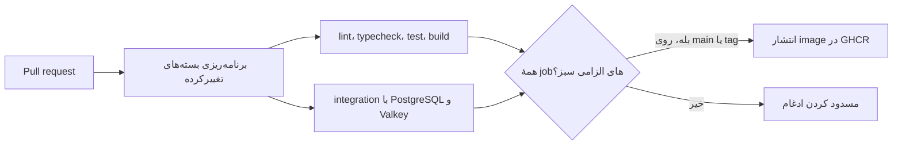

## مستندات و مشارکت

- [فهرست مستندات](DOCUMENTATION.md) و [راهنمای مشارکت](CONTRIBUTING.md)
- [استقرار production](docs/deploy-production.md)، [مرجع متغیرهای محیطی](docs/env-reference.md) و [Runbook](docs/runbook.md)
- [مشاهده‌پذیری](docs/observability.md)، [مسیر usage](docs/usage-pipeline.md) و [داده‌های seed](docs/seed.md)

همهٔ مستندات این مخزن دوزبانه‌اند. هر فایل بخش انگلیسی و بخش فارسی دارد و لینک‌های بالای هر صفحه بین آن‌ها جابه‌جا می‌کنند.
