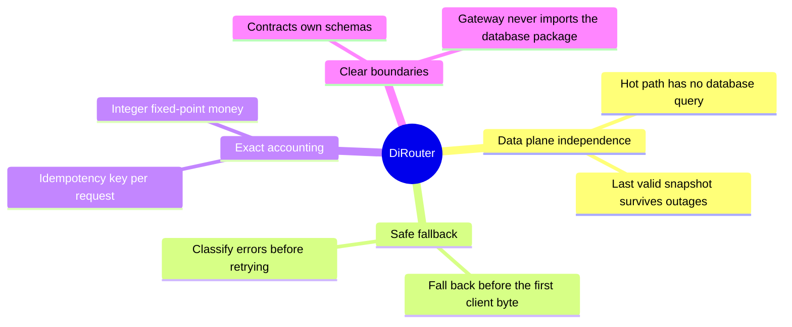
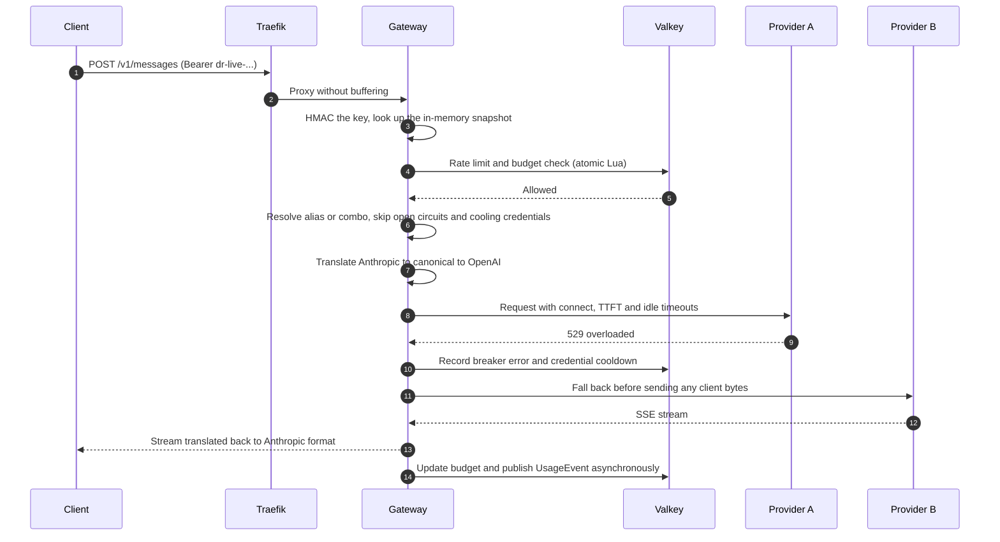
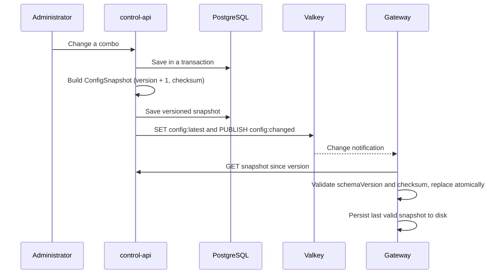
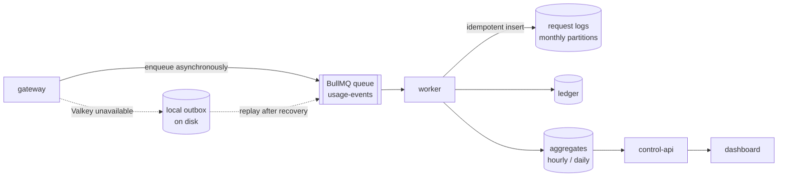
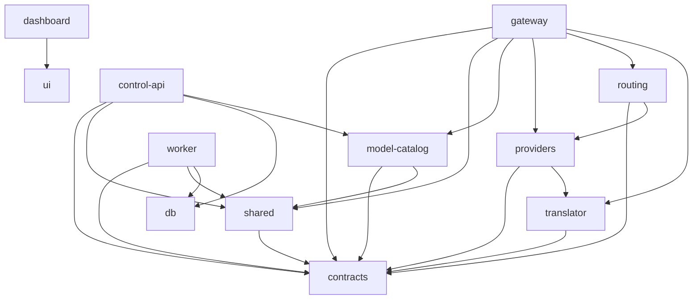
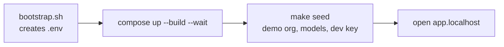
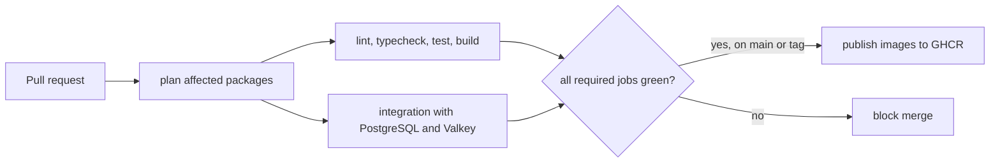

[English](README.md) · [فارسی](README.fa.md)

# DiRouter

DiRouter is a resilient gateway for Large Language Models. It exposes OpenAI- and Anthropic-compatible endpoints and adds the operational features production traffic needs: provider and credential fallback, circuit breakers, distributed rate limits, budgets, and usage accounting.

## Contents

- [Why DiRouter](#why-dirouter)
- [Core principles](#core-principles)
- [Request lifecycle](#request-lifecycle)
- [Configuration lifecycle](#configuration-lifecycle)
- [Usage and accounting](#usage-and-accounting)
- [Resilience matrix](#resilience-matrix)
- [Components](#components)
- [Repository layout](#repository-layout)
- [Technology stack](#technology-stack)
- [Quick start with Docker](#quick-start-with-docker)
- [Connecting a real provider](#connecting-a-real-provider)
- [Local development](#local-development)
- [Commands](#commands)
- [Continuous integration](#continuous-integration)
- [Documentation and contributing](#documentation-and-contributing)

## Why DiRouter

Teams that call LLM providers directly face recurring problems:

| Problem                                 | Without DiRouter                              | With DiRouter                                                         |
| --------------------------------------- | --------------------------------------------- | --------------------------------------------------------------------- |
| A provider returns 529 or 5xx           | The application fails or retries by itself    | The gateway retries and falls back before any byte reaches the client |
| One API key reaches its quota           | Requests fail until someone rotates the key   | That credential cools down and another one serves traffic             |
| Costs grow without control              | Spend is visible only in the provider console | Per-key and per-project budgets stop overspending                     |
| Each SDK speaks a different format      | Code is tied to one provider                  | One endpoint translates between OpenAI and Anthropic formats          |
| Configuration changes need a deployment | Restarts and risky rollouts                   | A versioned snapshot is pushed to running gateways                    |

## Core principles



| Principle               | Meaning                                                          | Record                                         |
| ----------------------- | ---------------------------------------------------------------- | ---------------------------------------------- |
| Data plane independence | Existing traffic continues if the control plane is unavailable.  | [ADR-006](adr/0006-data-plane-independence.md) |
| Stream fallback safety  | A stream switches provider only before the first byte is sent.   | [Architecture](ARCHITECTURE.md)                |
| Idempotent accounting   | Queue retries and outbox replays never charge a request twice.   | [Usage pipeline](docs/usage-pipeline.md)       |
| Money as integers       | Amounts use BigInt units (`1 USD = 10^8`), never floating point. | [Glossary](GLOSSARY.md)                        |

## Request lifecycle

A request passes through eight stages. The gateway performs all of them without querying PostgreSQL.



Animated view of the fallback path. The red packet hits Provider A, which fails; the blue packet then reaches Provider B.

<p align="center">
  
</p>

| Stage | Name        | What happens                                                                                                                                             |
| ----- | ----------- | -------------------------------------------------------------------------------------------------------------------------------------------------------- |
| 1     | Ingress     | Reads the virtual key from `Authorization: Bearer` or `x-api-key` and hashes it with HMAC-SHA256.                                                        |
| 2     | Validation  | Validates the body with `@dirouter/contracts`; unknown fields are kept where the API allows.                                                             |
| 3     | Limits      | Applies key, project, and team RPM, TPM, concurrency, and budget checks in atomic Lua scripts. If Valkey is down, a local limiter and `failMode` decide. |
| 4     | Routing     | Resolves the name to an alias, combo, or model, and builds an ordered list of targets.                                                                   |
| 5     | Translation | Converts to the canonical model, then to the upstream API. N + M translators, not N × M.                                                                 |
| 6     | Dispatch    | Applies layered timeouts, retries with jittered backoff, and falls back to the next target.                                                              |
| 7     | Response    | Converts the response or stream back to the caller's format, with stable error codes.                                                                    |
| 8     | Accounting  | Calculates cost, updates budget counters, and enqueues a `UsageEvent` without waiting.                                                                   |

Budget exhaustion returns `budget_exceeded` with HTTP 429.

## Configuration lifecycle

Administrators change configuration in the dashboard. Gateways receive a versioned snapshot without restarting.



- A `ConfigSnapshot` has a `schemaVersion` for its format and a monotonic `version`. Gateways reject older versions and unknown schema versions.
- Provider secrets appear only as AES-256-GCM ciphertext. The gateway decrypts them in memory with `MASTER_KEY`.
- If control-api is unavailable at startup, the gateway starts from its on-disk snapshot.

## Usage and accounting



<p align="center">
  
</p>

- Every event carries an `idempotencyKey`. Queue retries and outbox replays cannot charge the same request twice; database writes use a unique key with `ON CONFLICT ... DO NOTHING`.
- Valkey holds live budget counters. PostgreSQL is the accounting source of truth, and the worker periodically reconciles the counters against it.
- Dashboard queries read aggregate tables, not raw logs.

## Resilience matrix

| Risk                                         | Response                                                                            |
| -------------------------------------------- | ----------------------------------------------------------------------------------- |
| Transient provider error (429, 5xx, timeout) | Classify the error, retry with backoff and jitter, then fall back through the combo |
| Complete provider outage                     | Provider and model circuit breakers with half-open probes                           |
| A credential reaches its limit               | Cool that credential down and continue with another                                 |
| Slow provider                                | Separate connect, TTFT, and idle timeouts, plus a per-provider concurrency bulkhead |
| control-api or PostgreSQL outage             | Continue with in-memory and on-disk snapshots                                       |
| Valkey outage                                | Local limiter, configurable `failMode`, local usage outbox                          |
| New deployment                               | Graceful shutdown: stop accepting requests, drain open streams, then exit           |

## Components

| Component         | Responsibilities                                                                                | Hard runtime dependencies                                      |
| ----------------- | ----------------------------------------------------------------------------------------------- | -------------------------------------------------------------- |
| **Traefik**       | TLS, path routing, health checks, unbuffered SSE                                                | None                                                           |
| **gateway**       | API compatibility, routing, fallback, circuit breakers, limits, budgets, usage publication      | None when a valid snapshot exists; Valkey has a local fallback |
| **control-api**   | Administrative API, dashboard authentication, RBAC, credential encryption, snapshot publication | PostgreSQL, Valkey                                             |
| **worker**        | Usage event consumption, ledger and log writes, aggregate tables, partition maintenance         | PostgreSQL, Valkey                                             |
| **dashboard**     | Persian RTL administrative interface                                                            | control-api                                                    |
| **mock-provider** | Synthetic upstream with injected 429 and 5xx responses and delays for tests                     | None                                                           |
| **Valkey**        | Counters, cooldown and breaker state, config pub/sub, BullMQ queue                              | None                                                           |
| **PostgreSQL 17** | Source of truth for configuration, users, the ledger, and partitioned request logs              | None                                                           |

## Repository layout

```text
code/
├─ apps/
│  ├─ gateway/        Data plane for LLM requests; no PostgreSQL dependency
│  ├─ control-api/    Authentication, configuration management, snapshot publication
│  ├─ worker/         Usage queue consumer, aggregation, retention, budget reconciliation
│  ├─ dashboard/      Persian RTL dashboard (React + Vite)
│  ├─ website/        Public Persian site and routing demo
│  └─ mock-provider/  Synthetic upstream with fault injection for development and tests
├─ packages/          contracts, shared, db, model-catalog, providers, translator, routing, ui, configs
├─ deploy/            Images, Traefik, Prometheus, Grafana, nginx templates
├─ scripts/           CI planning, integration runner, benchmarks, dev helpers
├─ adr/               Architecture Decision Records
└─ docs/              Detailed guides (English .md and Persian .fa.md)
```



Apps may depend on packages; packages never depend on apps. `contracts` has no internal dependency, and the gateway must not depend on `@dirouter/db`.

## Technology stack

| Layer                    | Choice                                                                        | Record                                        |
| ------------------------ | ----------------------------------------------------------------------------- | --------------------------------------------- |
| Gateway                  | NestJS with the Fastify adapter and a lightweight hot path                    | [ADR-001](adr/0001-gateway-nestjs-fastify.md) |
| control-api and worker   | NestJS                                                                        | [ADR-001](adr/0001-gateway-nestjs-fastify.md) |
| Database                 | PostgreSQL 17 with Prisma                                                     | [ADR-002](adr/0002-postgresql-prisma.md)      |
| Counters, cache, pub/sub | Valkey                                                                        | [ADR-003](adr/0003-valkey.md)                 |
| Reverse proxy            | Traefik v3                                                                    | [ADR-004](adr/0004-traefik-reverse-proxy.md)  |
| Event queue              | BullMQ on Valkey                                                              | [ADR-005](adr/0005-bullmq-event-queue.md)     |
| Dashboard                | React, Vite, TypeScript, TanStack Router and Query, shadcn/ui, Tailwind (RTL) | —                                             |
| Schemas                  | Zod in `@dirouter/contracts`, with JSON Schema export                         | —                                             |
| Monorepo                 | pnpm workspaces, Turborepo, strict TypeScript, ESM                            | —                                             |
| Deployment               | Docker and Docker Compose (development, production, HA)                       | —                                             |

## Quick start with Docker

**Setup time:** a few minutes, depending on image downloads and the first build. This path runs against a mock provider and is not for production.

Requirements: Docker Engine with Docker Compose, `curl`, and OpenSSL. Ports 80 and 443 must be free.



```bash
cd code
./scripts/bootstrap.sh
docker compose -f compose.yaml -f compose.dev.yaml up -d --build --wait
make seed
```

`bootstrap.sh` creates `.env` with random secrets and mode 600. If `.env` exists it is not overwritten, so do not use `--force` on an existing installation. `make seed` creates an organization, models, an alias, and **development** keys, and connects providers to the mock.

| Service            | URL                            |
| ------------------ | ------------------------------ |
| Dashboard          | http://app.localhost           |
| Gateway health     | http://api.localhost/healthz   |
| Control API health | http://admin.localhost/healthz |
| Development email  | http://localhost:58025         |

Optional dashboard login: email `admin@dirouter.local` and the password generated in `.data/seed-admin.env` (a local, git-ignored file with mode 600).

### First request

The key below is the fixed **development mock** key. In production, create your own one-time key.

```bash
export DIROUTER_KEY='dr-dev-local-0000000000000000'
curl -fsS http://api.localhost/v1/chat/completions \
  -H "Authorization: Bearer $DIROUTER_KEY" \
  -H 'Content-Type: application/json' \
  -d '{
    "model": "gpt-4.1",
    "messages": [{"role":"user","content":"Hello"}]
  }'
```

The response is a Chat Completion from the mock. In the seed data, the alias `gpt-4.1` tries `mock/down` first and then falls back to `mock/small`, so `X-Dirouter-Attempts` may be greater than one. To see which provider answered:

```bash
curl -sS -D - -o /dev/null http://api.localhost/v1/chat/completions \
  -H "Authorization: Bearer $DIROUTER_KEY" \
  -H 'Content-Type: application/json' \
  -d '{"model":"mock/small","messages":[{"role":"user","content":"Hello"}]}'
# Expect: HTTP 200 and X-Dirouter-Provider: mock
```

## Connecting a real provider

1. Sign in to the dashboard. On a completely empty installation, `/setup` creates the organization, the OWNER, an optional provider, and the first key. In a seeded environment, use login instead.
2. In **Providers**, choose the type and base URL, enter a real credential, **test** the connection, and run **model discovery**.
3. In **Models and Combos**, create a model or add discovered ones. Check prices and context size, then create combos and aliases as needed.
4. In **Organization**, create a project. In **Virtual keys**, attach the key to the project and limit allowed models, RPM and TPM, concurrency, expiry, and budget.
5. The full key is shown only once. Store it in a secret manager and never put it in a URL, Git, or logs.
6. Test your model or alias and the real endpoint (for example `https://api.example.com/v1`) with the same curl command, replacing `localhost` with your domain.

Details of each page and the scenarios "subscription first, then cheap API" and "fallback across several credentials" are in the [dashboard user guide](docs/user-guide/README.md).

## Local development

For hot reload outside Docker you need Node.js 22 LTS and pnpm 10. PostgreSQL, Valkey, and the `.env` variables must be available; for the complete setup use the Docker path above.

```bash
corepack enable   # reads the pinned pnpm version from packageManager
pnpm install
pnpm build
pnpm dev
```

| App           | Default address                                 |
| ------------- | ----------------------------------------------- |
| gateway       | http://localhost:8080/healthz                   |
| control-api   | http://localhost:3000/healthz                   |
| mock-provider | http://localhost:8090/healthz                   |
| dashboard     | http://localhost:5173                           |
| website       | http://localhost:5174                           |
| worker        | No public HTTP; processes queue and writes logs |

## Commands

| Command                             | Purpose                                              |
| ----------------------------------- | ---------------------------------------------------- |
| `pnpm build`                        | Build all apps and packages with the Turborepo cache |
| `pnpm dev`                          | Run apps in watch mode                               |
| `pnpm test`                         | Vitest tests                                         |
| `pnpm lint`                         | ESLint across the workspace                          |
| `pnpm typecheck`                    | TypeScript checks                                    |
| `pnpm format` / `pnpm format:check` | Prettier write or check                              |

For one app: `pnpm --filter @dirouter/gateway dev`. Website details: [apps/website/README.md](apps/website/README.md).

## Continuous integration

GitHub Actions runs on pull requests and on `main`. It plans the changed packages and their dependents, then runs lint, typecheck, tests, and build. Integration tests run against PostgreSQL and Valkey containers. After checks pass on `main` or a version tag, images are published to GHCR. Details are in [CI.md](CI.md).



## Documentation and contributing

- [Documentation index](DOCUMENTATION.md) and the [contributing guide](CONTRIBUTING.md)
- [Production deployment](docs/deploy-production.md), [environment reference](docs/env-reference.md), and [runbook](docs/runbook.md)
- [Observability](docs/observability.md), [usage pipeline](docs/usage-pipeline.md), and [seed data](docs/seed.md)

All documentation in this repository is bilingual. Every document is two separate files — an English `.md` file and a Persian `.fa.md` file — and the language links at the top of each page switch between them. See the [documentation policy](CONTRIBUTING.md#documentation-policy).
