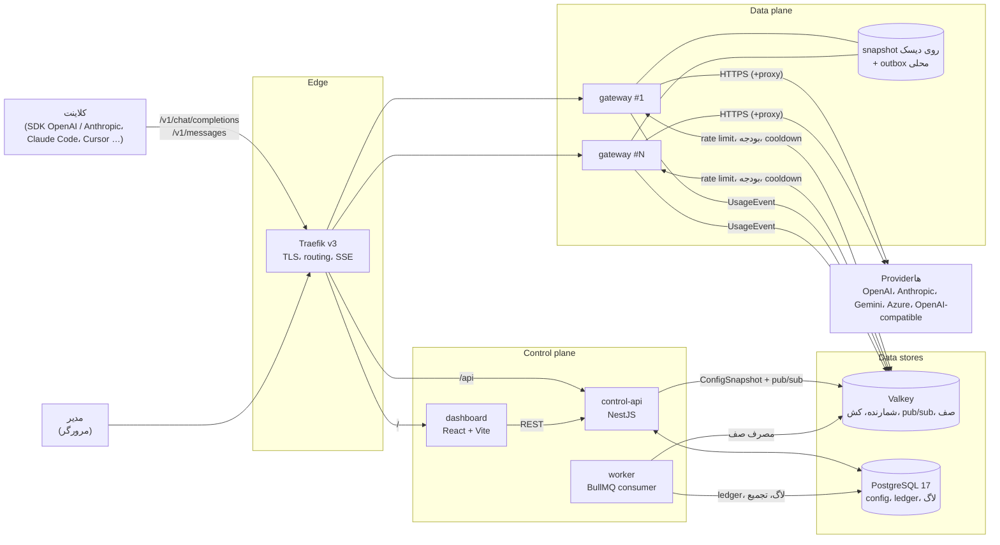
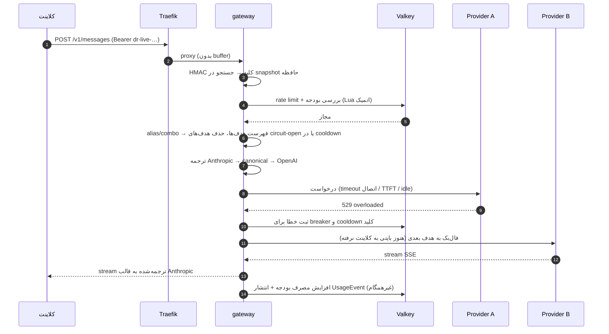
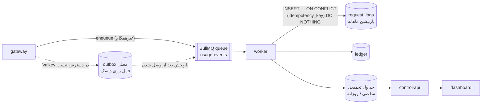
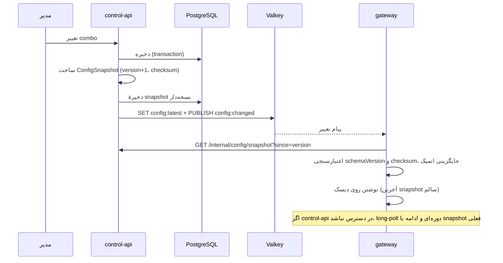

[English](architecture.fa.md) · [فارسی](architecture.fa.md)

# معماری DiRouter

> هر سند دوزبانه است: یک فایل انگلیسی با پسوند `.md` و یک فایل فارسی با پسوند `.fa.md` کنار هم قرار دارند و راهنماهای تفصیلی در `code/docs/` نگهداری می‌شوند. [سیاست مستندات](../CONTRIBUTING.fa.md#documentation-policy-fa) را در [CONTRIBUTING.fa.md](../CONTRIBUTING.fa.md) ببینید.

> این سند مبنای همهٔ کارت‌های اسپرینت ۱ است. تصمیم‌ها و دلیل‌هایشان در [ADRها](adr/README.fa.md) و تعریف مفاهیم در [واژه‌نامه](glossary.fa.md) آمده است.

## ۱. نمای کلی

DiRouter دو بخش جدا دارد:

- **Data plane** (`apps/gateway`): مسیر داغ هر درخواست LLM. احراز هویت کلید مجازی، rate limit، بودجه، مسیریابی، ترجمهٔ فرمت، فال‌بک و stream. باید سریع، stateless و مستقل از control plane باشد.
- **Control plane** (`apps/control-api`، `apps/worker`، `apps/dashboard`): مدیریت سازمان، کاربر، provider، کلید، مدل و combo؛ انتشار config؛ پردازش رویدادهای مصرف؛ گزارش‌ها و داشبورد.

اصل اول طراحی ([ADR-006](adr/0006-data-plane-independence.fa.md)): **data plane به control plane وابسته نیست.** اگر Postgres، control-api یا worker از دسترس خارج شوند، ترافیک با آخرین config سالم ادامه پیدا می‌کند.

## ۲. اجزا

| جزء               | مسئولیت                                                                                                    | وابستگی سخت در زمان اجرا      |
| ----------------- | ---------------------------------------------------------------------------------------------------------- | ----------------------------- |
| **Traefik**       | TLS (Let's Encrypt)، routing بر اساس مسیر، health check، عبور SSE بدون buffer                              | —                             |
| **gateway**       | API سازگار با OpenAI و Anthropic، مسیریابی، فال‌بک، circuit breaker، rate limit، بودجه، انتشار رویداد مصرف | هیچ (Valkey با fallback محلی) |
| **control-api**   | API مدیریتی، احراز هویت داشبورد، RBAC، رمزنگاری credentialها، ساخت و انتشار ConfigSnapshot                 | Postgres، Valkey              |
| **worker**        | مصرف صف UsageEvent، نوشتن ledger و لاگ، جداول تجمیعی، نگهداری پارتیشن‌ها                                   | Postgres، Valkey              |
| **dashboard**     | رابط مدیریتی فارسی و RTL                                                                                   | control-api                   |
| **mock-provider** | provider ساختگی با تزریق 429، 5xx و تأخیر برای تست و chaos                                                 | —                             |
| **Valkey**        | شمارنده‌های rate limit و بودجه، cooldown و وضعیت breaker، pub/sub تغییر config، صف BullMQ                  | —                             |
| **PostgreSQL**    | منبع حقیقت config، کاربران، ledger مالی، لاگ درخواست‌ها (پارتیشن‌بندی‌شده)                                 | —                             |

## ۳. مسیر یک درخواست

مراحل در گیت‌وی:

1. **ورود و احراز هویت** — کلید مجازی از `Authorization: Bearer` یا `x-api-key` خوانده، با HMAC-SHA256 هش و در snapshot حافظه جستجو می‌شود. هیچ query دیتابیسی در مسیر داغ نیست.
2. **اعتبارسنجی** — بدنه با اسکیمای `@dirouter/contracts` اعتبارسنجی می‌شود. فیلدهای ناشناخته حفظ می‌شوند.
3. **محدودیت‌ها** — rate limit (RPM، TPM، هم‌زمانی) و بودجه در سطح کلید، پروژه و تیم با یک Lua script اتمیک روی Valkey. اگر Valkey در دسترس نباشد، limiter محلی و `failMode` تعیین‌کننده است.
4. **مسیریابی** — نام مدل به alias، combo یا مدل resolve می‌شود و فهرست مرتب هدف‌ها (مدل + credential) ساخته می‌شود. هدف‌های circuit-open، کلیدهای در cooldown و مدل‌های قفل‌شده کنار گذاشته می‌شوند.
5. **ترجمه** — درخواست به مدل canonical و از آن به API مقصد ترجمه می‌شود (N + M مترجم به‌جای N × M).
6. **ارسال و تاب‌آوری** — timeoutهای چندلایه، retry با backoff و jitter، فال‌بک به هدف بعدی. فال‌بک در stream فقط تا قبل از ارسال اولین بایت به کلاینت مجاز است.
7. **پاسخ** — پاسخ یا stream به قالب API ورودی برگردانده می‌شود. خطاها هم در قالب همان API و با کد پایدار DiRouter.
8. **حسابداری** — هزینه از usage و قیمت مدل محاسبه، در Valkey به شمارندهٔ بودجه اضافه و یک `UsageEvent` در صف قرار می‌گیرد. پاسخ منتظر این مرحله نمی‌ماند.

## ۴. مسیر رویداد مصرف

- هر رویداد `idempotencyKey` دارد؛ تکرار یک رویداد (retry صف یا بازپخش outbox) هزینه را دوبار ثبت نمی‌کند.
- شمارندهٔ لحظه‌ای بودجه در Valkey است؛ Postgres منبع حقیقت حسابداری است و worker به‌صورت دوره‌ای شمارنده‌ها را با آن تطبیق می‌دهد.
- لاگ‌ها در جدول پارتیشن‌بندی‌شده ذخیره می‌شوند و داشبورد از جداول تجمیعی می‌خواند تا روی جدول خام aggregation سنگین اجرا نشود.

## ۵. مسیر config

- `ConfigSnapshot` با `schemaVersion` (قالب) و `version` (شمارندهٔ یکنواخت) منتشر می‌شود؛ گیت‌وی نسخهٔ قدیمی‌تر یا با schemaVersion ناشناخته را نمی‌پذیرد.
- رازها (کلید providerها) فقط رمزشده با AES-256-GCM در snapshot هستند و گیت‌وی با `MASTER_KEY` در حافظه رمزگشایی می‌کند.
- گیت‌وی هنگام بوت اگر control-api در دسترس نباشد، از snapshot روی دیسک شروع می‌کند.

## ۶. تاب‌آوری

| خطر                                     | راهکار                                                                           |
| --------------------------------------- | -------------------------------------------------------------------------------- |
| خطای گذرای provider (429، 5xx، timeout) | طبقه‌بندی خطا، retry با backoff و jitter، فال‌بک در زنجیرهٔ combo                |
| provider کاملاً قطع                     | circuit breaker برای provider و مدل با half-open probe                           |
| یک کلید به سقف رسیده                    | cooldown همان کلید و ادامه با کلید دیگر                                          |
| provider کند                            | timeoutهای جدا برای اتصال، TTFT و idle؛ bulkhead (سقف هم‌زمانی) برای هر provider |
| قطع control-api یا Postgres             | ادامه با snapshot حافظه و دیسک                                                   |
| قطع Valkey                              | limiter محلی، `failMode` قابل تنظیم، outbox محلی برای رویدادها                   |
| استقرار جدید                            | graceful shutdown: توقف پذیرش، تمام کردن streamهای باز، سپس خروج                 |

## ۷. فناوری‌ها

| لایه                 | انتخاب                                                                      | ADR                                              |
| -------------------- | --------------------------------------------------------------------------- | ------------------------------------------------ |
| gateway              | NestJS روی Fastify adapter با مسیر داغ سبک                                  | [ADR-001](adr/0001-gateway-nestjs-fastify.fa.md) |
| control-api، worker  | NestJS                                                                      | [ADR-001](adr/0001-gateway-nestjs-fastify.fa.md) |
| دیتابیس              | PostgreSQL 17 + Prisma                                                      | [ADR-002](adr/0002-postgresql-prisma.fa.md)      |
| شمارنده، کش، pub/sub | Valkey                                                                      | [ADR-003](adr/0003-valkey.fa.md)                 |
| ریورس پراکسی         | Traefik v3                                                                  | [ADR-004](adr/0004-traefik-reverse-proxy.fa.md)  |
| صف رویداد            | BullMQ روی Valkey                                                           | [ADR-005](adr/0005-bullmq-event-queue.fa.md)     |
| داشبورد              | React + Vite + TypeScript، TanStack Router/Query، shadcn/ui، Tailwind (RTL) | —                                                |
| اسکیماها             | zod در `@dirouter/contracts` با خروجی JSON Schema                           | —                                                |
| مونوریپو             | pnpm workspaces + Turborepo، TypeScript strict، ESM                         | —                                                |
| استقرار              | Docker و docker compose (dev، prod، HA)                                     | —                                                |

## ۸. پکیج‌های مشترک

| پکیج                      | محتوا                                                                                                 | مصرف‌کننده                              |
| ------------------------- | ----------------------------------------------------------------------------------------------------- | --------------------------------------- |
| `@dirouter/contracts`     | اسکیماهای OpenAI و Anthropic، مدل canonical، ConfigSnapshot، UsageEvent، قالب‌های خطا و taxonomy کدها | همه                                     |
| `@dirouter/shared`        | لاگر pino با redact، کلاس‌های خطا، اعتبارسنجی env، AES-256-GCM با key versioning، ULID، HMAC          | همهٔ اپ‌های Node                        |
| `@dirouter/db`            | شِمای Prisma و کلاینت                                                                                 | control-api، worker                     |
| `@dirouter/model-catalog` | قیمت و قابلیت مدل‌ها                                                                                  | control-api، gateway (از طریق snapshot) |
| `@dirouter/ui`            | کامپوننت‌های React                                                                                    | dashboard                               |

گیت‌وی به `@dirouter/db` وابسته نیست؛ این قاعده ADR-006 را در سطح کد تضمین می‌کند.

