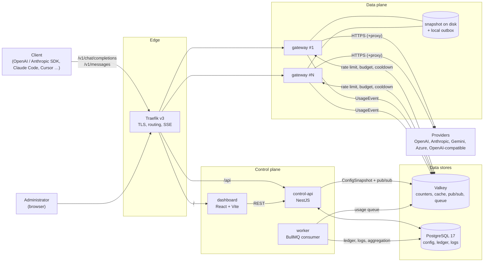
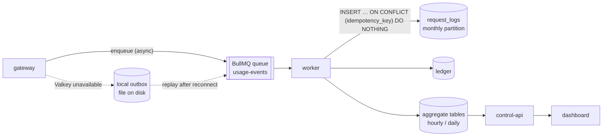
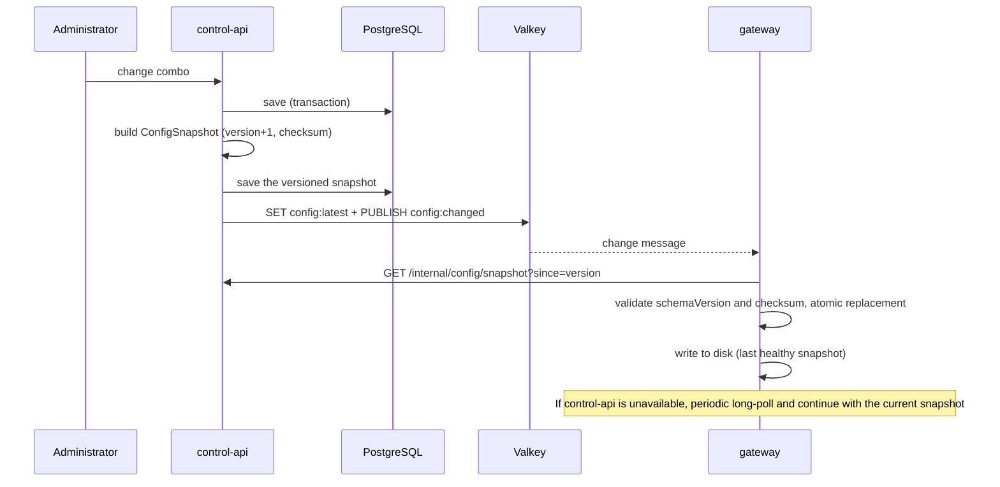
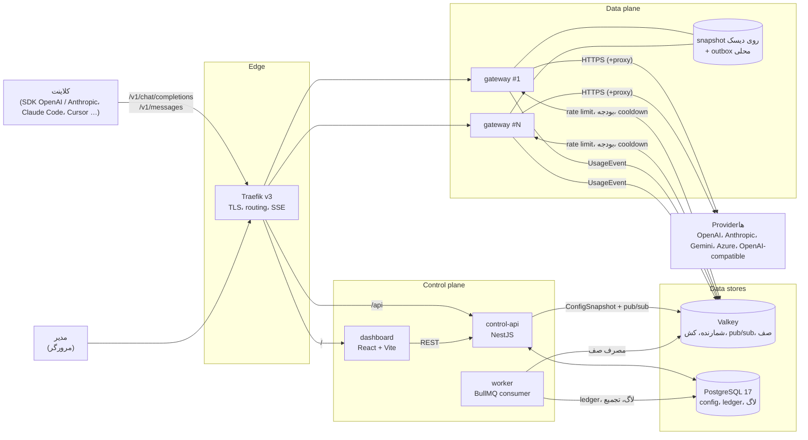
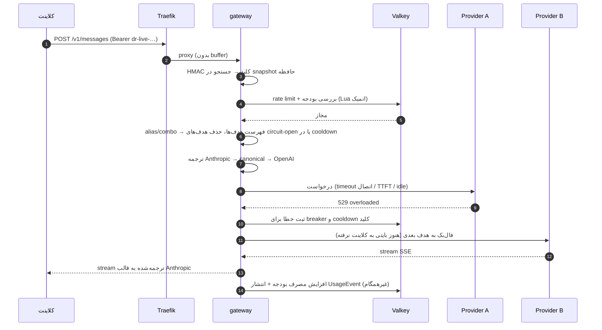
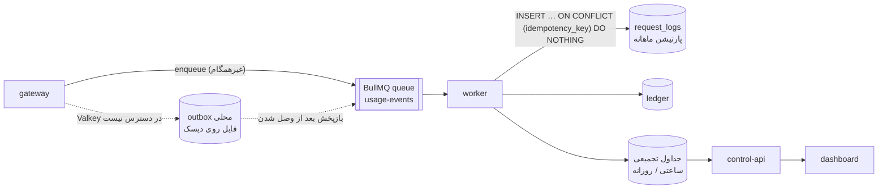
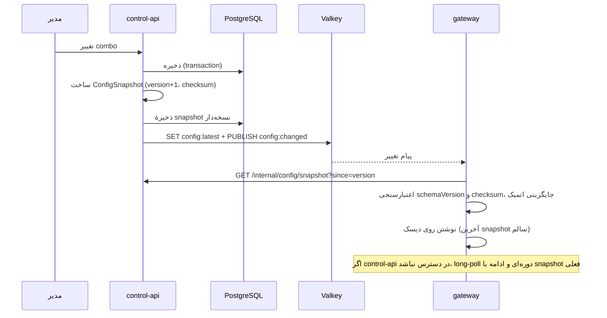

[English](#english) · [فارسی](#persian)

<a id="english"></a>

# DiRouter Architecture

> All documentation in this repository is bilingual (English and Persian), and detailed guides live in code/docs/. See [CONTRIBUTING.md](../CONTRIBUTING.md).

> This document is the basis for all Sprint 1 board cards. The decisions and their rationale are in the [ADRs](adr/README.md), and the definitions of concepts are in the [glossary](glossary.md).

## 1. Overview

DiRouter has two separate parts:

- **Data plane** (`apps/gateway`): the hot path of every LLM request. Virtual key authentication, rate limiting, budgets, routing, format translation, failover, and streaming. It must be fast, stateless, and independent of the control plane.
- **Control plane** (`apps/control-api`, `apps/worker`, `apps/dashboard`): management of organizations, users, providers, keys, models, and combos; config publishing; processing of usage events; reports and the dashboard.

The first design principle ([ADR-006](adr/0006-data-plane-independence.md)): **the data plane does not depend on the control plane.** If Postgres, control-api, or worker become unavailable, traffic continues with the last healthy config.



## 2. Components

| Component         | Responsibility                                                                                                            | Hard runtime dependency           |
| ----------------- | ------------------------------------------------------------------------------------------------------------------------- | --------------------------------- |
| **Traefik**       | TLS (Let's Encrypt), routing by path, health checks, unbuffered SSE pass-through                                          | —                                 |
| **gateway**       | OpenAI- and Anthropic-compatible API, routing, failover, circuit breaker, rate limiting, budgets, publishing usage events | none (Valkey with local fallback) |
| **control-api**   | Management API, dashboard authentication, RBAC, credential encryption, building and publishing ConfigSnapshot             | Postgres, Valkey                  |
| **worker**        | Consuming the UsageEvent queue, writing the ledger and logs, aggregate tables, partition maintenance                      | Postgres, Valkey                  |
| **dashboard**     | Persian, RTL management interface                                                                                         | control-api                       |
| **mock-provider** | Simulated provider with injected 429, 5xx, and latency for testing and chaos                                              | —                                 |
| **Valkey**        | Rate-limit and budget counters, cooldown and breaker state, config-change pub/sub, BullMQ queue                           | —                                 |
| **PostgreSQL**    | Source of truth for config, users, the financial ledger, and request logs (partitioned)                                   | —                                 |

## 3. Path of a request

```mermaid
sequenceDiagram
  autonumber
  participant C as Client
  participant T as Traefik
  participant G as gateway
  participant V as Valkey
  participant P1 as Provider A
  participant P2 as Provider B

  C->>T: POST /v1/messages (Bearer dr-live-…)
  T->>G: proxy (unbuffered)
  G->>G: HMAC of the key → lookup in the in-memory snapshot
  G->>V: rate limit + budget check (atomic Lua)
  V-->>G: allowed
  G->>G: alias/combo → list of targets; drop circuit-open targets or those in cooldown
  G->>G: translate Anthropic → canonical → OpenAI
  G->>P1: request (connect / TTFT / idle timeouts)
  P1-->>G: 529 overloaded
  G->>V: record error for breaker and key cooldown
  G->>P2: fallback to the next target (no byte has been sent to the client yet)
  P2-->>G: SSE stream
  G-->>C: stream translated to the Anthropic format
  G->>V: increase budget usage + publish UsageEvent (async)
```

Steps in the gateway:

1. **Entry and authentication** — the virtual key is read from `Authorization: Bearer` or `x-api-key`, hashed with HMAC-SHA256, and looked up in the in-memory snapshot. There is no database query on the hot path.
2. **Validation** — the body is validated against the `@dirouter/contracts` schema. Unknown fields are preserved.
3. **Limits** — rate limits (RPM, TPM, concurrency) and budgets at the key, project, and team level, using one atomic Lua script on Valkey. If Valkey is unavailable, the local limiter and `failMode` decide.
4. **Routing** — the model name is resolved to an alias, a combo, or a model, and an ordered list of targets (model + credential) is built. Circuit-open targets, keys in cooldown, and locked-out models are set aside.
5. **Translation** — the request is translated to the canonical model and from there to the destination API (N + M translators instead of N × M).
6. **Sending and resilience** — multi-layer timeouts, retry with backoff and jitter, fallback to the next target. Fallback during a stream is allowed only before the first byte is sent to the client.
7. **Response** — the response or stream is returned in the format of the inbound API. Errors also use the format of that API and DiRouter's stable codes.
8. **Accounting** — the cost is computed from usage and the model price, added to the budget counter in Valkey, and a `UsageEvent` is queued. The response does not wait for this step.

## 4. Usage event path



- Every event has an `idempotencyKey`; a repeated event (a queue retry or an outbox replay) does not record the cost twice.
- The real-time budget counter lives in Valkey; Postgres is the source of truth for accounting, and the worker periodically reconciles the counters against it.
- Logs are stored in a partitioned table, and the dashboard reads from aggregate tables so that heavy aggregation does not run over the raw table.

## 5. Config path



- `ConfigSnapshot` is published with a `schemaVersion` (format) and a `version` (monotonic counter); the gateway does not accept an older version or an unknown schemaVersion.
- Secrets (provider keys) are only in the snapshot encrypted with AES-256-GCM, and the gateway decrypts them in memory with `MASTER_KEY`.
- When the gateway boots and control-api is unavailable, it starts from the snapshot on disk.

## 6. Resilience

| Risk                                         | Mitigation                                                                                |
| -------------------------------------------- | ----------------------------------------------------------------------------------------- |
| Transient provider error (429, 5xx, timeout) | Error classification, retry with backoff and jitter, fallback in the combo chain          |
| Provider completely down                     | Circuit breaker for the provider and the model with a half-open probe                     |
| A key reached its limit                      | Cooldown of that same key and continue with another key                                   |
| Slow provider                                | Separate timeouts for connection, TTFT, and idle; bulkhead (concurrency cap) per provider |
| control-api or Postgres outage               | Continue with the in-memory and disk snapshot                                             |
| Valkey outage                                | Local limiter, configurable `failMode`, local outbox for events                           |
| New deployment                               | Graceful shutdown: stop accepting, finish open streams, then exit                         |

## 7. Technologies

| Layer                    | Choice                                                                      | ADR                                           |
| ------------------------ | --------------------------------------------------------------------------- | --------------------------------------------- |
| gateway                  | NestJS on the Fastify adapter with a lightweight hot path                   | [ADR-001](adr/0001-gateway-nestjs-fastify.md) |
| control-api, worker      | NestJS                                                                      | [ADR-001](adr/0001-gateway-nestjs-fastify.md) |
| database                 | PostgreSQL 17 + Prisma                                                      | [ADR-002](adr/0002-postgresql-prisma.md)      |
| counters, cache, pub/sub | Valkey                                                                      | [ADR-003](adr/0003-valkey.md)                 |
| reverse proxy            | Traefik v3                                                                  | [ADR-004](adr/0004-traefik-reverse-proxy.md)  |
| event queue              | BullMQ on Valkey                                                            | [ADR-005](adr/0005-bullmq-event-queue.md)     |
| dashboard                | React + Vite + TypeScript, TanStack Router/Query, shadcn/ui, Tailwind (RTL) | —                                             |
| schemas                  | zod in `@dirouter/contracts` with JSON Schema output                        | —                                             |
| monorepo                 | pnpm workspaces + Turborepo, strict TypeScript, ESM                         | —                                             |
| deployment               | Docker and docker compose (dev, prod, HA)                                   | —                                             |

## 8. Shared packages

| Package                   | Contents                                                                                                      | Consumers                               |
| ------------------------- | ------------------------------------------------------------------------------------------------------------- | --------------------------------------- |
| `@dirouter/contracts`     | OpenAI and Anthropic schemas, canonical model, ConfigSnapshot, UsageEvent, error templates, and code taxonomy | all                                     |
| `@dirouter/shared`        | pino logger with redaction, error classes, env validation, AES-256-GCM with key versioning, ULID, HMAC        | all Node apps                           |
| `@dirouter/db`            | Prisma schema and client                                                                                      | control-api, worker                     |
| `@dirouter/model-catalog` | Model prices and capabilities                                                                                 | control-api, gateway (via the snapshot) |
| `@dirouter/ui`            | React components                                                                                              | dashboard                               |

The gateway does not depend on `@dirouter/db`; this rule enforces ADR-006 at the code level.

---

<a id="persian"></a>

# معماری DiRouter

> تمام مستندات این مخزن دوزبانه (انگلیسی و فارسی) است و راهنماهای تفصیلی در code/docs/ نگهداری می‌شوند. برای مشارکت به [CONTRIBUTING.md](../CONTRIBUTING.md) مراجعه کنید.

> این سند مبنای همهٔ کارت‌های اسپرینت ۱ است. تصمیم‌ها و دلیل‌هایشان در [ADRها](adr/README.md) و تعریف مفاهیم در [واژه‌نامه](glossary.md) آمده است.

## ۱. نمای کلی

DiRouter دو بخش جدا دارد:

- **Data plane** (`apps/gateway`): مسیر داغ هر درخواست LLM. احراز هویت کلید مجازی، rate limit، بودجه، مسیریابی، ترجمهٔ فرمت، فال‌بک و stream. باید سریع، stateless و مستقل از control plane باشد.
- **Control plane** (`apps/control-api`، `apps/worker`، `apps/dashboard`): مدیریت سازمان، کاربر، provider، کلید، مدل و combo؛ انتشار config؛ پردازش رویدادهای مصرف؛ گزارش‌ها و داشبورد.

اصل اول طراحی ([ADR-006](adr/0006-data-plane-independence.md)): **data plane به control plane وابسته نیست.** اگر Postgres، control-api یا worker از دسترس خارج شوند، ترافیک با آخرین config سالم ادامه پیدا می‌کند.



## ۲. اجزا

| جزء               | مسئولیت                                                                                                    | وابستگی سخت در زمان اجرا      |
| ----------------- | ---------------------------------------------------------------------------------------------------------- | ----------------------------- |
| **Traefik**       | TLS (Let's Encrypt)، routing بر اساس مسیر، health check، عبور SSE بدون buffer                              | —                             |
| **gateway**       | API سازگار با OpenAI و Anthropic، مسیریابی، فال‌بک، circuit breaker، rate limit، بودجه، انتشار رویداد مصرف | هیچ (Valkey با fallback محلی) |
| **control-api**   | API مدیریتی، احراز هویت داشبورد، RBAC، رمزنگاری credentialها، ساخت و انتشار ConfigSnapshot                 | Postgres، Valkey              |
| **worker**        | مصرف صف UsageEvent، نوشتن ledger و لاگ، جداول تجمیعی، نگهداری پارتیشن‌ها                                   | Postgres، Valkey              |
| **dashboard**     | رابط مدیریتی فارسی و RTL                                                                                   | control-api                   |
| **mock-provider** | provider ساختگی با تزریق 429، 5xx و تأخیر برای تست و chaos                                                 | —                             |
| **Valkey**        | شمارنده‌های rate limit و بودجه، cooldown و وضعیت breaker، pub/sub تغییر config، صف BullMQ                  | —                             |
| **PostgreSQL**    | منبع حقیقت config، کاربران، ledger مالی، لاگ درخواست‌ها (پارتیشن‌بندی‌شده)                                 | —                             |

## ۳. مسیر یک درخواست



مراحل در گیت‌وی:

1. **ورود و احراز هویت** — کلید مجازی از `Authorization: Bearer` یا `x-api-key` خوانده، با HMAC-SHA256 هش و در snapshot حافظه جستجو می‌شود. هیچ query دیتابیسی در مسیر داغ نیست.
2. **اعتبارسنجی** — بدنه با اسکیمای `@dirouter/contracts` اعتبارسنجی می‌شود. فیلدهای ناشناخته حفظ می‌شوند.
3. **محدودیت‌ها** — rate limit (RPM، TPM، هم‌زمانی) و بودجه در سطح کلید، پروژه و تیم با یک Lua script اتمیک روی Valkey. اگر Valkey در دسترس نباشد، limiter محلی و `failMode` تعیین‌کننده است.
4. **مسیریابی** — نام مدل به alias، combo یا مدل resolve می‌شود و فهرست مرتب هدف‌ها (مدل + credential) ساخته می‌شود. هدف‌های circuit-open، کلیدهای در cooldown و مدل‌های قفل‌شده کنار گذاشته می‌شوند.
5. **ترجمه** — درخواست به مدل canonical و از آن به API مقصد ترجمه می‌شود (N + M مترجم به‌جای N × M).
6. **ارسال و تاب‌آوری** — timeoutهای چندلایه، retry با backoff و jitter، فال‌بک به هدف بعدی. فال‌بک در stream فقط تا قبل از ارسال اولین بایت به کلاینت مجاز است.
7. **پاسخ** — پاسخ یا stream به قالب API ورودی برگردانده می‌شود. خطاها هم در قالب همان API و با کد پایدار DiRouter.
8. **حسابداری** — هزینه از usage و قیمت مدل محاسبه، در Valkey به شمارندهٔ بودجه اضافه و یک `UsageEvent` در صف قرار می‌گیرد. پاسخ منتظر این مرحله نمی‌ماند.

## ۴. مسیر رویداد مصرف



- هر رویداد `idempotencyKey` دارد؛ تکرار یک رویداد (retry صف یا بازپخش outbox) هزینه را دوبار ثبت نمی‌کند.
- شمارندهٔ لحظه‌ای بودجه در Valkey است؛ Postgres منبع حقیقت حسابداری است و worker به‌صورت دوره‌ای شمارنده‌ها را با آن تطبیق می‌دهد.
- لاگ‌ها در جدول پارتیشن‌بندی‌شده ذخیره می‌شوند و داشبورد از جداول تجمیعی می‌خواند تا روی جدول خام aggregation سنگین اجرا نشود.

## ۵. مسیر config



- `ConfigSnapshot` با `schemaVersion` (قالب) و `version` (شمارندهٔ یکنواخت) منتشر می‌شود؛ گیت‌وی نسخهٔ قدیمی‌تر یا با schemaVersion ناشناخته را نمی‌پذیرد.
- رازها (کلید providerها) فقط رمزشده با AES-256-GCM در snapshot هستند و گیت‌وی با `MASTER_KEY` در حافظه رمزگشایی می‌کند.
- گیت‌وی هنگام بوت اگر control-api در دسترس نباشد، از snapshot روی دیسک شروع می‌کند.

## ۶. تاب‌آوری

| خطر                                     | راهکار                                                                           |
| --------------------------------------- | -------------------------------------------------------------------------------- |
| خطای گذرای provider (429، 5xx، timeout) | طبقه‌بندی خطا، retry با backoff و jitter، فال‌بک در زنجیرهٔ combo                |
| provider کاملاً قطع                     | circuit breaker برای provider و مدل با half-open probe                           |
| یک کلید به سقف رسیده                    | cooldown همان کلید و ادامه با کلید دیگر                                          |
| provider کند                            | timeoutهای جدا برای اتصال، TTFT و idle؛ bulkhead (سقف هم‌زمانی) برای هر provider |
| قطع control-api یا Postgres             | ادامه با snapshot حافظه و دیسک                                                   |
| قطع Valkey                              | limiter محلی، `failMode` قابل تنظیم، outbox محلی برای رویدادها                   |
| استقرار جدید                            | graceful shutdown: توقف پذیرش، تمام کردن streamهای باز، سپس خروج                 |

## ۷. فناوری‌ها

| لایه                 | انتخاب                                                                      | ADR                                           |
| -------------------- | --------------------------------------------------------------------------- | --------------------------------------------- |
| gateway              | NestJS روی Fastify adapter با مسیر داغ سبک                                  | [ADR-001](adr/0001-gateway-nestjs-fastify.md) |
| control-api، worker  | NestJS                                                                      | [ADR-001](adr/0001-gateway-nestjs-fastify.md) |
| دیتابیس              | PostgreSQL 17 + Prisma                                                      | [ADR-002](adr/0002-postgresql-prisma.md)      |
| شمارنده، کش، pub/sub | Valkey                                                                      | [ADR-003](adr/0003-valkey.md)                 |
| ریورس پراکسی         | Traefik v3                                                                  | [ADR-004](adr/0004-traefik-reverse-proxy.md)  |
| صف رویداد            | BullMQ روی Valkey                                                           | [ADR-005](adr/0005-bullmq-event-queue.md)     |
| داشبورد              | React + Vite + TypeScript، TanStack Router/Query، shadcn/ui، Tailwind (RTL) | —                                             |
| اسکیماها             | zod در `@dirouter/contracts` با خروجی JSON Schema                           | —                                             |
| مونوریپو             | pnpm workspaces + Turborepo، TypeScript strict، ESM                         | —                                             |
| استقرار              | Docker و docker compose (dev، prod، HA)                                     | —                                             |

## ۸. پکیج‌های مشترک

| پکیج                      | محتوا                                                                                                 | مصرف‌کننده                              |
| ------------------------- | ----------------------------------------------------------------------------------------------------- | --------------------------------------- |
| `@dirouter/contracts`     | اسکیماهای OpenAI و Anthropic، مدل canonical، ConfigSnapshot، UsageEvent، قالب‌های خطا و taxonomy کدها | همه                                     |
| `@dirouter/shared`        | لاگر pino با redact، کلاس‌های خطا، اعتبارسنجی env، AES-256-GCM با key versioning، ULID، HMAC          | همهٔ اپ‌های Node                        |
| `@dirouter/db`            | شِمای Prisma و کلاینت                                                                                 | control-api، worker                     |
| `@dirouter/model-catalog` | قیمت و قابلیت مدل‌ها                                                                                  | control-api، gateway (از طریق snapshot) |
| `@dirouter/ui`            | کامپوننت‌های React                                                                                    | dashboard                               |

گیت‌وی به `@dirouter/db` وابسته نیست؛ این قاعده ADR-006 را در سطح کد تضمین می‌کند.
