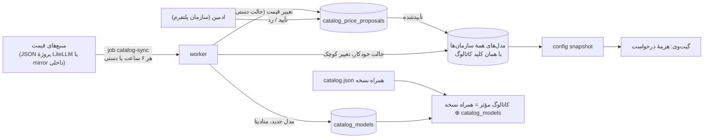

[English](catalog-sync.md) · [فارسی](catalog-sync.fa.md)

<div dir="rtl">

# همگام‌سازی کاتالوگ مدل و قیمت (کارت ۲۷.۵)

کاتالوگ مدل قبلاً فقط یک فایل JSON همراه هر نسخه بود (`packages/model-catalog/src/catalog.json`). این فایل همچنان پایه است، ولی حالا یک job در worker از یک یا چند منبع بیرونی قیمت می‌خواند تا مدل‌ها و قیمت‌های جدید بدون انتشار نسخه برسند.

## ساختار کلی



- **کاتالوگ مؤثر** (`GET /orgs/{org}/catalog`): ورودی‌های همراه نسخه که ورودی‌های همگام‌شده روی آن‌ها قرار می‌گیرند؛ کلید همگام‌شده برنده است. هر ورودی `source` دارد (`bundled` یا آدرس منبع) و اگر منبع‌ها دیگر آن را فهرست نکنند `removedFromSource` می‌گیرد (همچنان قابل استفاده است). نسخه به شکل `2026.11.07+sync.<زمان آخرین همگام‌سازی موفق>` است.
- **هزینهٔ درخواست** هرگز به منبع وابسته نیست: گیت‌وی قیمت را از ردیف مدل‌های سازمان در config snapshot می‌خواند. قیمت کاتالوگ فقط وقتی به درخواست می‌رسد که در همین ردیف‌ها نوشته شود؛ پس در حالت دستی تغییر قیمت تا تأیید ادمین اثری ندارد و بدون اینترنت گیت‌وی با آخرین مقادیر سالم کار می‌کند.

## job همگام‌سازی

job نگهداری `catalog-sync` در worker (هر `CATALOG_SYNC_INTERVAL_MS`، پیش‌فرض ۶ ساعت؛ ادمین می‌تواند فوراً هم اجرایش کند):

۱. همهٔ منبع‌ها را دانلود می‌کند (timeout برابر `CATALOG_SYNC_TIMEOUT_MS`، حداکثر ۵۰ مگابایت). منبعی که شکست بخورد گزارش می‌شود و چیزی اضافه نمی‌کند؛ اگر هیچ منبعی خوانده نشود اجرا `failed` ثبت می‌شود و چیزی تغییر نمی‌کند.

۲. هر سند را parse و اعتبارسنجی می‌کند. دو قالب پشتیبانی می‌شود:

- فایل `model_prices_and_context_window.json` پروژهٔ LiteLLM (منبع پیش‌فرض). قیمت هر توکن دقیقاً و بدون عدد اعشاری شناور به دلار به ازای هر میلیون توکن تبدیل می‌شود؛ providerهایی که DiRouter پشتیبانی نمی‌کند، حالت‌های پشتیبانی‌نشده (moderation، rerank و …) و ورودی با قیمت منفی یا غیرمعقول کنار گذاشته و شمرده می‌شوند.
- قالب خود DiRouter یعنی `{ "models": [CatalogEntry…] }`، هم‌شکل کاتالوگ همراه نسخه، برای mirror داخلی دست‌چین.

سندی که هیچ ورودی معتبری نداشته باشد کامل رد می‌شود.

۳. منبع‌ها را ادغام می‌کند (برای یک مدل منبع جلوتر برنده است) و با کاتالوگ مؤثر مقایسه می‌کند:

- **مدل جدید** ← فوراً به `catalog_models` اضافه می‌شود (تا مدلی از آن استفاده نکند هزینه‌ای ندارد)؛
- **فقط متادیتا** (context window، قابلیت‌ها، تاریخ deprecation) ← فوراً اعمال می‌شود؛
- **تغییر قیمت** ← در حالت `manual` پیشنهادی برای ادمین؛ در حالت `auto` فوراً اعمال و همهٔ مدل‌های سازمان‌ها روی آن کلید بازقیمت‌گذاری می‌شوند، مگر نرخ توکن بیش از `CATALOG_SYNC_MAX_CHANGE_FACTOR` (پیش‌فرض ۳ برابر) تغییر کند یا به صفر برسد یا از صفر شروع شود که باز منتظر تأیید می‌ماند (`reason: large_change`)؛
- **حذف از منبع‌ها** ← با `removedAt` علامت می‌خورد (هرگز حذف نمی‌شود)، و فقط وقتی همهٔ منبع‌ها پاسخ داده باشند.

۴. منبع ناقص را رد می‌کند: اگر همگام‌سازی‌های قبلی حداقل ۲۰ مدل ذخیره کرده باشند و همان منبع‌ها حالا کمتر از نصف آن‌ها را فهرست کنند، اجرا شکست می‌خورد و چیزی اعمال نمی‌شود. (تغییر فهرست منبع‌ها، مثلاً جایگزینی فهرست عمومی با mirror، مجاز است مجموعه را تغییر دهد.)

مقایسه و همهٔ نوشتن‌ها در یک تراکنش و زیر advisory lock انجام می‌شود تا دو replica از worker یک تغییر را دو بار اعمال نکنند. پیشنهاد تکرار نمی‌شود: همان قیمتی که در انتظار است یا رد شده دوباره پیشنهاد نمی‌شود، و اگر منبع نظرش را عوض کند یا به قیمت فعلی برگردد پیشنهاد در انتظار `superseded` می‌شود. worker بعد از بازقیمت‌گذاری مدل‌ها `dirouter:config:rebuild` را منتشر می‌کند تا گیت‌وی قیمت جدید را در snapshot بعدی بگیرد.

## تغییرات schema

| کجا                | فیلد                      | معنا                                                                                                                                             |
| ------------------ | ------------------------- | ------------------------------------------------------------------------------------------------------------------------------------------------ |
| `ModelPricing`     | `tiers[]`                 | `{ aboveInputTokens, inputPerMTok, outputPerMTok, cacheReadPerMTok?, cacheWritePerMTok? }`: پرامپت بلندتر از آستانه با نرخ همان پله قیمت می‌خورد |
| `ModelPricing`     | `batchDiscount`           | کسر تخفیف (`0.5` یعنی فراخوانی batch نصف قیمت)، از قیمت batch منبع؛ ذخیره و نمایش داده می‌شود ولی اعمال نمی‌شود (گیت‌وی هنوز API batch ندارد)    |
| ورودی کاتالوگ، مدل | `deprecationDate`         | تاریخ اعلام‌شدهٔ بازنشستگی مدل توسط provider (`YYYY-MM-DD`)، در نمای مدل و snapshot                                                              |
| `models`           | `price_override`          | سازمان قیمت این مدل کاتالوگ را دستی گذاشته؛ همگام‌سازی، تأیید و دکمهٔ «همگام‌سازی از کاتالوگ» خود سازمان به آن دست نمی‌زنند                      |
| جدول‌های جدید      | `catalog_models`          | ورودی‌های همگام‌شدهٔ کاتالوگ                                                                                                                     |
|                    | `catalog_price_proposals` | تغییرهای قیمت منتظر تصمیم ادمین (یا تصمیم‌گرفته‌شده)                                                                                             |
|                    | `catalog_sync_runs`       | یک ردیف برای هر اجرا (۵۰۰ ردیف آخر نگه داشته می‌شود)، در داشبورد نمایش داده می‌شود                                                               |
|                    | `catalog_sync_settings`   | تنظیمات ادمین که بر env اولویت دارند                                                                                                             |

قیمت پلکانی در `computeCost` پکیج `@dirouter/model-catalog` اعمال می‌شود، پس هزینهٔ گیت‌وی، قیمت فروش و بودجه‌ها همه از آن استفاده می‌کنند. migration: `20261125160000_catalog_sync`.

## override دستی سازمان

- ساخت مدل با `catalogKey` قیمت، context window، قابلیت‌ها، پله‌ها و تاریخ deprecation را از کاتالوگ مؤثر می‌گیرد.
- دادن قیمت صریح (هنگام ساخت یا بعداً) کلید کاتالوگ را نگه می‌دارد ولی `priceOverride: true` می‌گذارد: تغییر قیمت کاتالوگ، تأییدها و `POST models/sync-catalog` دیگر به آن مدل دست نمی‌زنند.
- `PATCH /orgs/{org}/models/{id}` با `{ "followCatalog": true }` قیمت دستی را کنار می‌گذارد و دوباره قیمت کاتالوگ را می‌گیرد. ویرایشگر مدل در داشبورد این را به‌صورت یک checkbox نشان می‌دهد و فقط قیمت‌هایی را می‌فرستد که با کاتالوگ فرق دارند.

## API ادمین (فقط سازمان پلتفرم)

سازمان‌های دیگر 404 می‌گیرند، مثل هر مسیری که وجود ندارد.

| مسیر                                                    | مجوز           | اثر                                                                                      |
| ------------------------------------------------------- | -------------- | ---------------------------------------------------------------------------------------- |
| `GET /orgs/{org}/catalog-sync`                          | `models:read`  | تنظیمات ذخیره‌شده، تعداد پیشنهادهای در انتظار، ۲۰ اجرای آخر                              |
| `PUT /orgs/{org}/catalog-sync/settings`                 | `models:write` | `{ enabled?, sources?, mode?, maxChangeFactor? }`؛ فهرست خالی `sources` یعنی پیش‌فرض env |
| `POST /orgs/{org}/catalog-sync/run`                     | `models:write` | یک اجرای فوری در صف worker می‌گذارد (202)                                                |
| `GET /orgs/{org}/catalog-sync/proposals?status=pending` | `models:read`  | پیشنهادها (در انتظار، تأییدشده، ردشده یا جایگزین‌شده)                                    |
| `POST /orgs/{org}/catalog-sync/proposals/{id}/approve`  | `models:write` | قیمت را اعمال می‌کند؛ `appliedModels` را برمی‌گرداند                                     |
| `POST /orgs/{org}/catalog-sync/proposals/{id}/reject`   | `models:write` | رد می‌کند؛ همان قیمت دوباره پیشنهاد نمی‌شود                                              |

هر تغییر در audit log ثبت می‌شود. داشبورد همین‌ها را در پنل **همگام‌سازی کاتالوگ و قیمت** پایین صفحهٔ مدل‌ها نشان می‌دهد.

## پیکربندی

پیش‌فرض‌های env برای worker (به [مرجع env](env-reference.fa.md) نگاه کنید): `CATALOG_SYNC_ENABLED`، `CATALOG_SYNC_SOURCES`، `CATALOG_SYNC_MODE`، `CATALOG_SYNC_INTERVAL_MS`، `CATALOG_SYNC_MAX_CHANGE_FACTOR`، `CATALOG_SYNC_TIMEOUT_MS`. تنظیمات ادمین که در دیتابیس ذخیره شده بر این‌ها اولویت دارد.

### استقرار بدون اینترنت و در ایران

GitHub raw معمولاً در دسترس نیست. یا منبع‌ها را خاموش کنید (`CATALOG_SYNC_ENABLED=false` یا کلید داشبورد) و با کاتالوگ همراه نسخه کار کنید، یا فایل را داخل شبکه mirror کنید و منبع را به آن بدهید:

```bash
# روی ماشینی که اینترنت دارد، مثلاً در یک cron روزانه
curl -fsSL https://raw.githubusercontent.com/BerriAI/litellm/main/model_prices_and_context_window.json \
  -o /srv/mirror/model_prices.json
# worker
CATALOG_SYNC_SOURCES=https://mirror.internal/model_prices.json
```

mirror دست‌چین می‌تواند از قالب خود DiRouter هم استفاده کند، مثلاً همان `catalog.json` همراه نسخه با ورودی‌های اضافهٔ شما.

## تست‌ها

- `packages/model-catalog/src/sync.test.ts`: تبدیل دقیق قیمت، قالب LiteLLM و DiRouter، ورودی‌های کنارگذاشته، diff، محافظ منبع ناقص، هزینهٔ پلکانی.
- `apps/worker/src/catalog-sync.integration.test.ts` (Postgres واقعی، fixture محلی HTTP): مدل جدید اضافه می‌شود؛ تغییر قیمت پیشنهاد می‌شود و تا تأیید مدل‌ها را بازقیمت‌گذاری نمی‌کند؛ مدل‌های با قیمت دستی حفظ می‌شوند؛ حالت خودکار با نگه‌داشتن تغییر بزرگ؛ منبع در دسترس‌نبودن، خراب و ناقص آخرین کاتالوگ سالم را نگه می‌دارد؛ خاموش کردن.
- `apps/control-api/src/models/catalog.integration.test.ts`: کاتالوگ مؤثر، پله‌ها در snapshot، تأیید که قیمت snapshot (هزینهٔ درخواست) را عوض می‌کند، `followCatalog`، تنظیمات و اجرای فوری.
- `apps/dashboard/src/components/catalog-sync.test.tsx`: پنل داشبورد.
- سناریوی `27.5` در `scripts/e2e/sprint-4.mjs` از مسیر Traefik با `/catalog/prices.json` در mock provider.

</div>
