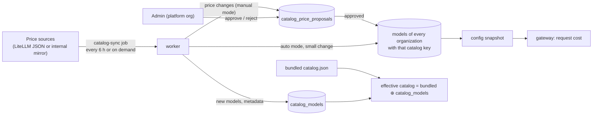

[English](catalog-sync.md) · [فارسی](catalog-sync.fa.md)

# Model catalog and price sync (card 27.5)

The model catalog used to be a JSON file bundled with each release (`packages/model-catalog/src/catalog.json`). It is still the baseline, but a worker job now reads one or more external price sources, so new models and price changes arrive without a release.

## How it fits together



- **Effective catalog** (`GET /orgs/{org}/catalog`): the bundled entries overlaid with the synced ones; a synced key wins. Each entry carries `source` (`bundled` or the source URL) and `removedFromSource` when the sources stopped listing it (it stays usable). The version reads `2026.11.07+sync.<time of the last successful sync>`.
- **Request cost** never depends on the source: the gateway prices from the organization model rows in its config snapshot. A catalog price reaches a request only when it is written to those rows, so in manual mode a price change has no effect until an admin approves it, and without internet the gateway keeps pricing with the last good values.

## The sync job

The worker's `catalog-sync` maintenance job (every `CATALOG_SYNC_INTERVAL_MS`, default 6 hours; admins can also run it at once):

1. Downloads every source (timeout `CATALOG_SYNC_TIMEOUT_MS`, at most 50 MB). A source that fails is reported and contributes nothing; if no source can be read the run is recorded as `failed` and nothing changes.
2. Parses and validates each document. Two formats are understood:
   - LiteLLM's `model_prices_and_context_window.json` (the default source). Prices per token are converted exactly (no floating point) to dollars per million tokens; providers DiRouter does not support, unsupported modes (moderation, rerank …) and entries with a negative or absurd price are skipped and counted.
   - DiRouter's own format `{ "models": [CatalogEntry…] }`, the same shape as the bundled catalog, for a curated internal mirror.
     A document without any valid entry is rejected as a whole.
3. Merges the sources (an earlier source wins for the same model) and diffs them against the effective catalog:
   - **new model** → added to `catalog_models` at once (it costs nothing until a model uses it);
   - **metadata only** (context window, capabilities, deprecation date) → applied at once;
   - **price change** → in `manual` mode a proposal for an admin; in `auto` mode applied at once and every organization model on that key is repriced, unless a token rate changes by more than `CATALOG_SYNC_MAX_CHANGE_FACTOR` (default 3×) or to or from zero, which still waits for approval (`reason: large_change`);
   - **missing from the sources** → marked `removedAt` (never deleted), and only when every source answered.
4. Refuses a truncated source: if earlier syncs stored at least 20 models and the same sources now list fewer than half of them, the run fails and nothing is applied. (A changed source list, such as a mirror replacing the public list, is allowed to change the set.)

The diff and all writes happen in one transaction under an advisory lock, so two worker replicas never apply the same change twice. A proposal is not repeated: the same proposed price that is already pending or was rejected is not proposed again, and a pending proposal is superseded when the source changes its mind or goes back to the price in force. After repricing models the worker publishes `dirouter:config:rebuild`, so the gateway gets the new prices in the next snapshot.

## Schema additions

| Where                | Field                     | Meaning                                                                                                                                                      |
| -------------------- | ------------------------- | ------------------------------------------------------------------------------------------------------------------------------------------------------------ |
| `ModelPricing`       | `tiers[]`                 | `{ aboveInputTokens, inputPerMTok, outputPerMTok, cacheReadPerMTok?, cacheWritePerMTok? }`: a prompt longer than the threshold is priced at the tier's rates |
| `ModelPricing`       | `batchDiscount`           | Fraction (`0.5` = batch calls cost half), read from the source's batch prices; applied to batches run through `/v1/batches` (card 30.1)                      |
| catalog entry, model | `deprecationDate`         | Provider's announced retirement date (`YYYY-MM-DD`), shown in the model view and carried in the snapshot                                                     |
| `models`             | `price_override`          | The organization priced this catalog model by hand; syncs, approvals and the org's own "sync from catalog" leave it alone                                    |
| new tables           | `catalog_models`          | Synced catalog entries                                                                                                                                       |
|                      | `catalog_price_proposals` | Price changes waiting for (or decided by) an admin                                                                                                           |
|                      | `catalog_sync_runs`       | One row per run (newest 500 kept), shown in the dashboard                                                                                                    |
|                      | `catalog_sync_settings`   | Admin settings that override the environment                                                                                                                 |

Tier pricing is applied by `computeCost` in `@dirouter/model-catalog`, so the gateway's cost, the sale price and budgets all use it. Migration: `20261125160000_catalog_sync`.

## Organization overrides

- Creating a model with a `catalogKey` takes price, context window, capabilities, tiers and deprecation date from the effective catalog.
- Giving explicit prices (on create or later) keeps the catalog key but sets `priceOverride: true`: catalog price changes, approvals and `POST models/sync-catalog` no longer touch that model.
- Models that existed before catalog sync all started with `priceOverride: false`, hand-priced ones included. Migration `20261125200000_review_hardening` marks every such model `priceOverride: true` unless its prices equal its synced catalog entry exactly (an entry that is only in the bundled catalog cannot be compared in SQL, so its models are marked too). A sync therefore never reprices a hand-priced model silently; use `followCatalog` to put a model back on the catalog price.
- Approving a proposal claims it first (`UPDATE … WHERE status = 'pending'`), so two concurrent approvals, or an approval racing a sync that supersedes the proposal, apply it at most once; the other gets 404 (no pending proposal).
- `PATCH /orgs/{org}/models/{id}` with `{ "followCatalog": true }` drops the manual price and takes the catalog price again. The dashboard's model editor offers this as a checkbox and only sends prices that differ from the catalog.

## Admin API (platform organization only)

Other organizations get 404, as for any route that does not exist.

| Route                                                   | Permission     | Effect                                                                                           |
| ------------------------------------------------------- | -------------- | ------------------------------------------------------------------------------------------------ |
| `GET /orgs/{org}/catalog-sync`                          | `models:read`  | Stored settings, number of pending proposals, last 20 runs                                       |
| `PUT /orgs/{org}/catalog-sync/settings`                 | `models:write` | `{ enabled?, sources?, mode?, maxChangeFactor? }`; an empty `sources` list means the env default |
| `POST /orgs/{org}/catalog-sync/run`                     | `models:write` | Queues a one-off run on the worker (202)                                                         |
| `GET /orgs/{org}/catalog-sync/proposals?status=pending` | `models:read`  | Proposals (pending, approved, rejected or superseded)                                            |
| `POST /orgs/{org}/catalog-sync/proposals/{id}/approve`  | `models:write` | Puts the price into force; returns `appliedModels`                                               |
| `POST /orgs/{org}/catalog-sync/proposals/{id}/reject`   | `models:write` | Rejects it; the same price is not proposed again                                                 |

Every change is written to the audit log. The dashboard shows the same in a **Catalog and price sync** panel at the bottom of the Models page.

## Configuration

Environment defaults for the worker (see [env-reference](env-reference.md)): `CATALOG_SYNC_ENABLED`, `CATALOG_SYNC_SOURCES`, `CATALOG_SYNC_MODE`, `CATALOG_SYNC_INTERVAL_MS`, `CATALOG_SYNC_MAX_CHANGE_FACTOR`, `CATALOG_SYNC_TIMEOUT_MS`. The admin settings stored in the database win over them.

### Air-gapped and Iranian deployments

GitHub raw is often unreachable. Either switch the sources off (`CATALOG_SYNC_ENABLED=false` or the dashboard switch) and keep the bundled catalog, or mirror the file inside the network and point the sources at it:

```bash
# on a machine with internet access, e.g. in a daily cron job
curl -fsSL https://raw.githubusercontent.com/BerriAI/litellm/main/model_prices_and_context_window.json \
  -o /srv/mirror/model_prices.json
# worker
CATALOG_SYNC_SOURCES=https://mirror.internal/model_prices.json
```

A curated mirror can also use DiRouter's own format, for example the bundled `catalog.json` with your own entries added.

## Tests

- `packages/model-catalog/src/sync.test.ts`: exact price conversion, LiteLLM and DiRouter formats, skipped entries, diff, truncation guard, tier cost.
- `apps/worker/src/catalog-sync.integration.test.ts` (real Postgres, local HTTP fixture): a new model is added; a price change becomes a proposal and does not reprice models until approved; hand-priced models are kept; auto mode with the large-change hold; unreachable, broken and truncated sources keep the last good catalog; switching off.
- `apps/control-api/src/models/catalog.integration.test.ts`: effective catalog, tiers in the snapshot, approval changes the snapshot price (the request cost), `followCatalog`, settings and run-now.
- `apps/dashboard/src/components/catalog-sync.test.tsx`: the panel.
- `scripts/e2e/sprint-4.mjs` scenario `27.5` through Traefik against the mock provider's `/catalog/prices.json`.
