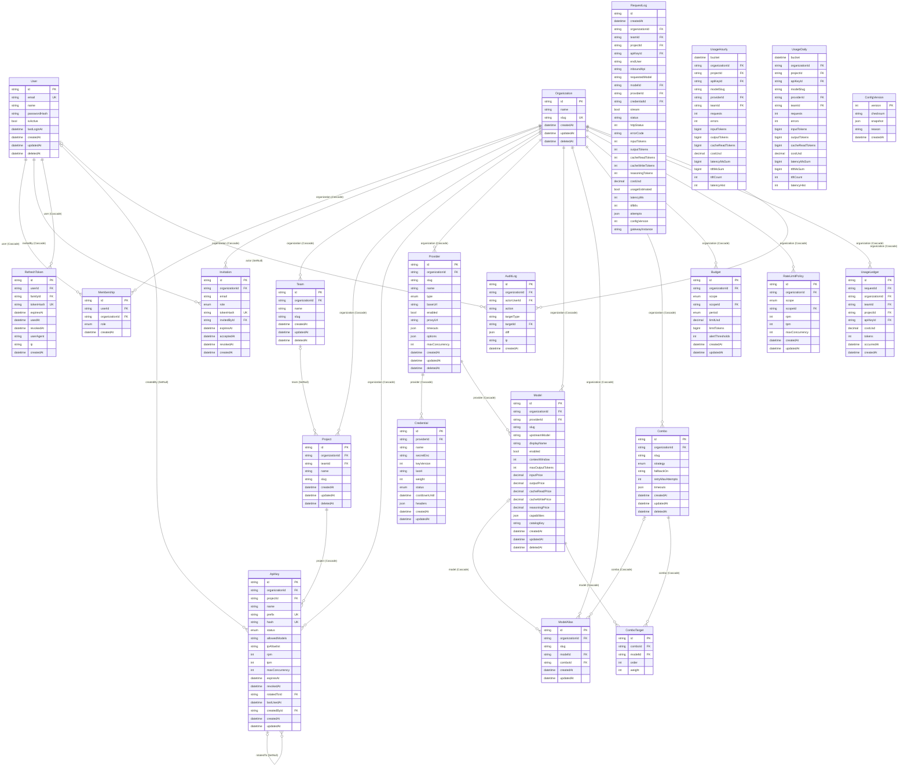

[English](#english) · [فارسی](#persian)

<a id="english"></a>

# Database

Code: `packages/db` (Prisma 6, PostgreSQL 17) · cards 3.1 and 3.2

## Models

| Domain              | Model (table)                                                                                                                               | Note                                                              |
| ------------------- | ------------------------------------------------------------------------------------------------------------------------------------------- | ----------------------------------------------------------------- |
| Identity and access | `Organization` (organizations), `User` (users), `Membership` (memberships, role), `Invitation`, `RefreshToken`                              | soft-delete for organization and user                             |
| Structure           | `Team` (teams), `Project` (projects)                                                                                                        | a project is optionally under a team (SetNull)                    |
| Virtual key         | `ApiKey` (api_keys): prefix, hash, allowedModels, ipAllowlist, expiresAt, status                                                            | `rotatedTo` for key rotation                                      |
| Provider            | `Provider` (providers): type, baseUrl, proxyUrl, timeouts; `Credential` (credentials): secretEnc, keyVersion, weight, status, cooldownUntil | the secret is always encrypted (AES-256-GCM, AAD = credential ID) |
| Catalog             | `Model` (models): contextWindow and prices; `ModelAlias`; `Combo` and `ComboTarget` (order, weight)                                         | prices are `Decimal(18,8)`                                        |
| Limits              | `Budget`, `RateLimitPolicy`                                                                                                                 | at the key, project, or team level                                |
| Usage               | `RequestLog` (request_log, monthly partition), `UsageLedger`, `UsageHourly`, `UsageDaily`                                                   | no FK on request_log (high volume and partitioning)               |
| Config and audit    | `ConfigVersion` (config_versions), `AuditLog` (audit_logs)                                                                                  | versioned snapshot of the gateway                                 |

## ER diagram

Only the main fields and relationships are shown for readability. This diagram was generated from `schema.prisma` by a script; regenerate it after schema changes.



## Deletion policy

- **soft-delete** (`deleted_at`): Organization, User, Team, Project, Provider, Model, and Combo. These are referenced by logs and reports, so history must not be lost. Deletion through the API only sets `deleted_at`, and the snapshot does not include deleted items.
- **Cascade**: the direct dependents of an organization (memberships, invitations, keys, providers, credentials, models, aliases, combos, budgets, rate limits, ledger, and audit). These are removed only when the organization is actually deleted.
- **SetNull**: `Project.teamId`, `ApiKey.createdBy`, `ApiKey.rotatedTo`, and `AuditLog.actor`. Deleting a user or team keeps the dependent record.
- All foreign keys have indexes (Postgres does not create indexes automatically).

## Partitioning `request_log`

- A native **monthly partition** on `created_at` (UTC). The primary key is `(id, created_at)` because Postgres requires the partition key in the PK. `id` is the request ID, and a duplicate event is skipped with `ON CONFLICT DO NOTHING`.
- Partitions are in a separate `partitions` schema (`partitions.request_log_YYYY_MM`) so that `prisma migrate` does not detect them as drift.
- The `request_log_default` partition prevents insert failures, even when a month's partition has not been created for any reason.
- Indexes are defined on the parent table and inherited by all partitions: `(project_id, created_at)`, `(api_key_id, created_at)`, `(organization_id, created_at)`, and `(status)`.
- **Automatic creation**: the worker runs the `partitions` job every hour, i.e. `dirouter_ensure_request_log_partitions(3)`, which creates the current month and the three following months. It runs with an advisory lock and only on one replica. The migration also calls it once.

## Retention

- `REQUEST_LOG_RETENTION_MONTHS` (default 3): the `retention` job calls the function `dirouter_drop_request_log_partitions(n)` every day at 03:17 UTC. This function `DROP`s the partitions that are entirely older than n months (the current month is not counted).
- Dropping a partition is instant and, unlike `DELETE`, does not bloat the table.
- `usage_hourly`, `usage_daily`, and `usage_ledger` are not deleted. The dashboard and budgets read from these, so old reports remain correct after the raw logs are deleted.

## Aggregate tables

`usage_hourly` and `usage_daily` with the key `(bucket, organization_id, project_id, api_key_id, model_slug, provider_id)`:

- `model_slug` is the model the client requested (a model, an alias, or a combo). An empty `provider_id` means no provider responded.
- requests, errors (any status other than success), tokens, `cost_usd`, and the sums of latency and ttft (for averages).
- `latency_hist` is a 10-bucket histogram with the boundaries 100, 250, 500, 1000, 2500, 5000, 10000, 30000, and 60000 milliseconds, plus an overflow bucket, for approximate p50/p95/p99.

Rollup (migration `usage_rollups`):

- `dirouter_rollup_hour(ts)` recalculates one hour **completely from scratch** from request_log. `dirouter_rollup_day(date)` calculates the day from the hourly rows (the histogram with the aggregate `dirouter_int_array_sum`).
- After writing each batch, the worker puts the changed hours into the set `dirouter:rollup:dirty-hours` on Valkey. The `rollup` job (every 30 seconds) takes them with `SPOP`, together with the current and previous hour, and rebuilds the related hours and days.
- Because the calculation is idempotent, a late event (for example a replay after a Valkey outage) or a repeated run does not double the numbers.

## Performance (10 million rows)

Test (2026-11-07) on PostgreSQL 17 in a separate container on Docker Desktop, with default settings:

- 10,000,000 `request_log` rows over the last 30 days: 1 organization, 5 teams, 20 projects, 200 keys, 10 models, and 5 providers. Their aggregation produced 6,200 `usage_daily` rows.

| Dashboard query (30 days, `EXPLAIN ANALYZE`)     | Source                            | Time      |
| ------------------------------------------------ | --------------------------------- | --------- |
| Daily series: requests, errors, tokens, and cost | `usage_daily`                     | **2.2ms** |
| Top 10 models with average latency               | `usage_daily`                     | **3.6ms** |
| The same daily series                            | raw `request_log`, for comparison | 4,950ms   |

So the dashboard always reads from the aggregate tables. request_log is only for the Request Log Explorer, with a time-range filter and the `(project_id, created_at)` and `(api_key_id, created_at)` indexes.

Test script: insertion with `generate_series`, rollup with `INSERT … SELECT … GROUP BY`, and `EXPLAIN (ANALYZE)` on the same queries (in the history of card 3.2).

## Commands

```bash
pnpm --filter @dirouter/db exec prisma migrate dev      # new migration in dev
make migrate                                            # migrate deploy in compose
INTEGRATION_DATABASE_URL=… INTEGRATION_VALKEY_URL=… pnpm --filter @dirouter/worker test:integration
```

---

<a id="persian"></a>

# پایگاه داده

کد: `packages/db` (Prisma 6، PostgreSQL 17) · کارت‌های ۳.۱ و ۳.۲

## مدل‌ها

| دامنه            | مدل (جدول)                                                                                                                                  | نکته                                                       |
| ---------------- | ------------------------------------------------------------------------------------------------------------------------------------------- | ---------------------------------------------------------- |
| هویت و دسترسی    | `Organization` (organizations)، `User` (users)، `Membership` (memberships، نقش)، `Invitation`، `RefreshToken`                               | soft-delete برای سازمان و کاربر                            |
| ساختار           | `Team` (teams)، `Project` (projects)                                                                                                        | پروژه اختیاراً زیر تیم است (SetNull)                       |
| کلید مجازی       | `ApiKey` (api_keys): prefix، hash، allowedModels، ipAllowlist، expiresAt، status                                                            | `rotatedTo` برای چرخش کلید                                 |
| provider         | `Provider` (providers): type، baseUrl، proxyUrl، timeouts؛ `Credential` (credentials): secretEnc، keyVersion، weight، status، cooldownUntil | secret همیشه رمزشده (AES-256-GCM، AAD = شناسهٔ credential) |
| کاتالوگ          | `Model` (models): contextWindow و قیمت‌ها؛ `ModelAlias`؛ `Combo` و `ComboTarget` (order، weight)                                            | قیمت‌ها `Decimal(18,8)`                                    |
| محدودیت          | `Budget`، `RateLimitPolicy`                                                                                                                 | سطح کلید، پروژه یا تیم                                     |
| مصرف             | `RequestLog` (request_log، پارتیشن ماهانه)، `UsageLedger`، `UsageHourly`، `UsageDaily`                                                      | بدون FK روی request_log (حجم بالا و پارتیشن)               |
| پیکربندی و ممیزی | `ConfigVersion` (config_versions)، `AuditLog` (audit_logs)                                                                                  | snapshot نسخه‌دار گیت‌وی                                   |

## نمودار ER

برای خوانایی فقط فیلدها و رابطه‌های اصلی آمده است. این نمودار با اسکریپت از `schema.prisma` ساخته شده؛ با تغییر شِما دوباره بسازید.


## سیاست حذف

- **soft-delete** (`deleted_at`): Organization، User، Team، Project، Provider، Model و Combo. این‌ها در لاگ‌ها و گزارش‌ها ارجاع دارند و نباید تاریخچه گم شود. حذف از API فقط `deleted_at` می‌گذارد و snapshot موارد حذف‌شده را نمی‌آورد.
- **Cascade**: وابسته‌های مستقیم سازمان (عضویت، دعوت، کلید، provider، credential، مدل، alias، combo، بودجه، rate limit، ledger و ممیزی). این‌ها فقط با حذف واقعی سازمان پاک می‌شوند.
- **SetNull**: `Project.teamId`، `ApiKey.createdBy`، `ApiKey.rotatedTo` و `AuditLog.actor`. حذف کاربر یا تیم رکورد وابسته را نگه می‌دارد.
- همهٔ کلیدهای خارجی ایندکس دارند (Postgres خودکار ایندکس نمی‌سازد).

## پارتیشن‌بندی `request_log`

- پارتیشن **ماهانهٔ native** روی `created_at` (UTC). کلید اصلی `(id, created_at)` است چون Postgres کلید پارتیشن را در PK می‌خواهد. `id` همان request id است و رویداد تکراری با `ON CONFLICT DO NOTHING` رد می‌شود.
- پارتیشن‌ها در schema جدای `partitions` هستند (`partitions.request_log_YYYY_MM`) تا `prisma migrate` آن‌ها را drift تشخیص ندهد.
- پارتیشن `request_log_default` جلوی شکست insert را می‌گیرد، حتی وقتی به هر دلیل پارتیشن ماه ساخته نشده باشد.
- ایندکس‌ها روی جدول والد تعریف شده‌اند و به همهٔ پارتیشن‌ها ارث می‌رسند: `(project_id, created_at)`، `(api_key_id, created_at)`، `(organization_id, created_at)` و `(status)`.
- **ساخت خودکار**: worker هر ساعت job `partitions` را اجرا می‌کند، یعنی `dirouter_ensure_request_log_partitions(3)`، که ماه جاری و سه ماه بعد را می‌سازد. با advisory lock و فقط در یک replica اجرا می‌شود. migration هم یک بار همین را صدا می‌زند.

## retention

- `REQUEST_LOG_RETENTION_MONTHS` (پیش‌فرض ۳): job `retention` هر روز ساعت 03:17 UTC تابع `dirouter_drop_request_log_partitions(n)` را صدا می‌زند. این تابع پارتیشن‌هایی را که کاملاً قدیمی‌تر از n ماه هستند `DROP` می‌کند (ماه جاری حساب نمی‌شود).
- drop پارتیشن آنی است و بر خلاف `DELETE` جدول را bloat نمی‌کند.
- `usage_hourly`، `usage_daily` و `usage_ledger` حذف نمی‌شوند. داشبورد و بودجه از این‌ها می‌خوانند، پس گزارش‌های قدیمی بعد از حذف لاگ خام هم درست می‌مانند.

## جداول تجمیعی

`usage_hourly` و `usage_daily` با کلید `(bucket, organization_id, project_id, api_key_id, model_slug, provider_id)`:

- `model_slug` همان مدلی است که کلاینت خواسته (مدل، alias یا combo). `provider_id` خالی یعنی هیچ providerی پاسخ نداد.
- requests، errors (هر status غیر success)، توکن‌ها، `cost_usd`، جمع latency و ttft (برای میانگین).
- `latency_hist` هیستوگرام ۱۰ سطلی با مرزهای 100، 250، 500، 1000، 2500، 5000، 10000، 30000 و 60000 میلی‌ثانیه، و بیشتر، برای p50/p95/p99 تقریبی.

rollup (migration `usage_rollups`):

- `dirouter_rollup_hour(ts)` یک ساعت را **کامل از نو** از request_log حساب می‌کند. `dirouter_rollup_day(date)` روز را از ساعتی حساب می‌کند (هیستوگرام با aggregate `dirouter_int_array_sum`).
- worker بعد از نوشتن هر دسته ساعت‌های تغییرکرده را در set `dirouter:rollup:dirty-hours` روی Valkey می‌گذارد. job `rollup` (هر ۳۰ ثانیه) آن‌ها را با `SPOP` برمی‌دارد، به‌علاوهٔ ساعت جاری و قبلی، و ساعت‌ها و روزهای مربوط را از نو می‌سازد.
- چون محاسبه idempotent است، رویداد دیررس (مثلاً replay بعد از قطعی Valkey) یا اجرای تکراری عدد را دو برابر نمی‌کند.

## کارایی (۱۰ میلیون ردیف)

تست (۲۰۲۶-۱۱-۰۷) روی PostgreSQL 17 در کانتینر جدا روی Docker Desktop، با تنظیمات پیش‌فرض:

- ۱۰٬۰۰۰٬۰۰۰ ردیف `request_log` در ۳۰ روز اخیر: ۱ سازمان، ۵ تیم، ۲۰ پروژه، ۲۰۰ کلید، ۱۰ مدل و ۵ provider. تجمیع آن‌ها ۶٬۲۰۰ ردیف `usage_daily` شد.

| کوئری داشبورد (۳۰ روز، `EXPLAIN ANALYZE`) | منبع                           | زمان      |
| ----------------------------------------- | ------------------------------ | --------- |
| سری روزانه: درخواست، خطا، توکن و هزینه    | `usage_daily`                  | **2.2ms** |
| ۱۰ مدل پرمصرف با میانگین latency          | `usage_daily`                  | **3.6ms** |
| همان سری روزانه                           | `request_log` خام، برای مقایسه | 4,950ms   |

پس داشبورد همیشه از جداول تجمیعی می‌خواند. request_log فقط برای Request Log Explorer است، با فیلتر بازهٔ زمانی و ایندکس‌های `(project_id, created_at)` و `(api_key_id, created_at)`.

اسکریپت تست: درج با `generate_series`، rollup با `INSERT … SELECT … GROUP BY` و `EXPLAIN (ANALYZE)` روی همان کوئری‌ها (در تاریخچهٔ کارت ۳.۲).

## دستورها

```bash
pnpm --filter @dirouter/db exec prisma migrate dev      # migration جدید در dev
make migrate                                            # migrate deploy در compose
INTEGRATION_DATABASE_URL=… INTEGRATION_VALKEY_URL=… pnpm --filter @dirouter/worker test:integration
```
