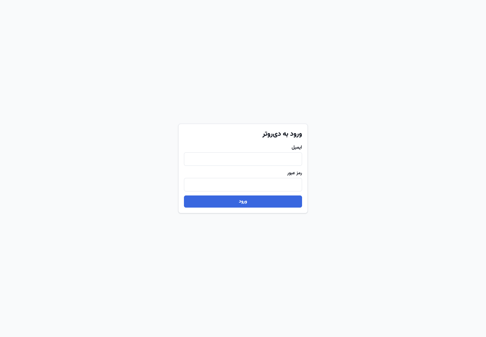
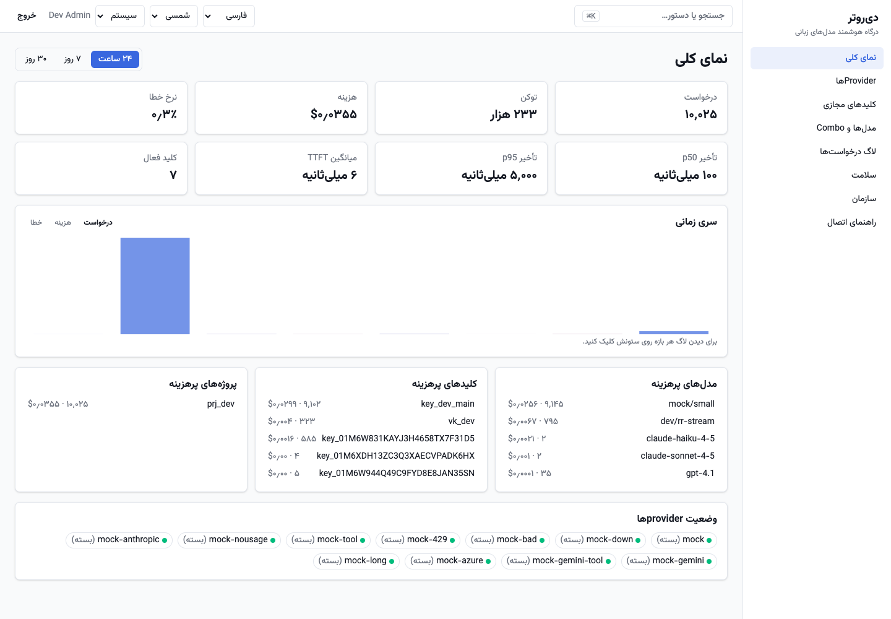
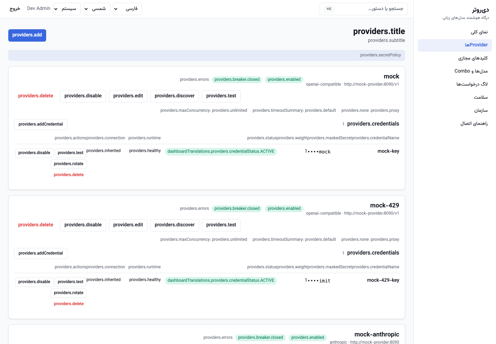
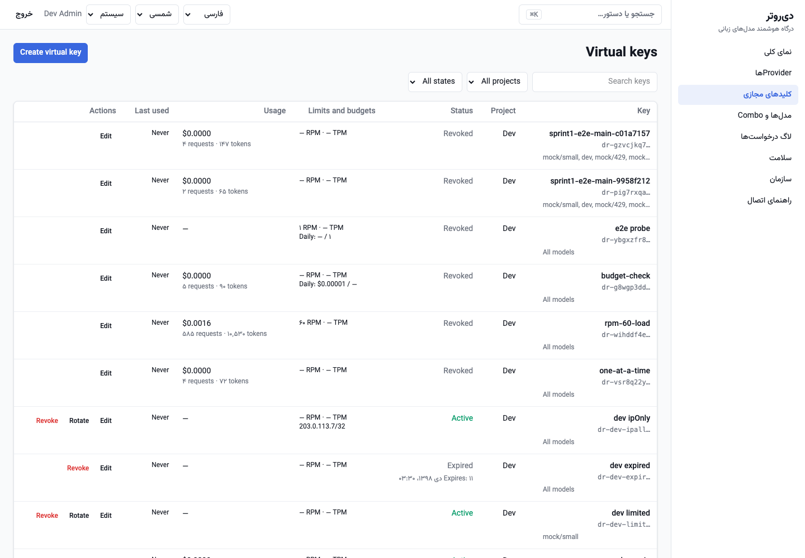
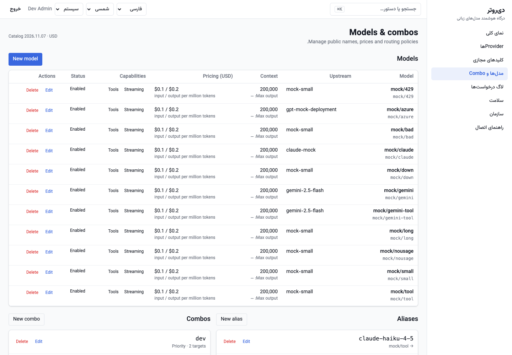
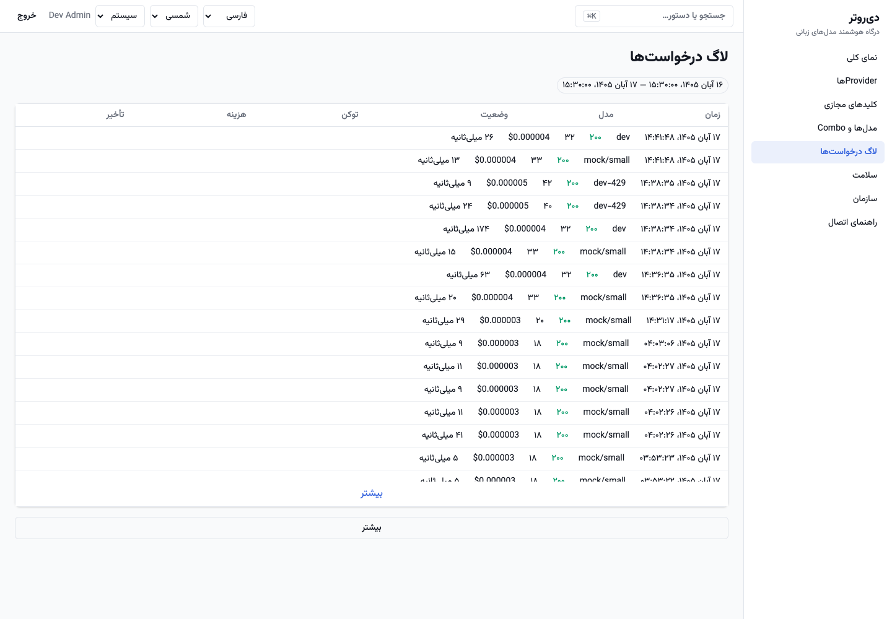
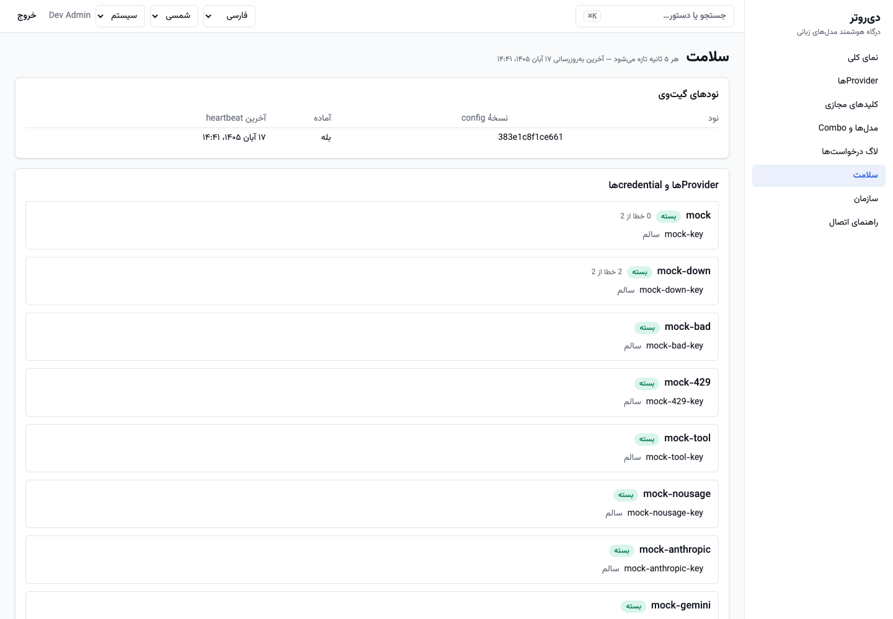
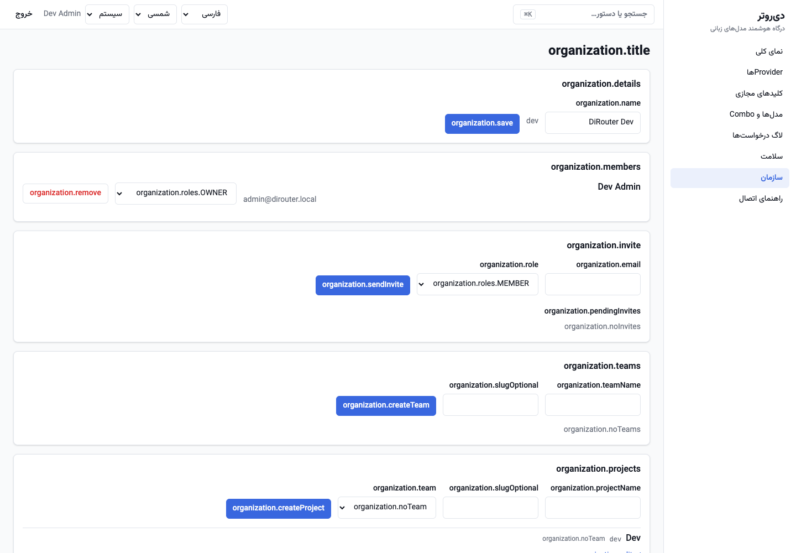
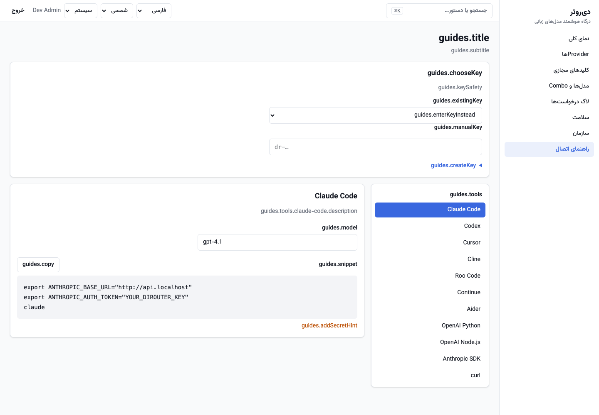
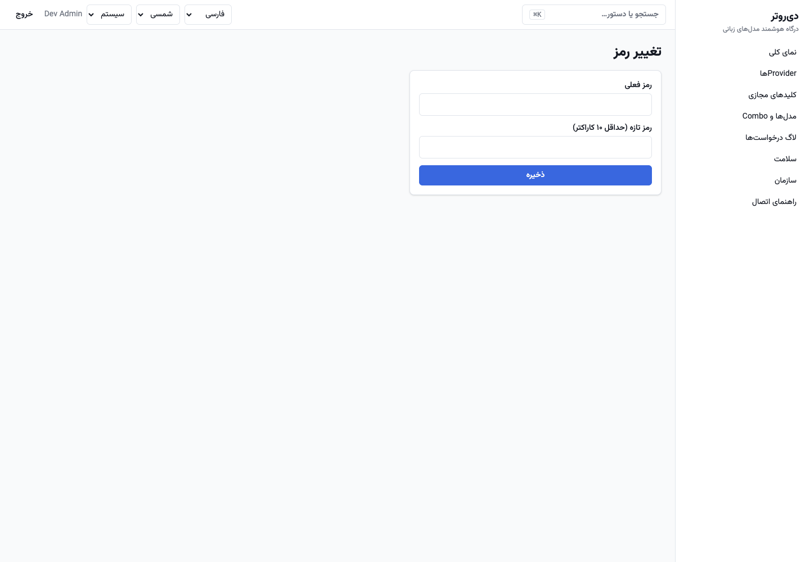

# راهنمای کاربر داشبورد

این راهنما مسیر فعلی داشبورد فارسی را توضیح می‌دهد. تصویرها در ۸ نوامبر ۲۰۲۶ از نصب توسعهٔ محلی با دادهٔ mock گرفته شده‌اند؛ هیچ credential واقعی یا کلید مجازی کاملی در آن‌ها نیست. نام‌ها و اعداد تصویر نمونه‌اند، نه دادهٔ production.

## شروع و جهت‌یابی

- **نصب خالی:** `/setup` را باز کنید. مرحلهٔ ۱ سازمان و OWNER می‌سازد؛ مرحلهٔ ۲ provider اختیاری با credential می‌گیرد؛ مرحلهٔ ۳ پروژهٔ `Default` و اولین کلید مجازی می‌سازد. رمز باید حداقل ۱۰ کاراکتر باشد. کلید را همان‌جا کپی و امن نگه دارید؛ بازیابی مقدار کامل ممکن نیست.
- **نصب موجود:** `/login` ایمیل و رمز می‌گیرد. خروج از منوی حساب انجام می‌شود. نشست پس از reload از refresh cookie بازیابی می‌شود و با خروج/تغییر رمز باطل می‌شود.
- نوار کناری به نمای کلی، Providerها، کلیدهای مجازی، مدل‌ها و Combo، لاگ درخواست‌ها، سلامت، سازمان و راهنمای اتصال می‌رود. حساب کاربر از نوار بالا و مسیر `/account` در دسترس است.
- زبان فارسی/English، تقویم شمسی/میلادی و تم سیستم/روشن/تیره قابل تغییر است. `⌘K` جست‌وجوی فرمان را باز می‌کند.
- بازهٔ ۲۴ ساعت/۷ روز/۳۰ روز در Overview و Keys مشترک است. صفحات overview هر ۳۰ ثانیه و health هر ۵ ثانیه تازه می‌شوند.



## مفاهیم: از provider تا درخواست

```text
Organization
├─ Provider ── Credential (چند کلید upstream با وزن)
├─ Model ───── نام upstream + قیمت + context + قابلیت‌ها
├─ Combo ───── چند Model + استراتژی + retry/fallback
├─ Alias ───── نام پایدار کلاینت → Model یا Combo
└─ Project ─── Virtual Key ── مدلهای مجاز + limit + بودجه + انقضا/IP
```

| مفهوم                       | معنا و نکتهٔ عملی                                                                                                                                                            |
| --------------------------- | ---------------------------------------------------------------------------------------------------------------------------------------------------------------------------- |
| **Provider**                | اتصال به OpenAI، Anthropic، Gemini، Azure OpenAI یا API سازگار با OpenAI. Base URL، proxy، timeout و سقف همزمانی دارد.                                                       |
| **Credential**              | راز upstream داخل provider. چند credential وزن‌دار برای توزیع بار/سهمیه و فال‌بک استفاده می‌شوند. فقط چهار حرف آخر ماسک‌شده دیده می‌شود؛ مقدار کامل قابل بازیابی نیست.       |
| **Model**                   | نگاشت نام عمومی به `upstreamModel` همان provider. قیمت بر یک میلیون توکن، context، max output و قابلیت‌ها را دارد.                                                           |
| **Combo**                   | مجموعهٔ مدلها. `priority` ترتیب ثابت، `weighted` انتخاب وزنی و `round-robin` چرخش به ازای combo+کلید دارد. `fallbackOn` تعیین می‌کند کدام کلاس خطا به کاندیدای بعدی برود.    |
| **Alias**                   | نامی که کلاینت می‌بیند و به model یا combo اشاره می‌کند. با تغییر مقصد alias، نام API کلاینت ثابت می‌ماند.                                                                   |
| **Virtual Key**             | کلید `dr-…` برای اپ کلاینت؛ با provider credential فرق دارد. فقط HMAC و prefix ذخیره می‌شود و مقدار کامل در create/rotate یک بار نمایش داده می‌شود.                          |
| **RPM / TPM / Concurrency** | سقف درخواست/توکن در دقیقه و درخواستهای همزمان. محدودیت کلید، پروژه و تیم با هم اعمال می‌شود؛ رد با 429 و `Retry-After` است.                                                  |
| **Budget**                  | سقف دلار یا توکن روزانه/ماهانه. دوره بر UTC است. درخواست شروع‌شده تمام می‌شود و بعد از ثبت هزینه، درخواست بعدی ممکن است 429 `budget_exceeded` بگیرد.                         |
| **Circuit breaker**         | پس از خطاهای سلامت مکرر، provider یا model موقتاً `open` می‌شود؛ `half_open` تست محدود و `closed` عادی است. cooldown/lockout مربوط به credential است، نه لزوماً کل provider. |

جزئیات دقیق: [routing](../concepts/routing.md)، [limits و budget](../concepts/limits.md)، [کلیدها](../control-api/keys.md).

## نمای کلی — `/`

KPIهای درخواست، توکن، هزینه، نرخ خطا، p50/p95، TTFT و کلید فعال را با دورهٔ قبل مقایسه می‌کند. نمودار را بین درخواست/هزینه/خطا عوض کنید. کلیک روی ستون یا ردیف مدل/کلید/پروژهٔ پرهزینه، Request Log را با همان بازه و فیلتر باز می‌کند. وضعیت breaker providerها پایین صفحه خلاصه می‌شود.

**نکتهٔ خواندن:** هزینه از usage و قیمت مدل محاسبه می‌شود؛ قیمت صفر/قدیمی گزارش هزینه را نادرست می‌کند. «بسته» در وضعیت provider یعنی breaker **closed** و عادی است، نه غیرفعال.



## Providerها — `/providers`

برای OWNER و ADMIN امکان نوشتن وجود دارد.

1. **افزودن provider:** preset را انتخاب کنید. برای Azure/OpenAI-compatible مقدار Base URL را کامل کنید. نام و credential را وارد کنید؛ در تنظیمات شبکه proxy، چهار timeout و max concurrency را فقط در صورت نیاز تغییر دهید.
2. **تست:** تست کارت provider از credential پیش‌فرض و تست ردیف از همان credential استفاده می‌کند. نتیجه latency، status و گاهی تعداد مدل را نشان می‌دهد. 401/403 را با سلامت شبکه اشتباه نگیرید.
3. **کشف مدل‌ها:** مدلهای upstream را با کاتالوگ سازمان مقایسه می‌کند. مدل شناخته‌شده با قیمت کاتالوگ اضافه می‌شود؛ برای مدل ناشناخته قیمت ورودی/خروجی را وارد کنید.
4. **Credentialها:** نام قابل تشخیص و وزن بدهید. هدر سفارشی به شکل `name: value` در هر خط و proxy اختصاصی اختیاری است. بعد از ذخیره فقط secret ماسک‌شده و نام هدرها دیده می‌شود.
5. **چرخش/غیرفعال‌سازی:** برای تعویض راز، **چرخش** را بزنید و مقدار تازه بدهید؛ سپس تست کنید. disable فوری برای عزل credential است. حذف provider soft است و آن را غیرفعال می‌کند؛ حذف مدل در استفاده به دلیل وابستگی ممکن است رد شود.

**چک بعد از تغییر:** provider و credential فعال‌اند، تست موفق است، مدل/alias وجود دارد و یک درخواست آزمایشی در لاگ به provider موردنظر می‌رسد. دیدن breaker closed به‌تنهایی اثبات صحت credential نیست.



## کلیدهای مجازی — `/keys`

فهرست بر اساس نام/prefix، پروژه و وضعیت فیلتر می‌شود. هزینه/تعداد/توکن هر کلید در بازهٔ فعلی دیده می‌شود.

### ساخت

پروژه و نام را انتخاب کنید. `allowedModels` خالی یعنی همهٔ مدلهای سازمان؛ برای کاهش سطح دسترسی نام model/alias/combo را با کاما یا خط جدید وارد کنید. RPM، TPM و max concurrency اختیاری‌اند. انقضا، IP/CIDR allowlist و بودجهٔ روزانه/ماهانه را متناسب با مصرف‌کننده تنظیم کنید.

### چرخش امن

1. **چرخش** و مهلتٔ کلید قدیم (پیش‌فرض ۲۴ ساعت) را تعیین کنید.
2. کلید تازهٔ یک‌بارنمایش را در secret manager بگذارید و کلاینت‌ها را به آن منتقل کنید.
3. کلید قدیم تا پایان grace کار می‌کند؛ پس از مهاجرت، با لاگ/آخرین استفاده مطمئن شوید دیگر مصرفی ندارد. برای نشت فعال منتظر grace نمانید و **ابطال** فوری کنید.

وضعیت `rotating` یعنی جایگزین صادر شده؛ `expired` و `revoked` قابل استفاده نیستند. MEMBER هم می‌تواند کلید بسازد، VIEWER فقط مشاهده می‌کند.



## مدل‌ها و Combo — `/models`

این صفحه سه بخش مدل، alias و combo دارد.

- **مدل:** از کاتالوگ انتخاب کنید تا قیمت، context و قابلیت‌ها پر شود، یا custom بسازید. `slug` نامی است که در API استفاده می‌شود؛ `upstreamModel` نام واقعی provider است. قیمتهای input/output بر یک میلیون توکن و به USD وارد می‌شوند. ویرایش قیمت دستی مدل را از sync کاتالوگ جدا می‌کند؛ sync کاتالوگ مدلهای وابسته را به نسخهٔ تازه به‌روز می‌کند.
- **Combo:** حداقل یک و حداکثر ۲۰ مدل یکتا اضافه کنید. ترتیب را با drag یا فلش عوض کنید. retry تلاش مجدد روی کاندیدا و fallback رفتن به کاندیدای بعدی است؛ هر دو را محدود نگه دارید. پیش‌نمایش اجرا ترتیب priority/round-robin یا توزیع وزنی را قبل از ذخیره نشان می‌دهد.
- **Alias:** نام پایدار را به model یا combo وصل کنید. فضای نام model/alias/combo مشترک است و تکرار نام رد می‌شود.

`bad_request` و `content_filter` فال‌بک ندارند. اگر بخشی از stream به کلاینت رفته باشد، فال‌بک دیگر انجام نمی‌شود. timeout نهایی provider بر تنظیم combo اولویت دارد.



## لاگ درخواست‌ها — `/logs`

زمان، مدل درخواستی، HTTP status/error code، مجموع توکن، هزینه و latency نمایش داده می‌شود. فیلترهای ایجادشده از Overview به‌صورت chip و query parameter در URL می‌آیند؛ لینک قابل اشتراک است. حذف chip فیلتر را پاک می‌کند. جدول با اسکرول صفحهٔ بعد را می‌گیرد و دکمهٔ «بیشتر» نیز در صورت وجود cursor نمایش داده می‌شود.

- برای عیب‌یابی، بازه را کوچک و مدل/کلید/پروژه/status را محدود کنید.
- این صفحه metadata است؛ prompt و response کامل را نشان نمی‌دهد. `X-Request-Id` پاسخ gateway را با لاگ ساخت‌یافته gateway/worker مرتبط کنید.
- latency پایان‌به‌پایان با TTFT فرق دارد. خطای provider را با خطای admission مثل rate limit یا budget اشتباه نگیرید.
- اگر درخواست تازه دیده نمی‌شود، ابتدا کمی صبر و فیلترها را بررسی کنید؛ سپس backlog صف و worker را طبق [Runbook](../runbook.md#۸-تأخیر-یا-افت-usage-و-لاگ-درخواست) بسنجید.



## سلامت — `/health`

- **Nodes:** شناسه replica، نسخهٔ config، ready و last seen. نسخه‌های بسیار متفاوت یا last seen قدیمی نشانهٔ مشکل sync/heartbeat است.
- **Providers:** breaker، تعداد خطا/کل و زمان half-open بعدی. credentialها cooldown، disable موقت یا lockout مدل را جدا نشان می‌دهند.
- **Models:** فقط مدلهایی که breaker غیر closed دارند فهرست می‌شوند؛ پیام «همه بسته» یعنی وضعیت breaker عادی است.

OWNER و ADMIN می‌توانند reset بزنند. reset **رفع علت نیست** و credential اشتباه یا quota تمام‌شده را سالم نمی‌کند؛ اول اتصال و خطا را اصلاح کنید، سپس در صورت نیاز reset و یک درخواست آزمایشی بزنید. reset در audit log ثبت می‌شود و به replicaهای در دسترس اعلام می‌شود.



## سازمان — `/organization`

- نام سازمان را OWNER/ADMIN تغییر می‌دهد. در صورت چند عضویت، انتخاب سازمان در همین صفحه است.
- اعضا با نقش OWNER، ADMIN، MEMBER یا VIEWER دعوت می‌شوند. دعوت pending قابل ابطال است. اگر SMTP تنظیم نشده باشد، لینک دعوت را امن به شخص برسانید؛ آن را در کانال عمومی نگذارید.
- تیم برای گروه‌بندی پروژه است و پروژه مالک کلیدهای مجازی و مرز گزارش/limit است. حذف تیم/پروژه را پیش از بررسی وابستگیها انجام ندهید.
- حذف عضو یا تنزیل نقش OWNER باید با مالک جایگزین و بررسی دسترسی انجام شود. برای کاربر عادی کمترین نقش لازم را بدهید.

| نقش    | دسترسی اصلی                                      |
| ------ | ------------------------------------------------ |
| OWNER  | مدیریت کامل سازمان و نقشها                       |
| ADMIN  | مدیریت provider/config و اعضای مجاز، reset سلامت |
| MEMBER | ساخت پروژه و کلید، مشاهده و کار عملیاتی مجاز     |
| VIEWER | مشاهده؛ دکمه‌های نوشتن/reset ندارد               |



## راهنمای اتصال — `/guides`

Claude Code، Codex، Cursor، Cline، Roo Code، Continue، Aider، OpenAI Python/Node، Anthropic SDK و curl پشتیبانی می‌شوند.

1. ابزار و نام model/alias را انتخاب کنید.
2. کلید تازه بسازید یا مقدار کامل کلید موجود را موقتاً وارد کنید. انتخاب نام کلید از فهرست، مقدار secret را بازیابی **نمی‌کند**.
3. snippet را کپی کنید. بعد از کپی، مقدار واردشده از صفحه پاک می‌شود؛ snippet کپی‌شده حاوی راز است پس آن را در issue/chat عمومی paste نکنید.
4. endpoint OpenAI معمولاً `<gateway>/v1` و Anthropic ریشهٔ gateway است. مدل را به نام واقعی سازمان خود تغییر دهید؛ `gpt-4.1` صرفاً پیش‌فرض/نمونه است.



## حساب — `/account`

رمز فعلی و رمز تازهٔ حداقل ۱۰ کاراکتری را وارد کنید. پس از تغییر، همهٔ نشست‌ها باطل و به login می‌روید. رمز را در password manager نگه دارید؛ در screenshot یا فرم دیگری وارد نکنید.



## سناریوهای رایج

### الف) اول اشتراک، بعد API ارزان

1. برای مدل اشتراکی و API ارزان دو provider جدا و credential سالم بسازید؛ تست هر دو موفق باشد.
2. مدل متناظر هر provider را با نام upstream، context و قیمت درست ثبت کنید.
3. Combo بسازید؛ `priority`، مدل اشتراکی order 0 و API ارزان order 1.
4. `fallbackOn` را فقط برای خطاهایی بگذارید که جابه‌جایی معنا دارد، معمولاً `rate_limit`، `overloaded`، `server`، `timeout` و `connection`. برای 401/403 ابتدا credential را اصلاح کنید و به fallback کورکورانه تکیه نکنید.
5. alias ثابت به combo بدهید؛ کلید مجازی فقط همین alias را مجاز کند.
6. با provider سالم یک 200 بگیرید. سپس در محیط تست primary را غیرفعال/خطادار کنید و ببینید پاسخ به secondary می‌رسد و header/لاگ attempt آن را ثابت می‌کند. در production خرابی عمدی بدون مجوز انجام ندهید.

### ب) فال‌بک بین چند credential یک provider

1. دو credential جدا با سهمیه/حساب مستقل و نام روشن بسازید؛ وزن اولیهٔ مساوی بدهید.
2. مدل را فقط یک‌بار برای provider ثبت کنید؛ credentialها کاندیداهای همان مدل می‌شوند.
3. کلید مجازی و combo/alias را بسازید و `rate_limit` را در fallback مجاز کنید.
4. در تست، credential اول را 429 کنید. انتظار: credential دیگر امتحان می‌شود و اولی cooldown می‌گیرد؛ 429 مخصوص مدل ممکن است فقط lockout همان مدل باشد.
5. Health و لاگ را بررسی کنید. چند credential روی یک حساب/سهمیهٔ مشترک، ظرفیت مستقل ایجاد نمی‌کند.

### ج) مهاجرت بدون تغییر نام مدل در کلاینت

alias پایدار بسازید و کلید را به آن محدود کنید. ابتدا alias را به مدل فعلی وصل کنید؛ مدل جدید را تست و سپس مقصد alias را عوض کنید. یک درخواست آزمایشی و نرخ خطا/هزینه را قبل و بعد مقایسه کنید. rollback از نظر کلاینت فقط برگرداندن مقصد alias است.

## خطاهای رایج

| مشاهده                                    | معنا و اقدام اول                                                                                             |
| ----------------------------------------- | ------------------------------------------------------------------------------------------------------------ |
| 401 `invalid_api_key` / `api_key_expired` | کلید کامل درست است، revoked/expired نیست و به همان سازمان/محیط می‌رود. در صورت تردید rotate کنید.            |
| 403 `model_not_allowed`                   | نام model/alias در `allowedModels` کلید نیست؛ محدودیت را اصلاح یا مدل مجاز بفرستید.                          |
| 404 `model_not_found`                     | model/alias/combo در سازمان وجود ندارد یا نام اشتباه است؛ از صفحه Models نام دقیق را بگیرید.                 |
| 429 `rate_limited`                        | RPM/TPM/concurrency یکی از scopeها پر است؛ `Retry-After` را رعایت و الگوی burst را اصلاح کنید.               |
| 429 `budget_exceeded`                     | سقف دوره رسیده؛ مصرف را بررسی و در صورت نیاز بودجه را آگاهانه اصلاح کنید. شمارش دوره UTC است.                |
| 503 `no_available_provider`               | provider/model/credential غیرفعال، breaker باز یا cooldown است. Health را ببینید و بعد از رفع علت تست کنید.  |
| 401/403 از upstream                       | راز، دسترسی یا quota upstream را بررسی کنید. breaker closed بودن به‌تنهایی سلامت راز را ثابت نمی‌کند.        |
| پاسخ provider با فرمت ابزار کار نمی‌کند   | Base URL و wire protocol ابزار را با guide تطبیق دهید؛ نام alias و قابلیت tools/streaming مدل را بررسی کنید. |

برای قطعی زیرساخت و نشت راز از [Runbook عملیاتی](../runbook.md) استفاده کنید.
